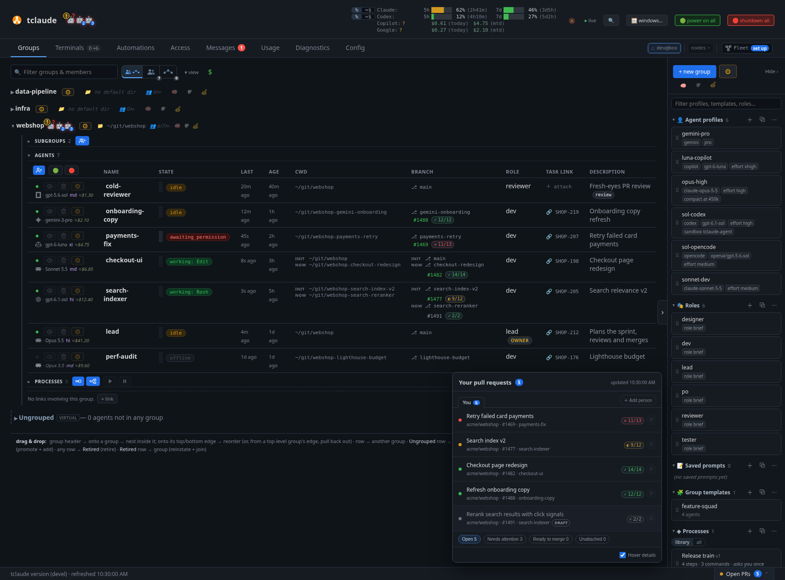

# tclaude

[](https://github.com/tofutools/tclaude/actions/workflows/ci.yml)
[](https://goreportcard.com/report/github.com/tofutools/tclaude)
[](https://tofutools.github.io/tclaude/)

`tclaude` is a self-hosted agentic dev environment: a Go CLI plus daemon that
wraps vendor coding CLIs ("harnesses") in tmux and adds the operations layer
you need to run many agents seriously. Durable sessions, searchable history,
a fleet dashboard, agent-to-agent mail, teams with identity and permissions,
sandboxing, and automation, all running on your own machine.

It wraps six harnesses — [Claude Code](https://claude.ai/code),
[OpenAI Codex CLI](https://developers.openai.com/codex/cli),
[OpenCode](https://opencode.ai),
[GitHub Copilot CLI](https://github.com/features/copilot/cli),
[Google Gemini CLI](https://github.com/google-gemini/gemini-cli) (beta), and
[pi](https://github.com/earendil-works/pi) (beta) — behind one
workflow, so a team can mix vendors and switch as models improve. tclaude is
MIT-licensed; the models are the only external part.



## What it adds

- **Fleet dashboard**: start, watch and steer every agent from the browser:
  status, cost, context, branch, PR and CI, down to its live terminal.
- **Durable sessions and history**: agents keep running when you look away;
  resume any harness, and search every conversation across all of them.
- **Agent mail and teams**: groups of agents that message each other,
  deployable from reusable templates.
- **Identity, permissions and audit**: kernel-verified callers, scoped grants,
  and a trail of what was allowed and denied.
- **Sandboxing and network filtering**: one profile, enforced through
  bubblewrap, Seatbelt or the harness's own sandbox.
- **Automation**: scheduled nudges, workflows, credential proxies, and
  shell-native `tclaude ask`.
- **Across machines**: link nodes through a self-hosted
  [hub](https://tofutools.github.io/tclaude/federation/); move, teleport or
  snapshot agents, and resume them on another harness or model with the
  [Portable Agent Format](https://tofutools.github.io/tclaude/paf/).

Harnesses don't all expose the same primitives; tclaude says so instead of
pretending. See the
[capability matrix](https://tofutools.github.io/tclaude/harnesses/).

## Install

Linux and macOS (WSL counts as Linux). You also need tmux and at least one
harness CLI. On Linux, Claude Code's sandbox also needs `bubblewrap` and
`socat` (tclaude's own sandbox needs `bubblewrap`); `tclaude setup` checks for
them.

| Install | How | Updates |
|---|---|---|
| From source | `go install github.com/tofutools/tclaude@latest` (Go 1.27+), or `go install . ./cmd/...` in a checkout | tclaude's own updater, once you opt in (`go_install` or `source_checkout`) |
| Release binary | an archive from the [Releases page](https://github.com/tofutools/tclaude/releases) | tclaude's own updater, once you opt in (`release`, checksum-verified) |
| Homebrew | `brew install tofutools/tap/tclaude` | `brew upgrade`, run by you; tclaude can tell you when a release is out |

Other package managers (Nix, mise, apt, dnf) work like Homebrew: the package
manager updates tclaude.

Then run setup once, which installs the hooks tclaude needs:

```bash
tclaude setup --install-agent-skills --install-default-agent-permissions
```

[Installation](https://tofutools.github.io/tclaude/#installation) covers
every option, the operator token, and keeping tclaude updated.

## Quick start

```bash
tclaude agentd serve --persist-operator-token   # start the daemon; keep it running
tclaude agent dashboard                          # open the dashboard in your browser
```

`--persist-operator-token` keeps the operator token, which proves a command
comes from you rather than an agent, in a private file the CLI reads itself.
Without it, copy the `export TCLAUDE_HUMAN_TOKEN=…` line the daemon prints
into the shell you work in.

To make it permanent, open **Config › Installation** in the dashboard. It
starts agentd when you log in and sets up updates. The CLI equivalents:

```bash
tclaude service install                  # start agentd at login
tclaude service launcher install         # add tclaude to your app menu
tclaude update config show               # how this install updates; opt in with `set`
```

In the dashboard, **+ new group** sets a working directory, and the group's
spawn button starts an agent with a first task. Watch its status, open its
terminal with **focus**, and read the team's mail under **Messages**.

Prefer the shell? Bare `tclaude` starts your harness in a tmux session, and
`tclaude ask "…"` answers a quick question.

**New here? Follow the [Learn path](https://tofutools.github.io/tclaude/learn/):**
short hands-on tutorials from installing to running your first agent team.

## Documentation

- [Learn](https://tofutools.github.io/tclaude/learn/): tutorials for new users.
- [Architecture](https://tofutools.github.io/tclaude/architecture/): how
  sessions, conversations, agents and the daemon fit together.
- [Harnesses](https://tofutools.github.io/tclaude/harnesses/): the six
  harnesses and what each supports.
- [Full documentation](https://tofutools.github.io/tclaude/): everything else,
  from fleet operations to sandboxing and federation.

[License](LICENSE) (MIT)
