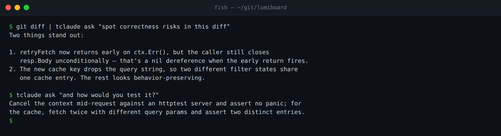

# Ask

!!! tip "New to tclaude?"
    Start with the [Learn path](learn/index.md).


`tclaude ask` puts a one-shot question to a coding harness without creating
a tmux session or taking over your terminal. It prints the answer, exits
with the harness's status, and keeps a resumable thread for the next
question from the same terminal and directory. All six agent harnesses —
Claude Code, Codex CLI, OpenCode, Copilot CLI, Gemini CLI, and pi — have an
ask surface.



*Piped input and a follow-up on the same per-terminal thread*

```bash
# Ask about the current project
tclaude ask "where is authentication enforced?"

# Fold piped input into the question
git diff | tclaude ask "is this safe to merge?"

# Capture a clean answer in a script
summary=$(tclaude ask "summarize this package in one sentence")

# Open the full harness TUI for a back-and-forth
tclaude ask -i "help me refactor this package"
```

Print mode (`-p`, the default) streams or prints the answer and returns to
the shell; it is safe for pipes and command substitution. Interactive mode
(`-i`) attaches the harness's normal TUI to the current terminal — it needs
a real tty. Neither creates a tclaude session; use
[Sessions](sessions.md) when you want detach/reattach.

## Thread continuity

The thread key is the current **terminal plus working directory**, stored in
tclaude's SQLite database. Repeated questions from the same terminal in the
same directory resume one conversation; changing either starts or resumes a
different bucket.

```bash
tclaude ask -w                     # show this bucket: terminal key, cwd,
                                   # current conversation id
tclaude ask -n "new topic: review the db package"  # fresh thread
tclaude ask -n                     # reset the bucket without asking
```

A fresh thread records which harness answered it, and an existing thread
**always keeps its recorded harness**, even if you change the default later
— use `-n` to pick up a new default. If the thread's conversation was
deleted in the harness, the next ask detects the stale mapping and starts
fresh. `-w/--where` on a fresh bucket reports the key without resolving a
harness.

## Harness, model, and effort

A fresh ask uses the configured ask profile, then ask-specific settings, then
the global default spawn profile. With none set, it defaults to Claude Code
with `sonnet` / `medium`. Per-call flags override model and effort:

```bash
tclaude ask -m haiku -e low "give me the short version"
```

To change the default harness for fresh asks, select a saved spawn profile
in the dashboard (**Config → Ask & scribe defaults**) or set `ask.profile`
in `~/.tclaude/data/config.json`. The profile supplies harness, model, and effort defaults. When an ask sandbox
policy is active, compatible ask/global spawn profiles also supply its sandbox
implementation, native mode, and approval policy. Identity fields require a
tracked worker. A deleted profile falls through to ask-specific settings and the
global default instead of failing. `ask.model` and `ask.effort` override the
corresponding global values. The global profile can select any supported
harness; unset non-Claude model/effort fields use that harness's defaults.

Resolution order per field: per-call flags → selected ask profile →
`ask.model` / `ask.effort` → global default spawn profile → harness built-ins.
The harness comes from the ask profile, then the global profile, then Claude
Code. Group defaults never participate. Incompatible ambient global
model/effort values are skipped, including when resuming a thread recorded
under another harness; explicit ask values are still validated.

## Sandbox policy

`ask.sandbox` controls sandbox-profile resolution for both captured asks and
`-i` foreground TUIs. Configure it beside **Ask — agent profile** in the
dashboard's **Config → Ask & scribe defaults**, or in the config file:

```json
{"ask": {"sandbox": "global"}}
```

- `global` (the default): use the dashboard global sandbox profile. With no
  global profile configured, ask retains its ordinary harness behavior.
- `auto`: combine global and group sandbox profiles. Match the ask's canonical
  working directory exactly against active groups' default directories, as
  session auto-join does. Zero matches uses global only. Among multiple matches,
  one group marked as the default spawn group wins; otherwise ask refuses and
  suggests `global` or a named policy. Matching never creates or joins a group.
- A profile name: use exactly that library profile and its includes, without
  global or group policy. `profile:<name>` also works, including for a library
  profile named `auto`, `global`, or `off`.
- `off`: skip sandbox profiles and preserve ordinary ask behavior.

Existing threads resolve the **current configured policy each turn**. Their
conversation IDs and harnesses remain intact; changing policy does not create
or migrate a thread. Successful confined launches disclose the resolved policy
on stderr. Missing policies, unavailable host tooling, and unsupported policy
shapes fail before the harness starts.

An active policy uses the compatible ask/global spawn profile's implementation,
otherwise `tclaude-layer`. `off` and `resource-only` implementations cannot
satisfy a requested ask policy. Native implementations must establish actual
confinement and represent the authored rules. Claude, Codex, and Gemini support
foreground policy replay; Copilot and OpenCode lack that replay contract, and
Pi's isolated state currently requires tracked-session lifetime. These asks
refuse an active policy with guidance to use a supported harness or tracked
worker.

| Harness | Ask sandbox support |
| --- | --- |
| Claude Code | Outer wall, stacked, or a verified confined native sandbox capable of the authored rules |
| Codex | Outer wall, stacked, or a confined native sandbox capable of the authored rules |
| Gemini CLI | Outer wall; its native sandbox cannot represent the requested profile |
| Copilot CLI | Refused: foreground policy replay is not supported |
| OpenCode | Refused: foreground policy replay is not supported |
| pi | Refused: isolated state needs tracked-session lifetime |

With a global policy configured, the default `global` setting therefore changes
Copilot, OpenCode, and pi asks from direct execution to an actionable refusal.
Set **Ask — sandbox → Off** (`ask.sandbox=off`) to retain direct asks, select an
ask profile for Claude, Codex, or Gemini, or use a tracked worker. Foreground
replay for Copilot/OpenCode and pi isolated-state lifetime are known follow-ups.

Directory provisioning, pre-launch scripts, native profiles, outer and stacked
walls, and resource limits share the one-shot worker launch preparation.
Foreground stdio and terminal process-group behavior are preserved. Cleanup
reaps a delegated cgroup when available. Without proof that all descendants
have stopped, per-run directories are retained until a boot change; the stderr
notice gives the path for manual removal after descendants stop. A live
foreground owner is protected from background sweeps.

Model-gateway caller identity is not available to untracked asks: a configured
gateway with an active policy is refused. Named-proxy access is disclosed as
unavailable when a confined ask would otherwise inherit it. Use a tracked
interactive worker when either is needed.

## Piped input

Piped stdin is appended to the typed question as context. Question and
payload travel as a single process argument behind the harness's
end-of-options guard (or as the prompt-flag value for Copilot), so diff
lines starting with `-` cannot be parsed as CLI flags.

```bash
rg -n "TODO|FIXME" . | tclaude ask "which of these should be fixed first?"
git show HEAD | tclaude ask "write a concise review"
```

## Capture safety

Print mode is designed so a captured answer cannot quietly modify your
workspace:

- **Codex** print runs `codex exec` in a read-only sandbox, with no
  git-repo requirement. It can inspect the directory but not change it.
- **Claude Code** print uses the non-interactive `claude -p` path.
- **Copilot** print runs headless `copilot -p`, buffered — the answer
  arrives whole rather than streaming. tclaude passes no permission flags:
  headless, a tool call that would need approval is simply denied and the
  turn finishes without it. tclaude also unsets `COPILOT_ALLOW_ALL` for
  every ask so that variable cannot promote the turn from your environment.
  This is Copilot's own headless fallback, not an OS sandbox.
- **Gemini** print runs headless `gemini --prompt`, buffered. Like Copilot,
  headless Gemini denies any tool call that would need approval. Gemini
  refuses to run headless in a directory it does not trust.
- **pi** print runs `pi --print`, or streams through `pi --mode json` on a
  terminal. pi itself never asks before a tool call, so tclaude limits a
  capture to pi's read-only tools (`read`, `grep`, `find`, `ls`): no shell
  and no file writes. An interactive pi ask instead loads tclaude's
  permission extension, so you approve each tool call that is not read-only
  in the pane.

Codex, Copilot, Gemini, and pi write verbose output to stderr; tclaude hides them by
default and keeps only the answer on stdout. `-v/--verbose` shows the
transcript, and a failure always reveals it so auth or model errors are not
swallowed.

Codex mints its conversation id on the first turn, so tclaude discovers a
fresh Codex thread's id after the run completes.

Claude's terminal stream uses a paced typewriter renderer; disable that
presentation layer with `--no-smoothing` or `TCLAUDE_ASK_SMOOTH=0` (piped
output is never smoothed).

## Flags

| Flag | Purpose |
|---|---|
| `-p`, `--print` | Print the answer and exit (default) |
| `-i`, `--interactive` | Open the full harness TUI; needs a real terminal |
| `-n`, `--new` | Forget the current terminal/directory thread first |
| `-m`, `--model` | Override the model for this turn |
| `-e`, `--effort` | Override reasoning effort for this turn |
| `-w`, `--where` | Print the current ask bucket and exit |
| `-v`, `--verbose` | Keep the harness's capture transcript on stderr |
| `--no-smoothing` | Disable the paced Claude terminal render |
