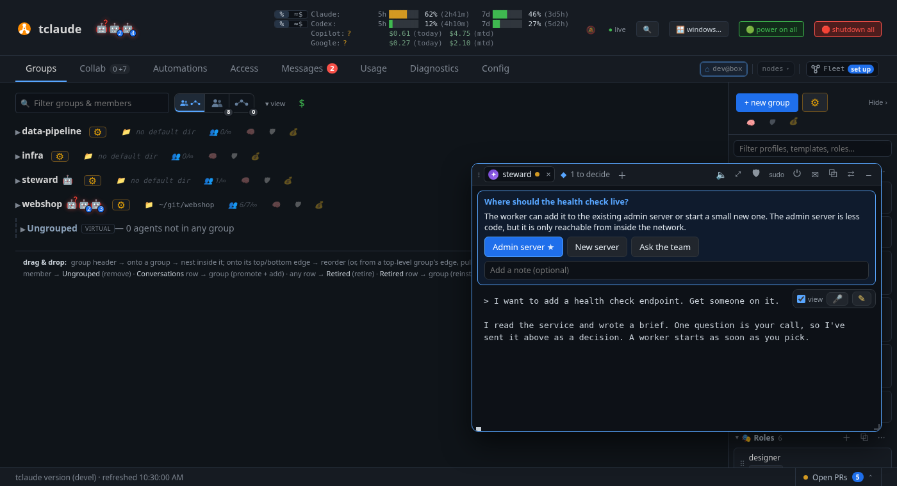

# Companion and Steward

The **companion** is a floating window that keeps agents' terminals with you on
every dashboard tab. The **Steward** is a helper agent that lives there: ask it
what you can do, how things are set up, or to get work started.

## Turning Collab on

The companion, the Steward, [boards](boards.md), the fleet brief and decisions
are experimental and off by default. Turn them on with **Collab** under
[Config › Experimental](dashboard-config.md#experimental), or `features.collab` in
`config.json`. You don't need to restart anything; the next dashboard refresh picks
it up.

| With Collab | Off | On |
|---|---|---|
| Tab name | Terminals | Collab |
| Companion and its shortcuts | Absent | Available |
| Access banner's **Review** | Opens Messages | Opens the [approval panel](#answering-permission-requests) |
| Boards, Config › Steward | Hidden | Shown |
| `tclaude agent board`, `fleet`, `guide`, `knowledge` | Refused with `collab_disabled` | Work |
| `notify-human --option` | Refused with `collab_disabled` | Sends a [decision](#decisions) |

The companion isn't available in a peer's per-node view or in pop-out windows.

## Using the companion

Each pinned agent shows as a pill at the bottom right, with its status. With
nothing pinned, you'll see a **✦ Steward** pill. Drag a pill to move the row to
another corner or to the middle of the bottom edge; outlines show the spots, Esc
cancels, and the window then opens from there until you move it yourself. A pill
can show:

- **needs you**: a permission prompt or question is waiting.
- **🔑 approval**: the agent asked for permission.
- **decide**: the agent asked you to [choose](#decisions).

Hover a pill to peek at the agent's last lines. It's read-only, and your keyboard
stays with the page.

Click a pill, or press **Ctrl+.** anywhere, to open the window. It stays above the
page without blocking it, and comes back when you reload the tab.

- **Move it** by its title bar. Resize it from any edge or corner.
- **Split the room** with any windows, boards and chats alike: snap one to the left and one to the right, and they
  fill the room and share a line. A corner stays a corner beside a half or another
  corner, and the cell nobody took stays empty: dragging a window over it offers that
  corner, or both corners of an empty half. Drag a line to redistribute,
  and it is remembered. Dropping a window near the edge or corner of a snapped window
  splits that window, so two windows, 2+1 and four are all possible, and four around
  one crossing drag together at the crossing. Bring the pointer near the centre of a line for a detach button,
  which unlocks that line: the windows stay snapped where they are, the line goes, and
  each side resizes from that edge on its own, so a space or an overlap can open. The
  other lines of a nested split or a quad stay shared. Dragging one out by its title bar, or
  closing or minimizing it, gives its room to its neighbour, and a window left alone
  goes back to its own panel size. A minimized or maximized window rejoins the split
  when it is back; a closed one does not. Pairs fill the room while it holds both windows at their
  minimum size.
- **Snap it** by dragging against the left, right or bottom edge to make a side
  panel or drawer, or into a corner to fill a quarter. Pull a snapped window's free
  edges to resize it; each spot keeps the size you gave it, across reloads too.
- **Give a chat its own window** by dragging its tab off the title bar, or with **▣**.
  It is the same terminal, and it moves, snaps, splits, minimizes and closes on its
  own. **Back to a tab** returns it. Open windows come back after a reload. The
  agent keeps running when its window closes.
- **Each agent is a tab**, up to eight. **＋** summons the Steward or pins another
  live agent, and **×** unpins one. The agent keeps running.
- **Scribes and Stewards** get a tab and a pill by themselves. One you close stays
  closed until you bring it back with **＋**.

An offline agent's tab has **Resume**. A tab that moved elsewhere has **Bring it
back here**.

### Title bar buttons

| Button | What it does |
|---|---|
| 🔈 / 🔊 | Turn [voice](#voice-and-dictation) on or off for this agent |
| ⤢ | Move it to the Collab tab |
| 🔑 N | Open the [approval panel](#answering-permission-requests) |
| 🛡 | Edit permissions (Steward only) |
| sudo | Open the [sudo editor](dashboard-access.md) (Steward only) |
| ⏻ | Shut the Steward down, after asking (Steward only) |
| ⟲ | Clear the agent's context, after asking (not for shell agents) |
| ✉ | Send a queued message (Ctrl/Cmd+M) |
| ⧉ | Detach it into its own browser window |
| ⇄ | Morph it, with Move, Teleport, Clone and Recall home a pick away |
| – | Minimize (Ctrl+.) |
| □ | Maximize, or restore the size it had |
| × | Close the tab you're on. The agent keeps running. With no agent showing, this minimizes the window. On a running Steward it asks, then shuts the Steward down and closes its tab, like ⏻ |

The last three are shaped like your OS's own window buttons: traffic lights at
the top left on macOS, flush in the top right corner on Windows, and round
GNOME-style buttons on Linux. **Config > Appearance > Window controls** picks a
look by hand. **Classic** keeps a plain minimize button and has no maximize or
close.

The small × on a tab, next to the name, unpins that agent and leaves it running.
On a Steward's tab it only minimizes the window, and the tab stays.
A Steward floated into an overlay window of its own has ⏻ too, and that window's
close button asks in the same way.

Dragging a maximized window by its title bar also restores it.

### Talking to an agent

Type in its terminal, just like the Collab tab. You get the harness's own
streaming, prompts and Esc interrupts.

**view**, the mic **🎤** and **✎** float at the terminal's top right, dimmed until
the pointer is on them. They take no room from the terminal, and clicks
anywhere else reach it. **view** is ticked by default and attaches the page you're
on to dictated messages, so the agent knows what you're looking at. A text field
and **Send** float at the bottom while you dictate.

**✎** (Ctrl+Shift+.) lets you draw over the page and send it to the agent. Circle,
underline, point or write freely. The agent gets a picture of the view with your ink
on it, as a file attached to the message, plus a numbered line for each mark. Sending
is your decision, so the agent doesn't need permission to capture your dashboard.
Marked secrets are masked in the picture, as in a [capture](#capture). Only that agent
can fetch it, unless other agents run without a sandbox, which can read your whole
tclaude data directory. An
agent on another node, or a picture it refuses, gets the lines only, and the notice
says so.

## Answering permission requests

When an agent asks for access, click **🔑 approval** on its pill, **🔑** in the title
bar, **🔑** on its terminal tab, or **Review** on the access banner. A panel titled
**🔑 Waiting for your OK** opens at the right, over whatever you're doing. **🔑 N to
approve** covers agents with no pill.

Each card has a countdown, **+5 min**, **Deny** and **Approve** (or **Approve
plan**). At zero it declines by itself. **Always allow? Open in Messages** takes
you to the full card. Requests that need a closer look, such as those from peers,
are collected in a link to [Messages](dashboard-messages.md#access-requests). Esc
closes the panel.

## Decisions

When an agent asks you to choose (`tclaude agent notify-human --option`, two to
six options), its tab shows the question, any mock, and a button per option.
The agent's recommendation has a **★**. You can **Add a note (optional)**. Your
choice goes back to the agent as mail, even if it's offline.

Decisions from every agent also wait in one queue: a **◆ N to decide** pill, and a
tab of the same name in the window. The same buttons are in the
[Messages](dashboard-messages.md) reader, without the note.



## Action links

An agent can put one button on a message (`tclaude agent notify-human --action`),
in Messages and, while the message is unread, in its chat. **×** dismisses it from
chat by marking the message read.

| Action | What the button does |
|---|---|
| `terminal` | Opens a shell in the agent's own directory |
| `board:<id>` | Opens that board |
| `pr:<url>` | Opens a GitHub PR the agent presented with `present-pr` |
| `tab:<name>` | Goes to a dashboard tab: `groups`, `terminals`, `automations`, `processes`, `plugins`, `access`, `messages`, `usage`, `diagnostics` or `config` |

The list is fixed, so an agent can't offer a free URL or command. It names an action
and the daemon works out the target and writes the button's text. A terminal link
can only be the agent's own tracked directory, and nothing happens until you click.
The click is in the audit log and marks the message read.

A terminal runs as you, outside the agent's sandbox, and the agent can write to its
directory, so check the path on the button first. If the agent moves before you
click, the click is refused and the button shows the new path. A shell already open
for that agent is reused, wherever it is now. The agent never gets the shell's
input or output. If the agent has retired, the board was deleted or the PR is no
longer presented, the button is off and says why.

Action links need [Collab](#turning-collab-on) and only work on the node that holds
the message: a peer looking at this node's messages sees no button.

## Voice and dictation

**Voice.** **🔈** turns voice on for that agent's tab (**🔊**). When its turn ends,
its last message is read aloud. Code is skipped, tables are dropped, links become
their text, and long replies are cut short. It also says when the agent needs you,
and reads decisions with their options. Typing in the terminal stops speech. It uses
your browser's built-in voices. It reads the agent's transcript, so it doesn't work
on OpenCode.

**Dictation.** **🎤** dictates into a draft, and the draft takes the keyboard. End
with "send now" to send it; no pause is needed, and the phrase stays out of the
message. It only counts at the very end of a finished phrase, so a sentence that
merely contains it, or the word "send", is plain text. **Enter** or **Send** sends
what's in the draft, also while the mic is on. Press the button again to stop, and
the keyboard goes back to the terminal with the draft kept. Typing in the draft stops
the mic so you can edit. If the browser ends listening by itself, the keyboard stays
on the draft.

A message dictated to an agent starts with `[dictated]`, so the agent knows why
sensible symbols may be missing. A draft stays marked after you edit it, typed
messages aren't marked, and the marker never reaches a plain shell. Turn it off in
Config › Voice.

Pauses can add punctuation while you dictate to an agent: a comma after a short
one, a period and a capital after a longer one. Both are off by default and set in
Config › Voice, and both must be shorter than send after silence. Timing comes from
when the recognizer reports words, so it's approximate and a mark can land a word
off. Marks the recognizer added aren't doubled. Plain shells get none, and neither do
languages written without spaces or with their own marks.

Change the phrase, or untick it to turn spoken send off, in
[Config › Voice](dashboard-config.md#voice). Dictation listens in your browser's
language, so pick a phrase in that language.

**Where the audio goes.** Without on-device speech, Chrome sends it to Google's
service. **Download on-device speech** in Config › Voice has Chrome fetch a language
pack, after which recognition stays on your machine. tclaude doesn't ship it, Chrome
manages it, and nothing downloads without that click. Once installed it's used
automatically, and the draft shows which is in use. If it fails at the start of a
dictation, that dictation falls back to Google's service and tells you.

**Hands-free (opt-in, all off by default).**

- **Wake phrases.** The focused phrase, "hey agent" by default, starts dictating with
  no click; words after it start the draft, without a trailing send phrase, which
  doesn't send here. The Steward phrase, "hey stewie" by
  default, always switches to the Steward, opening or focusing its window, and
  dictates there. A Steward in a window of its own gets focus instead, and you dictate
  there. It never starts a Steward: with none running you get a short notice.
  One listener hears both. A phrase needs two settings on: its own checkbox and the
  wake phrase listener. Neither changes the other, and Config says so when only one
  is on. A phrase of common words may fire by mistake. Dictation goes to the terminal or chat window with
  focus, or the only one showing. Otherwise nothing happens and the indicator says so.
  Plain shells get a draft as usual. This keeps a microphone open while a tab is
  showing, so without on-device speech **everything said in the room goes to Google's
  service for as long as it listens**. On-device speech is recommended.

  An indicator at the top of the page shows whenever it's on, says where the audio goes
  and has **Pause**. It stops while the tab is hidden, runs in one tab at a time, and
  waits while the mic is in use or a reply is read aloud. After repeated errors it
  stops and says why. If on-device speech stops working, it stops rather than
  switching to Google's service.
- **Continuous mode.** After a voice message sends, the next thing you say sends
  another, with no wake phrase, while the agent is still working. Each one after the
  first sends on send after silence, or after 3 seconds if that is off, and queues
  while the agent is busy. It stays on the agent it started on: changing focus, closing that terminal
  or hiding the tab stops it, and speech never moves to another agent. The Steward
  phrase is the one exception: said in continuous mode, it ends there and starts on
  the Steward, and what was in the draft stays with the old agent, unsent. So do **Esc**,
  **Stop**, typing in the draft, a failed send, saying the stop phrase ("stop
  listening") on its own, and silence, 2 minutes by default. The draft shows it's on.
  It stops rather than sends when the agent is blocked on you, at a prompt or held on
  an approval request, so it can't answer one. An open decision doesn't stop it: the
  agent has carried on, so your words go as a normal message and the decision stays open. Plain shells, peers' agents,
  detached terminal windows, Gemini CLI and pi get one message at a time. The microphone stays open, so without on-device speech **everything said
  in the room goes to Google's service for as long as it runs**. Replies aren't read
  aloud while it listens.

- **Send after silence.** With no new speech for a set time, 3 seconds by default,
  the draft is sent to the agent. It counts down first: **Esc**, **Cancel** or
  speaking again stops it. It never runs in a plain shell.

With both on, sound in the room can send mail to an agent, and Config warns about
that.

The same tools float over agent terminals in the
[Terminals tab](dashboard-terminals.md#dictation). No reply is read while any mic is
open, and starting one mic stops another. It uses your browser's speech recognition,
and in Chrome the audio is recognized by Google's service.

Where dictation can't work, the mic is disabled and a note beside it says why. That
covers browsers without speech recognition, and plain HTTP pages away from localhost.
Browsers refuse the microphone on those pages, so no site permission helps. To
dictate, open the dashboard on `localhost` or over HTTPS, for example with
[`tailscale serve`](remote.md#where-to-run-it). **🔈** voice doesn't need the
microphone and still works on plain HTTP.

## Marking up a page

**✎**, or **Ctrl+Shift+.**, puts a drawing layer over the page. Circle, underline or
draw an arrow at what you mean, add a note, and press **Send**. The agent can't see
your screen, so each mark goes as words: what it is and which control is under it,
such as `1. circled "Approve plan" (button)`, along with the page you're on. **Esc**
cancels and **Ctrl+Z** undoes the last stroke.

## The Steward

The Steward is an agent for all of tclaude. Summon it by clicking **✦ Steward**,
then **Summon the Steward**. It lives in the `steward` scribe group. Ask it what you
can do on a page, how your groups are configured, or to help set up groups, profiles,
processes or your sandbox.

### What to ask it

- **"Brief me."** It tells you what needs you, most urgent first, and can open the
  agent that's waiting in your companion window.
- **An idea.** It restates the idea, asks what it can't find out itself, writes a
  brief, then starts a worker or a task force once you approve. It follows the work
  through to presented PRs and puts taste calls to you as [decisions](#decisions).
- **Setup.** It inspects first, asks only what it can't infer, shows a numbered plan,
  and asks for the permissions for the whole plan once, for a limited time.

It follows the bundled `tclaude-fleet` and `tclaude-setup` skills. After upgrading,
run `tclaude setup --install-agent-skills` to install new skills.

The Steward can also point at the dashboard. It can see which view you're on,
switch you to another, ring a control with a note, mark things up, and open an agent
in your companion window. A cue only points. It never presses anything, and it
can't mark approval or decision controls. It plays once and fades after about 14
seconds. While you're typing or dictating, a hand-over only pins the agent, so your
words still go where you meant them.

### What it knows

The Steward has a [knowledge base](#knowledge-base) of tclaude's docs, pinned to the
build you are running, and uses it before guessing. Its answers match your version,
not whatever it remembers. You can add the source as well, with a download the
dashboard asks you about. If your build has uncommitted changes or names no commit,
the knowledge base says so.

### What the Steward may do

Set this under [Config › Steward](dashboard-config.md#steward). The daemon grants it
when a Steward is summoned, and a running one keeps what it started with, so retire
it to apply a change.

| Setting | Options |
|---|---|
| **Reads** | **Operator level (default)**: fleet, boards, the dashboard view, processes, triggers, usage, costs, host and federation activity. **Fleet and boards only**: just those. Both list every agent and group. |
| **Writes** | **Message agents (default)**: can reach any agent. **Boards and notifying you only**. **Message agents and start workers**: can also spawn and set task links. |
| **Default permissions** | What a new Steward gets beyond Reads and Writes, or is denied from them. Opens the permission editor, and saves from there. |

Every level can draw on boards, point at the dashboard and notify you. Anything else
it asks for with `--ask-human`, and you approve it in the dashboard. **Message
agents** also reaches agents on linked instances that accept mail, so use **Boards
and notifying you only** to rule that out.

To change a running Steward's access, use **🛡** (permissions) and **sudo** in its
title bar. They need it to be running.

In both, each grant on a live Steward is for **This Steward only**, the default,
or **All future Stewards**, which stores it and gives it to every new Steward,
denies and scopes included. Stored sudo keeps its original expiry: a new Steward
never restarts the clock. The editors show which of the three sources each grant
comes from: this Steward, all future Stewards, or the **Reads and Writes** levels.
Changing or revoking a stored grant applies to later Stewards too, and the revoke
says so, while revoking an instance-only grant affects that instance alone. A
revoke by an agent stops at the instance: only you change what is stored. A stored
deny outlasts anything done to one Steward: lift it here or in Config > Steward.

**Config > Steward > Default permissions** edits the same stored list in the common
permission editor, without a Steward running. It shows what a new Steward would
hold, and you can deny any slug Reads or Writes give or grant any other, with scopes
where a slug has them. With `dashboard.capture` denied, a new Steward's brief leaves
capture out, and the **view** tick says **capture off** for any Steward without it.
Older `steward.default_permissions` values move to this list when the daemon starts.

Stewards that are already running catch up when the daemon starts or when they resume:
each gets what its levels now give and a message saying so. Saving Config > Steward
does not change one on its own. Each slug is given once, so this only adds: a deny
stays, and so does a permission you took off that Steward. A level slug with a stored
deny is not given. Stored permissions reach new Stewards only.

While an agent in the window holds elevated access, its tab and pill show **🔓**, and
a band above its terminal lists what it holds. **End sudo** appears when it holds
temporary sudo and ends that, with no confirmation; it can ask again. A sudo grant
stored for all future Stewards ends for them too, and the band says so on that grant.
Permanent access is listed but stays, including standing permissions stored for future
Stewards: change standing permissions in the 🛡 editor or **Config > Steward**,
and access from a group or from owning one in Groups.

### Making another agent the Steward

Any running agent can become the Steward. Choose **✦ make Steward…** in its ⚙ menu,
on Groups, the fused fleet view or a terminal tab. **✦** in the Steward's title bar
does the same, and holds the roster. Only you can do this: there is no permission or
sudo for it, so an agent can't make itself or another agent the Steward, even if a
message talks it into trying.

The confirmation shows what changes:

- **What it gains.** Your Reads and Writes levels, default permissions and what you
  stored for all future Stewards, as for a summon, plus the brief, capture guide and
  knowledge base, by message.
- **What it already holds beyond that.** This stays, and becomes part of what the
  Steward can do, so it's listed, with a warning if the agent can hand out
  permissions. A deny on a Steward permission stays too.
- **What happens to the old Steward.** **Keep on the roster**, **Keep as a normal
  agent** or **Retire it**.

The new Steward keeps its conversation, context, harness, working directory, sandbox
and groups, and joins the `steward` group alongside them. The rest of the fleet
doesn't change. A sandboxed agent stays sandboxed: Steward commands reach the daemon
over its socket, and files such as captures have to go where it can write. Any
harness can be the Steward except a plain shell, and an agent visiting from another
node can't. Voice doesn't work on OpenCode, as for any OpenCode agent.

An offline agent can take the role too. Its brief waits until you resume it.

### One active Steward, and the roster

One Steward is active. `steward`, your chosen name, the companion's **✦** and a
changed-name message all mean that agent, even while it's offline. Until you first
choose, the newest running Steward is the active one. Summoning a Steward yourself
makes the new one active. Only you can summon one: an agent's summon is refused,
whatever it holds.

Agents on the roster are normal agents, without Steward access, so only the active
Steward holds it. **✦** in the title bar lists them:

| Action | What it does |
|---|---|
| **Switch** | Makes a standby active in one click, and the old Steward goes on the roster. If the standby holds more than a Steward's defaults, the confirmation opens first. |
| **Stand down** | Takes the active Steward out of the role with nobody in its place. It goes on the roster and keeps running. |
| **×** | Takes a standby off the roster. It stays a normal agent. |
| **Make another agent the Steward…** | Finds a running agent and opens the confirmation. |

Leaving the role removes what the role gave and nothing else. What you granted that
agent separately, in its permissions editor or with sudo, stays, and the confirmation
lists it. Coming back gives the role's access again, except anything you took off it
yourself. If you summon a new Steward while the active one is offline, the old one
goes on the roster the same way, once the new one is running. Retiring an agent takes it off the roster.

An agent going on the roster has its scheduled jobs and standing orders paused, and is
told so. They run again if it takes the seat, except any you disabled yourself. One
kept as a normal agent keeps them running. One aimed at a group that has emptied waits
for that group instead. Taking a standby off the roster leaves them disabled until
someone enables them.

Other live Stewards, such as a second one summoned earlier, stay as they are and show
as **also running**. Only one is active, and **Switch** makes one of them active.

### Shutting it down

⏻, or the window's ×, shuts the Steward down, after asking: it stops, and keeps its seat, its
conversation and what it holds. After that, and whenever no Steward is running,
the window and **✦ Steward** offer two ways on:

| Action | What it does |
|---|---|
| **Resume** | Brings back the same agent on the same conversation, and says how long ago it last ran. It catches up with its levels as any Steward does when it resumes. |
| **Start fresh** | Summons a new Steward, with no memory of the old one. The old one goes on the roster without Steward access, and its conversation stays in history. It keeps what you gave it separately, as anything leaving the role does, and the window lists that first. |

With no earlier Steward, the window offers only the summon. A detached Steward window
has the same ⏻ in its header. Its **Resume** brings the agent back in that window, and
its **Start fresh** closes the window and the new one opens in the companion. To end
an agent for good, retire it.

### Clearing context

⟲ gives the agent on the active tab a fresh conversation, after asking: the same
agent, identity and permissions, and it remembers nothing from before. The old
conversation stays in history. It is a reincarnation with no handoff, so it works
on every harness except a shell, and it is also a mode of the **Reincarnate agent**
dialog. A Steward gets its role brief again. Any other agent gets its identity, its
group and profile startup context and a pointer to its original briefing, unless its
group's re-injection setting narrows that.

### Other Steward settings

- **Spawn profile**: what a new Steward launches with. Unset, it uses the global
  default profile.
- **Name**: what you call it, up to 32 characters. The companion shows it, and agents
  can message it by that name as well as by `steward`. A running Steward gets a message
  when you change it here.
- **Startup prompt**: your own instructions, up to 10,000 bytes, added to what every
  new Steward is told.

These settings can only change on this node's Config tab. Agents and linked instances
can't read or write them, and config bundles don't carry them.

### Messaging the Steward

`steward` always reaches the active Steward. If it's offline, the send fails and says
so. An agent can answer a message from the Steward with `tclaude agent reply <id>`,
whatever its groups and permissions. Writing to it first, with `tclaude agent message
steward`, needs `message.direct` or a shared group, like any other agent. With Collab
on, `steward` and your chosen name always mean the Steward, even if another agent has
that name.

## Commands behind this

**`tclaude agent steward`** chooses the Steward from your own terminal. It's for you
only: the daemon refuses an agent, and the commands need Collab.

```bash
tclaude agent steward ls                            # the active Steward and the roster
tclaude agent steward set <agent>                   # show what would change
tclaude agent steward set <agent> --then keep --yes # do it; --then is roster, keep or retire
tclaude agent steward step-down [agent]             # leave the role, nobody in its place
tclaude agent steward rm <agent>                    # take a standby off the roster
```

**`tclaude agent fleet`** is the brief. It lists agents in every group, including
ungrouped ones, with status, task link and presented PRs, then ranks what needs you:
approvals, permission prompts, questions, failed turns, agents being recovered,
presented PRs, unread messages, and agents idle for ten minutes or more. Offline
agents are counted, and `--all` lists them. `--group <name>` narrows it, and `--json`
gives the raw brief. It needs `fleet.read`.

**`tclaude agent guide`** drives the pointing. `guide view` needs
`dashboard.view.read`. Its time on the view counts from the last view
change, so it grows while the operator stays put; its `connection` line says
when a tab last reported and a page last polled. `guide show` needs `dashboard.guide`:

```bash
tclaude agent guide show --tab <tab> --target "<visible text>" --note "<note>"
tclaude agent guide show --path <path> --circle "<text>" --underline "<text>" \
  --arrow "<from> -> <to>"
tclaude agent guide show --open <agent>
```

With Collab on, `fleet.read` also lifts the group scoping on `tclaude agent ls`
and shows group default directories in `tclaude agent groups ls`, so the
Steward can name any agent or group you have open. It changes only what is
listed: who it can message is still decided at send, and group environment
values stay with you.

A cue holds up to six marks. These slugs and `fleet.read` are given to a Steward when
it's summoned, and aren't granted to other agents by default.

### Capture

`tclaude agent guide capture -o view.png` shows the Steward what
you see, with `dashboard.capture`, which it gets when summoned and other agents
do not. It saves an image of your dashboard and prints the cursor position and
what is under it, the focused control, any selected text, the viewport, and the
open board with the region on screen. `--json` gives the same as data.

The tab renders its own page, so a capture holds only that dashboard page,
never another window or your desktop, and needs no browser prompt. Terminals are
rendered as their real text. Every capture shows you a notice naming the agent,
which is left out of the image. With several tabs open it takes the focused
one, else the visible one heard from last. A hidden tab is never captured,
because you would not see the notice, so the command then fails and says so; it
also fails when no dashboard is open. The daemon stores a capture only when
asked to with `--save`.

A capture shows whatever is on screen, including open messages and terminal
output, which reaches the Steward even though it cannot read agents' mail
through the API. Password fields and fields holding tokens, keys or environment
values are masked, in the image and in the text that comes with it. Hover styles are not reproduced,
and the cursor is drawn as a marker. An iframe shows as a labelled box. It works
in Chrome, Edge and Firefox; Safari refuses to read back the render, so the
command fails there. It needs Collab, like the rest of the Steward.

A tab showing a peer's dashboard (`?node=`) counts as open, and `guide view`,
capture and marks work on it: they belong to this node's agents and to you at
this browser, not to the peer. So a capture can show this node's Steward what a
peer shares with you, and `--save` keeps that on this node. The peer is not
told. The companion window itself stays off a peer's page, and cues from `guide
show` do not play there.

### Marks

`tclaude agent guide mark <kind>` lets the Steward draw on your view
to get your attention, with `dashboard.mark`, which it gets when summoned and
other agents do not. A mark is a `highlight`, `circle`, `underline`, `box`,
`arrow`, `freehand` stroke or `label`, on a control named by visible text
(`--target`) or selector (`--ref`), or on a screen region (`--region`). `--blink`
pulses it, unless your system asks for reduced motion. Marks follow their
control as the page scrolls and resizes; a region follows the page's scroll.
They never take a click: only the buttons on a mark's tip, and **Dismiss all
marks**, respond to the pointer, and clicks on the rest of a tip reach the page
under it. Neither a mark nor its tip lands on an approval control.

Every mark has a tip with **✓** (got it), **×** (dismiss) and **Reply**. Reply
sends your answer to the agent as mail naming the mark and its tip, so you need
not say which one you mean, and the mark stays up. Each mark times out on its
own: 60 seconds by default, 10 minutes at most. At most 10 marks are up at once,
and a tip is at most 280 characters; past a limit the request is refused. A
tab shows marks only while on screen.

Marks are stored, so `tclaude agent guide marks` (paged, with `--state`) lists
active, expired, dismissed, acknowledged, cleared and replaced marks, with who
ended each and how. The newest 1000 ended marks are kept. Captures show marks
and report whether each was drawn, so the Steward can confirm one landed.

### Knowledge base

`tclaude agent knowledge` reads the docs and source of the build the daemon is
running, with `knowledge.read`, which a Steward gets when summoned and other
agents do not.

```bash
tclaude agent knowledge status                     # the pin, and how exact it is
tclaude agent knowledge search "guide mark" -i     # docs first, then source
tclaude agent knowledge read companion.md#capture  # a page, or one section of it
tclaude agent knowledge read pkg/claude/agentd/steward.go --lines 100-160
tclaude agent knowledge ls pkg/claude/agentd
```

A docs page ends with the pages it links to and those linking to it, so the links
work as a graph: read a link's `page.md#section` to follow it. Every command takes
`--json`, which gives the links as data. A long file comes back in part and says
which lines to ask for next.

Every answer starts with how far it can be trusted:

| Label | Meaning |
|---|---|
| `exact` | A clean build of a known commit, or a release. Docs and any source there is match what is running. |
| `dirty` | A commit plus uncommitted changes. Docs are as built. Source is that commit without the changes. |
| `unknown` | The build names no commit, such as `go build` from an extracted tree. Docs are as built, and there is no source. |

The docs are built into the binary, so they work with no checkout and offline. The
source is not: it is an optional download that only you can start. Reading the
knowledge base never downloads anything, and an agent can't start or approve a
download. Without the source, docs still work and `knowledge status` says it isn't
there and how you can get it.

When a Steward exists and the running version has no source, the dashboard asks
once. The card says what it is, about 18 MiB from `github.com/tofutools/tclaude`,
about 28 MiB on disk:

| Answer | What happens |
|---|---|
| **Yes, this version** | Downloads now. The next version asks again. |
| **Yes, every new version** | Downloads now, then by itself for each new version, when a Steward is summoned or the daemon starts with one. |
| **No** | Downloads nothing and doesn't ask again. |

The download runs in the background, so nothing waits for it, and a card shows its
progress. GitHub doesn't send an archive's length, so the bar measures against the
expected size. A failure stays on screen with **Try again**.

Your answer is kept as `steward.source_download` (`ask`, `each_version` or `never`),
under **Config > Steward > Knowledge base**, where you can change it. The same place
shows what is stored and its size, with **Download now** and **Remove**. Remove
deletes the copy and sets the choice to `never`, so the question doesn't come back.

A version already held is never fetched again. The copy lives under
`~/.tclaude/data/knowledge`, and only the running build's copy is kept: a new
download replaces the old one, and the daemon clears other versions when it starts.
Tests, vendored and minified files, source maps, lockfiles and binaries are left out
of it, which is about half the tree. A download for a commit must name that commit;
one for a release tag trusts the tag.

The daemon holds the copy and only answers reads, so an agent can't change it. It
needs no new filesystem access, whatever the sandbox. It holds what ships with
tclaude and nothing of your setup: no config, startup prompts, messages or
credentials. Screenshots and the preliminary v2 designs are left out.

### Saved captures

`guide capture --save` keeps a capture on this machine
under `~/.tclaude/data/captures`, and `guide captures` and `guide captures get
<id>` read it back, so the Steward can recover what has been going on, for
example after compaction. The newest 50 are kept, up to 256 MiB in all; the
oldest go first.
