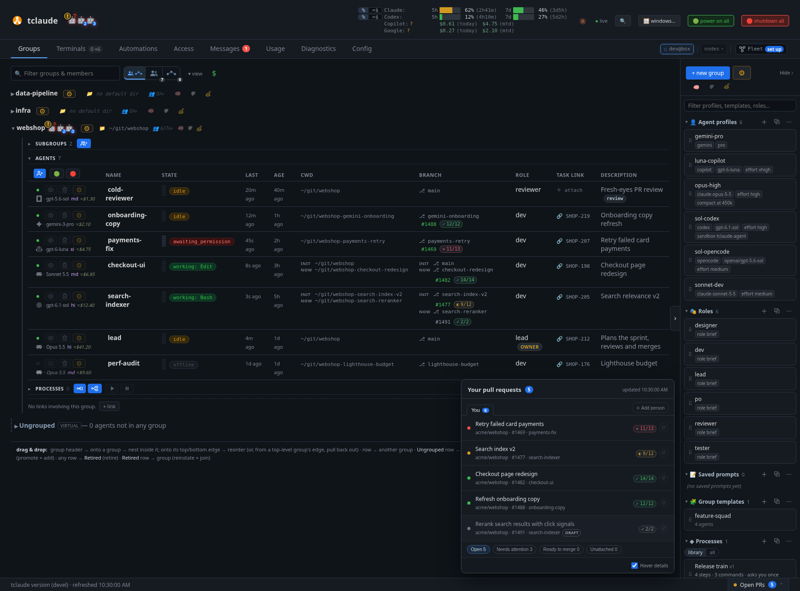

# Groups

**Groups** is the dashboard's home tab: every group, every agent in it, and
what each one is doing. Use it to see who needs you, start agents, and open any
agent's terminal. For the rest of the dashboard see the
[dashboard tour](dashboard.md). For what groups mean, see
[Agents and groups](agents-and-groups.md).

*The Groups tab, with the library panel on the right*

## The toolbar

Above the groups, from left to right:

- **Filter groups & members.** Matches group names and each member's title,
  role, description, directory and branch. A count shows how many are left;
  **×** clears it.
- **📜 search conversations.** Opens a panel that searches the text of past
  conversations. See [Searching conversations](#searching-conversations).
- **The view switch.** Three icons: **Both**, **Agents** and **Processes**. See
  [Agents and processes](#agents-and-processes). With
  `features.groups_route_map` on, a Route map view joins them; see
  [Group routes](group-routes.md#open-a-published-route-on-the-host).
- **▾ view.** What the list includes and which columns it shows. A badge on it
  counts what you changed from the defaults. See
  [What ▾ view controls](#what-view-controls).
- **$**. Shows or hides cost on each row. It is hidden when there is no cost to
  show.

While the right panel is open, **+ new group**, the actions **⚙** and the
default profile pickers sit at the top of that panel. When you hide the panel,
they move to the toolbar.

The **⚙** actions menu has a filter box, like every ⚙ menu in the dashboard:

| Item | What it does |
|---|---|
| `⤒ import…` | Import an agent or a group from a file. See [Exporting and importing](#exporting-and-importing). |
| `📸 snapshots…` | Open this node's [snapshot library](#snapshots). |
| `🧹 clean up` | Unjoin, retire, delete or reinstate in bulk. |
| `🗑 delete retired…` | Delete retired agents. |
| `⧉ profiles…`, `⧉ templates…`, `⧉ roles…`, `🛡 sandbox profiles…` | Open the [library](dashboard-library.md) managers. |
| `⇄ cross-harness spawns…` | Set which harness may spawn which. |
| `🔗 links…` | Manage [group links](agents-and-groups.md). |

### What ▾ view controls

**show offline** and **show ungrouped** are on by default. The others are off:
**show retired**, **show conversations**, **show replaced generations** and
**show offline scribes**. Your choices are saved by the daemon. A group's ⚙ menu
overrides **show offline** for that group: click 💤 to cycle through the tab
default, shown and hidden.

Below them, **Columns** lists what you can hide: ID, State, Process, Last, Age,
CWD, Branch, Role, Task link and Description. ID is off by default, and Process
only exists with `features.processes` on. Click a column header to sort.

### Bottom of the page

Extra rows appear at the end of the list, depending on ▾ view:

- **Ungrouped**: agents in no group.
- **Conversations**: sessions tclaude knows that are not agents yet.
  **promote** makes one an agent.
- **Retired**: retired agents, with who retired them and why. **reinstate**
  brings one back.
- **Replaced generations**: older versions of an agent that has reincarnated.

## Searching conversations

**📜 search conversations** opens a box above the groups; the command palette
has it too. Type at least three characters and it searches titles, summaries,
first prompts and transcripts for that text, ignoring case. It covers
this node's conversations, not a peer's.

Each result shows its best matches and what you can do with it: **promote** a
plain conversation into an agent, **reinstate** a retired agent, or **copy id**
for anything that is already an agent or an older generation. To resume a
conversation, promote it and then start it from its agent row.

Each search runs once, when you stop typing, and takes at most five seconds.
It reads the newest conversations first and shows up to 50 results, so the line
under the box says when older ones weren't reached. Archived conversations
aren't searched, and transcripts stored compressed or outside plain files are
matched on title and first prompt only. For a regular expression or a complete
scan, use [`tclaude conv search --content`](conversations.md#searching).

## A group

Click a group's name to fold or unfold it. Next to the name are the group's
activity bots and its **⚙**, then quick options. Those fold to icons and expand
when you hover. To turn that off, use **Group quick options** in
[Config › Appearance](dashboard-config.md#appearance), or **📌 pin quick
options open** in the group's ⚙ menu.

| Icon | What it is | Click to |
|---|---|---|
| 📝 | Description (when shown) | Edit it |
| 📁 | Default directory | Edit it; 📁 browses; Ctrl-click (⌘-click on a Mac) opens a terminal there |
| 👥 | Members and cap, such as `2/∞` | Change the cap (0 means none) |
| 🧠 | Default spawn profile | Pick one |
| 🛡 | Default sandbox profile | Pick one |
| 💰 | Default usage profile | Pick one |
| 🔗 | Links, when the group has any | Open them |

Inside the group are folding sections: **Subgroups**, **Agents** and
**Processes**. Each remembers whether you folded it, per group. **Agents** has
three buttons: spawn into this group, 🟢 power on everyone offline, and 🛑 shut
down everyone running. **Processes** has Agent process, Group process, resume
all and pause all. These buttons sit on the section line while it is folded, and
at the top of its table while it is open.

Below the sections is the group's list of links, with **+ link**.

### The group ⚙ menu

| Item | What it does |
|---|---|
| `⚙ settings…` | Name, description, default directory, startup context, spawn profile, saved prompts, sandbox profile, environment, member cap, notifications, remote policy, link |
| `+ add member` | Add an existing agent |
| `⏰ schedule…` | Set up a [cron job](dashboard-automations.md#cron-jobs) for this group |
| `📋 standing orders…` | Set up [standing orders](dashboard-automations.md#standing-orders) |
| `✉ message` | Write to the group, or to some of it |
| `🗂 view messages` | Open the group's folder in [Messages](dashboard-messages.md) |
| `📋 set startup context…` | What every agent joining the group is told |
| `☆ make directory auto-join default` | This group wins when bare `tclaude` finds several groups for the directory (needs a default directory) |
| `🔑 group permissions…` | Grants for every member |
| `⇄ cross-harness spawns…` | This group's harness spawn rules |
| `🔔 notifications: on` | Mute or unmute the group |
| `📱 remote policy: inherit` | The default for new agents: opt-in, deny or inherit. A spawn's own setting still wins. |
| `📌 pin quick options open` | Keep the quick options expanded |
| `rename`, `📂 nest under…`, `⧉ clone…` | Organize the group |
| `⧉ save as template…`, `⤓ export…` | Reuse or move it |
| `🧹 cleanup` | Bulk cleanup for this group |
| `↓ pull repositories…`, `↻ sync repositories…` | [Update its repositories](#pull-or-sync-group-repositories) |
| `🧹 cleanup worktrees…` | [Review and remove worktrees](worktrees.md#dashboard-cleanup-sweep) |
| `🪟 windows…` | Focus or hide its agent windows |
| `🖥 open web terminal` | A shell in the default directory (needs one) |
| `delete group` | Delete it |

### Drag and drop

Drag a group header onto another group to nest it, or to its top or bottom edge
to reorder. Ctrl-drag (⌘-drag on a Mac) a header to clone the group. Drag an agent's row to
another group to move it. A **Retire** bin appears while you drag: drop a row there
to retire it, or a queued spawn to discard it. Drag from **Retired** to a group to
reinstate an agent. Dragging a **Conversations** row to a group promotes it
and adds it. From the library, drag a profile, role or template onto a group to
spawn. Once a drop lands, the receiving group opens and a short blip marks the
spot.

## The member row

Each agent is one row. The first column has the status dot, then icons for
focus window, retire, and **⚙**. **Agent hide button** in
[Config › Appearance](dashboard-config.md#appearance) adds a hide window icon. Below them is the harness line,
such as a Claude Code logo, then `Opus 4.8 hi $0.42`: harness, model, effort and
cost. Hover the logo for the harness name. A harness with no logo, such as pi,
shows its name as text.

- **The status dot** is `●` online and `○` offline. Click it to turn the agent
  off (exit gracefully or force kill) or wake it.
- **Cost.** `$x.xx` is real spend. `≈$x.xx` is a what-if estimate for
  subscription use: what it would cost per token, not a charge.

| Column | Shows |
|---|---|
| Name | The agent's name. Click to rename. A `!` means unread notifications. |
| State | [Context meter](#the-context-meter), state pill and [badges](#badge-glossary) |
| Process | Which process step the agent is on |
| Last | The last hook event |
| Age | How long since it started |
| CWD | Start directory and current directory, marked `init` and `now`. Click to open a terminal there. |
| Branch | `⎇ branch` (a link to the forge), then [PR and CI pills](#pr-ci-and-review-pills) and any PRs presented with `tclaude agent present-pr`. GitLab merge requests get the same treatment when the project is on a configured instance. |
| Role | `+ role` to set it; `owner` marks a group owner |
| Task link | A link to the work item; `＋ attach` to add one (or `tclaude agent task`) |
| Description | `+ descr / tags` to add text and tags |
| ID | The short agent ID (hidden by default) |

The state pill is one of: `working`, `idle`, `idle + work` (background work is
still running), `awaiting_permission`, `awaiting_input`, `error`, `crashed`,
`restarting`, `crash loop / backoff`, `offline`, `waking…`, `recovered
automatically`, `recovery suppressed` or `exited`. A plain shell shows `running`.

### The agent ⚙ menu

Items only appear when they apply to that agent.

| Group | Items |
|---|---|
| Look | `view messages`, `terminals & windows…`, `summary…` (online agents), `export debug info` |
| Change | `edit`, `make owner` / `revoke owner`, `permissions`, `+ sudo`, notify on/off, remote on/off, `⚡ enable fast mode` (Codex), `⏰ schedule…`, `💰 usage budget…` |
| Restart | `reincarnate`, `↻ restart`, `⚠ restart without sandbox` / `🔒 restore sandbox + restart`, `🧩 sandbox implementation…` |
| Send elsewhere | `move to…`, `teleport to…`, `clone to…` (`clone…` without a fleet), `📸 snapshot…`, `⤓ export (PAF)…`, `morph…`, `⌂ recall home…` (when visiting) |
| Remove | In a group: `remove`, `retire`. Ungrouped: `retire`, `delete`. |

**summary…** starts an export that appears in
[Automations › Exports](dashboard-automations.md#exports).

**export debug info** downloads a JSON file with what was requested, what
resolved and what is running: spawn parameters, sandbox settings and launch
evidence. It works while the agent is offline. It includes environment values
and local paths, so treat it as sensitive; task text and one-time tokens are
redacted.

### Opening a terminal

- **The focus icon** jumps to the agent's web pane, or its native window when
  **Default terminal** is set to native in
  [Config › Terminals & windows](dashboard-config.md#terminals-windows).
- **The hide icon**, when turned on, detaches a native window. The agent keeps
  running.
- **`terminals & windows…`** gives all four choices: **Open session window**,
  **Open session in browser**, **Shell in its directory** and **Shell in
  browser**.

Browser terminals open in the [Collab tab](dashboard-terminals.md).

### Badge glossary

Badges only show when they apply.

| Badge | Meaning |
|---|---|
| 🤖+N | N sub-agents still running |
| ⚙+N | N background shell commands still running |
| 👁+N | N monitors still watching (log tail, CI poll, websocket) |
| 🚫 | agentd has refused N callbacks from this session; see below |
| 🔒 | Sandbox confined |
| ⚠ | Sandbox off, unknown, not enforced or partly enforced. Hover for the details. |
| 📱 | Remote control on (Claude Code, best-known state). Click to open the session. |
| ⚡ | Codex fast mode. Click to turn it off. |
| 🔓 | N active sudo grants. Click to manage them. |
| 💰 | Usage budget |
| ◆ | Running on a subscription sent from another node |
| ⌂ | Visiting from another node, or back home |
| `⇢ morph` | A morph is in progress |

**🚫 means the row is frozen.** Status, model, cost, context and directory all
stay at their last accepted value, so don't trust the row. The usual cause is a
dead session row on the same process, or a session ID mismatch. See
[Logs](dashboard-diagnostics.md#logs) for how to investigate it.

**The sandbox badge** tooltip gives the status, which sandbox applies, the
profile and any resource limits. Click it to turn the sandbox off temporarily or
restore it (not for Codex built-in sandboxes). See
[Sandboxing](sandboxing.md).

### The context meter

Five segments, green to yellow to red. The tooltip reads like `context: 120k /
200k tokens (assumed cap) — 60%`. The note in brackets says where the cap came
from: configured, reported by the harness, from the model catalog, or assumed.
Subscription quota is not on the row; see
[the header](dashboard.md#the-header) and [Usage](dashboard-usage.md).

### PR, CI and review pills

- **PR pill** (`#1234`, or `!7` for a merge request): colored by open, draft,
  merged or closed. Rest the pointer on it for a details card: title, author,
  branches, diffstat and the start of the description. A merge request's card
  is read from the GitLab API and names its project; on an instance without
  the diffstat fields it leaves the counts out.
- **CI pill** (`✓ 12/14`): glyphs ✓ ✕ ◐ ·, not counting skipped checks. Hover or
  focus it for a checks panel, failures first, with live timers and a link to
  GitHub (the pipelines tab, for a GitLab merge request). On merged and closed PRs it only shows when the final run failed,
  unless **CI on finished PRs** is on in
  [Config › Appearance](dashboard-config.md#appearance).
- **Review pill**: a person icon on open, non-draft PRs. Green with a count is
  approved, red with a count is changes requested, amber means a review is
  required, grey means none yet. Only human reviews count. Hover for each
  reviewer's latest review. A GitLab merge request gets the same pill: its
  approvals, its reviewers' change requests, and amber while the project's
  approval rules want more approvals. GitLab records no time on an approval,
  so its rows show no age. An instance older than reviewer states (GitLab
  added them after approvals) shows approvals only. agentd notes, per
  instance, which newer fields an instance lacks (reviewer states, the
  details card's diffstat, the recently closed query) and stops asking for
  them until it restarts. After upgrading GitLab, restart agentd to get them.

PR and CI data comes from `git` and `gh`, or the GitLab API for a merge
request, cached for 90 seconds.

### Open PRs

**Open PRs** in the footer lists your pull requests across the fleet.

- **Filters:** **Open**, **Needs attention**, **Ready to merge**, **Unattached**,
  **Closed**, and **Ignored** when you have ignored any. Each shows a count.
  Drafts are grey and stay out of **Needs attention** unless you tick **Include
  drafts** there. **Ready to merge** is approved PRs with passing CI. Requested
  changes count toward **Needs attention**.
- **Hover a title** for the PR details card. Untick **Hover details** in the
  popover's footer if it gets in the way. It is one setting with Open MRs.
- **⊘** ignores a PR for 1 day, 1 week, 30 days or permanently. **Restore** under
  **Ignored** brings it back.
- **＋ Add person** adds a tab for someone else's PRs, up to eight people. ✕ on
  the tab stops tracking them. Their PRs do not count toward the footer number.
  You only see PRs your `gh` login can see.
- **Open all on GitHub** opens the current list.

Rows stay ordered by repository and PR number, so updates don't move them.
Archived repositories are never listed. If GitHub rate-limits you, agentd pauses
its background GitHub calls for 5 minutes, up to 30 while the limit holds.

### Open MRs

**Open MRs** sits next to **Open PRs** and covers the GitLab instances in
`agent.git_proxy.gitlab_hosts` (see [GitLab proxy](proxies.md#gitlab-proxy)).
It shows once a configured instance has answered, whether or not `gh` is
installed. Without a `gitlab_hosts` entry or a token it does not show at all;
a gitlab.com project needs a `"gitlab.com": "https://gitlab.com"` entry.

The footer carries two numbers. **mine** counts your open merge requests,
where "your" means the user that `gitlab_token_file` belongs to; it turns blue
when one of them needs attention. **all** counts everyone's open merge
requests that the token can see. For an admin token that is every project on
the instance.

The popover opens on **Mine**. Next to it is one tab per project with open
merge requests, holding everyone's: projects your agents work in come first,
then the busiest. A project tab's rows also say who wrote each merge request,
and **Open in GitLab** opens the project's own list.

- **Filters:** **Open**, **Needs attention**, **Ready to merge** and
  **Unattached**, with counts. **Ready to merge** is at least one approval, a
  passing head pipeline, and no merge conflict. **Needs attention** means
  ready for a decision: the pipeline has finished, red or green, or there is
  none; or the merge request conflicts with its target; or changes were
  requested. A pipeline still running with nothing failed does not count. Drafts are grey and stay out of **Needs attention** unless you tick
  **Include drafts**, which is the same setting as in Open PRs.
- **Rows** read `!7` for merge request 7, and note conflicts. The CI pill
  shows the head pipeline's state; hover it for the pipeline's jobs. The
  [review pill](#pr-ci-and-review-pills) follows it. A project tab's row shows
  approvals, and a reviewer's change requests too when the merge request is
  yours or an agent's.
- **Open all on _host_** (on **Mine**) opens that instance's list of your
  merge requests. An instance that could not be read says why, above the list.

agentd asks each instance once every 30 seconds. Your own list is a single
GraphQL query, and its reviewers' states a second one. Everyone's list starts with GitLab's REST merge request list,
which names the projects and covers the 500 most recently updated open merge
requests. Up to 20 projects per instance are then read through GraphQL, five
per query: those your agents work in first, then the ones with the most open
merge requests. Past either cap, the remaining projects are left out and the
**all** count ends in `+`. If the project-wide read fails while your own list
answers, the project tabs keep their last lists and say so. The instance is
not marked as failed. That needs a GitLab recent enough to have
`detailedMergeStatus` (16.x is safe); an older one reports the missing field
instead of a list. A rate-limited instance is retried after the wait GitLab
names, up to 5 minutes, and keeps showing its last list meanwhile. Hovering a
title opens the merge request's details card, under the same **Hover details**
setting as Open PRs. **⊘** ignores a merge request for 1 day, 1 week, 30 days
or permanently, as in Open PRs and in the same store. It leaves Mine, every
project tab and both footer numbers, and waits under **Ignored** with a
**Restore** button. On **Mine**, **Closed _N_d** lists your merge requests
merged or closed in the last _N_ days, the same `dashboard.recent_pr_window_days`
window as Open PRs (0 turns it off), with the same **Final CI** switch. It is
read every 150 seconds; a closed merge request keeps its last pipeline status
and is not read again. Project tabs have no closed list, and the people tabs
are Open PRs only.

## Starting agents

### Creating a group workspace

**+ new group** opens **Create group**. **Start from** is **Blank**, an existing
**Group**, or a **Template**. Then set the name, where to place it, and the
**Workspace**:

- **Use existing directory** points the group at a folder.
- **Clone repository** clones from GitHub over SSH or HTTPS, using the daemon's
  own credentials, and makes the checkout the default directory. It creates
  missing parent folders. If a clone fails, the dialog stays open so you can
  retry. The repository URL can be stored as the group's link.

The rest is optional: startup context, environment, max members, link.

### The spawn dialog

To start an agent, use the spawn button inside a group, drag a
profile, role or template onto the group, or press Ctrl K (⌘ K on a Mac) and type
`spawn`. It runs the same path as `tclaude agent spawn`; see
[Spawning and lifecycle](spawning-and-lifecycle.md).

For most spawns, pick a **Profile**, give it a **Name** and an **Initial msg**,
and press **Spawn** (Ctrl Enter, or ⌘ Enter on a Mac). The rest of the form overrides the profile:

| Fields | Use them for |
|---|---|
| **Profile**, `Clear`, `Save as profile…` | Fill the form from a [saved profile](dashboard-library.md#agent-profiles), or save this form as one |
| **Group**, **Name**, **Initial msg**, **Saved prompts**, **Attachments** | Who it is and what it should do. Attachments (upload, drag or paste) become part of its briefing. |
| **Roles**, **Display role**, `owner`, `Permissions…`, `Context…` | Role, ownership, permissions at birth, and a preview of its context |
| **Environment**, **Descr**, **Task link** | Environment overrides, description, link to the work |
| **Harness**, **Fast mode**, **Model**, **Effort**, **Auto-compact window**, **Context max**, **Usage from**, **Claude login** | What it runs on |
| **Sandbox**, **Sandbox profile**, **Usage profile** | Confinement and spending limits |
| **Approval policy** or **Permission mode**, **Approval reviewer**, **Tool governance**, **Question timeout** | How much it may do without asking. The dialog warns about high-autonomy choices. |
| **On resume** | What a later resume or reincarnation of this agent re-reads and what it keeps: a summary of each [relaunch policy](launch-resolution.md#per-agent-overrides) row that differs from its default, with where it comes from (a profile, this spawn, or the global table). **Edit…** sets rows for this spawn only: **Default** leaves a row to the spawn profiles and then the global table, **Follow global** takes the global table even where a profile sets it, and the other buttons pick a mode. The editor also lists every other input by layer. The global table is in [Config › Launch](dashboard-config.md#launch). **Save as profile…** carries the rows. Shown for a spawn on this node only. |
| **CWD**, **Worktree repo**, **Worktree**, **New branch**, **Base branch** | Where it works. See [Git worktrees](worktrees.md). |
| Checkboxes | Auto focus a terminal, include the group's context, start with remote control, and harness-specific options |

**⏸ Add to queue** (Ctrl Shift Enter, or Shift ⌘ Enter on a Mac) saves the spawn without starting it.
Queued agents show as rows with **▶** to start them, and a **⏸ queued** chip in
the toolbar lists them. Drag a queued row to the **Retire** bin to discard it.

### The Spawn queue

With [capacity limits](spawning-and-lifecycle.md#capacity-limits-and-the-spawn-queue)
set, a **Spawn queue** block sits above the groups. Its first line shows how
many agents count toward `max_live_agents`, whether there is room, how many
spawns wait, and the configured thresholds. Below it, the spawns waiting for
capacity are listed in queue order, local and from peers (tagged **remote**),
with who asked and how long each has waited. **✕ cancel** takes one out of the
queue; for a peer's request, cancelling denies it. A group with waiting spawns
shows a **⌛ N queued** chip. When nothing waits the block is a single capacity
line, and with no limits set it is not shown.

These are different from **⏸ Add to queue** above. That saves a draft until
you start it; the Spawn queue holds spawns that were asked for and wait for
capacity.

Saved prompts are covered in the [library](dashboard-library.md#saved-prompts).

### Task forces

A group deployed from a template with a mission shows a task force card: **🎯
hide info** folds it, and **↻ re-brief**, **⏻ stand down** and any **▸ advance**
for phases act on the whole team. See
[Teams at scale](teams-at-scale.md).

## Agents and processes

This section applies with `features.processes` on; see
[Config › Experimental](dashboard-config.md#experimental). The view switch
changes what each group shows, and each choice has its own address.

- **Both** (`/groups`, the default) shows **Agents** and **Resources** sections
  together. Hover an agent to draw dashed lines to the steps it performs, and
  hover a step to see its performers. A group with nothing running and nothing
  attached shows **Resources** as a single line.
- **Agents** (`/groups/agents`) shows the roster, with run counts on each group
  and an optional **Process** column.
- **Processes** (`/groups/processes`) shows each group's runs as live graph
  cards. Open a run to inspect nodes, answer decisions, reassign performers, and
  pause or resume. An open run has its own address,
  `/groups/runs/<group>/<run-id>`, so Back closes it.

To start a run, use the **Agent process** or **Group process** button on the
group's Resources section.

### Resources

**Resources** lists everything attached to the group, grouped by kind:
- **Processes:** its saved processes and runs.
- **Boards:** the collab boards linked to the group.
- **Pages:** the live pages its members showed into it, including closed
  ones saved with the group.
- **Shell:** the group's terminal, in its default directory.

A kind with nothing in it is hidden. **＋ New** adds a process, a new board
linked to the group, a blank live page, or opens the group's shell (once the
group has a directory). Draw on the blank page to show what to build, and a
member takes it over with its own source (see
[Live page › A page the operator creates in a group](live-page.md#a-page-the-operator-creates-in-a-group)).

Every row wears a state pill that reads the same for every kind:
- **open in Collab**, **floating** or **minimized**: this browser shows it as
  a Collab tab, in an overlay window, or on the dock.
- **running**: a process with an active run.
- **live** (a page) or **background** (a shell): it runs, open nowhere here.
- **closed**: it exists, and nothing of it is live.

Open, floating and minimized are this browser's own: another browser of
yours keeps its own windows. The row's main button follows the state:
**Focus** brings an open one forward, **Restore** takes it off the dock,
**Open** opens it (**Attach** for a running shell, **Reopen** for a closed
page). A live page also has **↻**, which reloads it in every view, and a
running shell **×**, which kills it after a confirm. The row's **⋯** holds
**Delete…**, behind a confirm, for a page or a board.

Each resource has a lock chip. Click it to switch between two states:
- **✎ agents can edit** (the default): agents edit the resource under their
  usual permissions.
- **🔒 agents: read-only:** members still use the resource, but no agent can
  change it, whatever it is granted.

Only you can toggle the lock. The same chip is on the resource's own header
too: the process editor, the board and the page. See
[Permissions › The operator's lock on a resource](permissions-and-audit.md#the-operators-lock-on-a-resource).

A peer's group in the fused view lists its resources too, read from that
node, where that node grants you `groups.resources.read` for the group (the
roster grant alone no longer shows it, nor does `groups.resources.lock`
without the read grant). Its boards and pages are named
but not opened here. Its lock chips toggle only where that node grants you
`groups.resources.lock`; otherwise a chip is greyed out and its tooltip says
so. If the node refuses a toggle, a toast says why. See
[Connect and share](federation-peers.md).

Hover the view switch to choose which runs show:
**Running**, **Planned** and **Done**. See
[Processes](processes.md#in-the-dashboard).

## Moving and saving agents

### Exporting and importing

In an agent's ⚙ menu, **⤓ export (PAF)…** downloads a [PAF](paf.md) file. Choose
whether the conversation travels, as **Native history**, **Harness-neutral
context** or both. If the credential scan finds something, the download waits
until you tick *Export anyway; I have checked the findings* or use **Redact…**,
which previews what it masks and downloads a redacted copy.

A group's **⤓ export…** offers `.paf` (the default) or `.zip (legacy)` for older
versions of tclaude.

**⤒ import…** takes either kind, and so does dropping the file on the page. The
file decides which preview opens.

- **An agent:** choose its group, working directory, harness and model. The
  preview shows how its history lands, the credential scan and the security
  posture. **Import (offline)** lands it without starting it; **Import & start**
  also starts it. An import is always a fork.
- **A group:** shows what would collide, plus a table of members where each one,
  or all of them, can change harness or model. Imported members land offline.

### Snapshots

**📸 snapshots…** in the toolbar ⚙ menu opens this node's snapshot library. An
agent's **📸 snapshot…** opens it with the create form filled in, or use **+ take
snapshot…**. Each row shows the agent, harness, size, expiry and credential
findings, with these actions:

- **Spawn…** starts a new agent from the snapshot.
- **⤓** exports it as a [PAF](paf.md).
- **Share…** puts it on a [board](boards.md) for named members. You review a
  consent summary and type `share`. A snapshot with suspected credentials must be
  redacted first.
- **Publish…** makes a public copy, always masking credentials, paths and
  identity. You preview it and acknowledge before the `.public.paf` downloads.
- **✕** removes it. **prune expired** removes every expired snapshot.

Resilience policies are managed with `tclaude agent snapshot policy`; when any
exist, a table here shows each one's last good snapshot and when the next is due.

Snapshots stay on their node. If a peer trusts this node unrestricted, its agents
show **📸 snapshot…** and **⤓ export (PAF)…**, and its groups **⤓ export…**, on its
own page and in the fused Groups view. The dialog acts on that node's library, and
files download through this node. A public copy or a board share is made here, from
the downloaded file. A restricted peer hides these items.

## Pull or sync group repositories

Update the checkouts in your group directories without leaving the dashboard. In
the command palette, use **Pull all repositories…** or **Sync all
repositories…**, or search `pull <group>`. A group's ⚙ menu has **↓ pull
repositories…** and **↻ sync repositories…**.

**Pull** fetches and fast-forwards. **Sync** also prunes stale remote-tracking
references. Neither ever pushes, rebases or merges diverged history.

The dialog finds repositories in each group's directory and two levels below it,
following symlinks, and lists each once. It only shows checkouts on the default
branch, so feature-branch and detached worktrees are left out, and it does not
scan every agent worktree. Pick repositories, filtering if you like, then press
Ctrl Enter (⌘ Enter on a Mac).

- **Switch to default branch first** starts on. Untick it to pull each current
  branch's upstream.
- **Discard uncommitted changes** starts off. Without it, dirty checkouts are
  skipped. With it, tracked edits are reset and untracked files are removed with
  `git clean -fd`; ignored files and nested repositories stay.
- **Parallel updates** is 4 by default, up to 100. Each repository gets two
  minutes.

Diverged branches, branches checked out in another worktree, and in-progress
merges or rebases are skipped with a reason. One failure doesn't stop the others.
Updates are not atomic: a failed later step can leave an earlier fetch, branch
switch or discard in place, so check the repository before retrying. Closing the
dialog is blocked while a batch runs, and losing the connection cancels what has
not finished.
