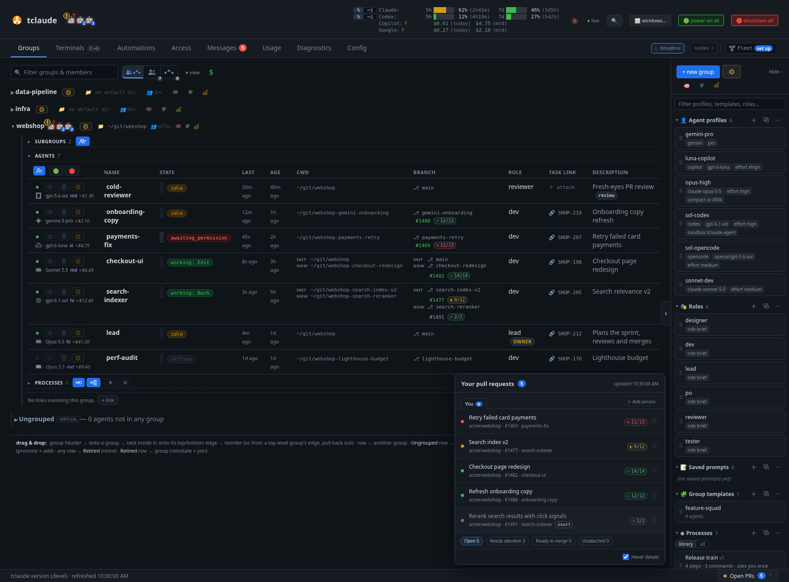
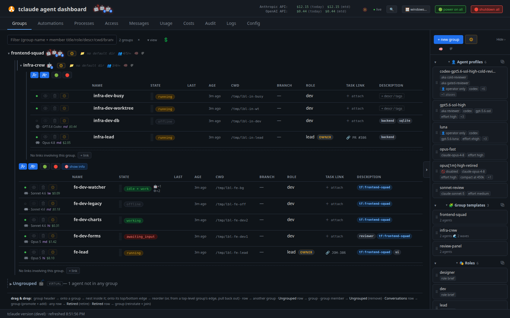
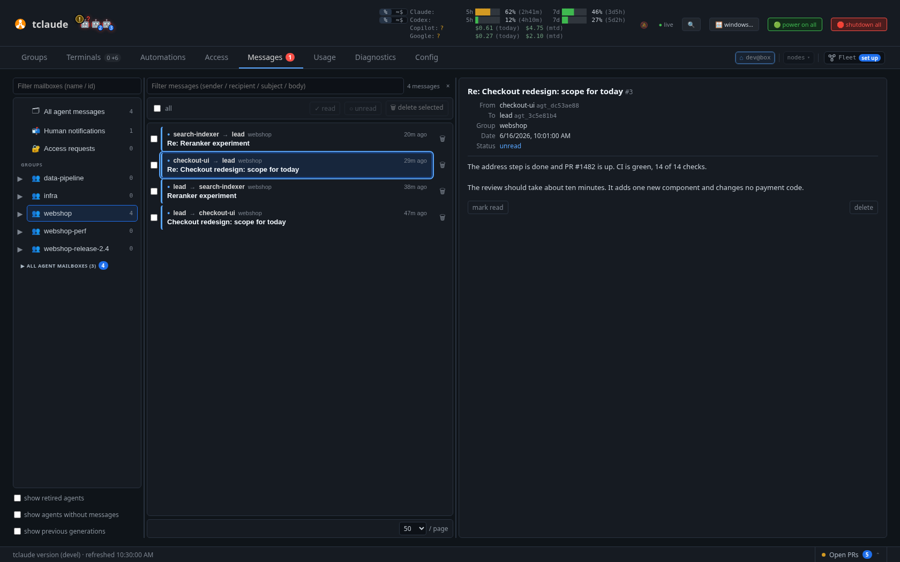
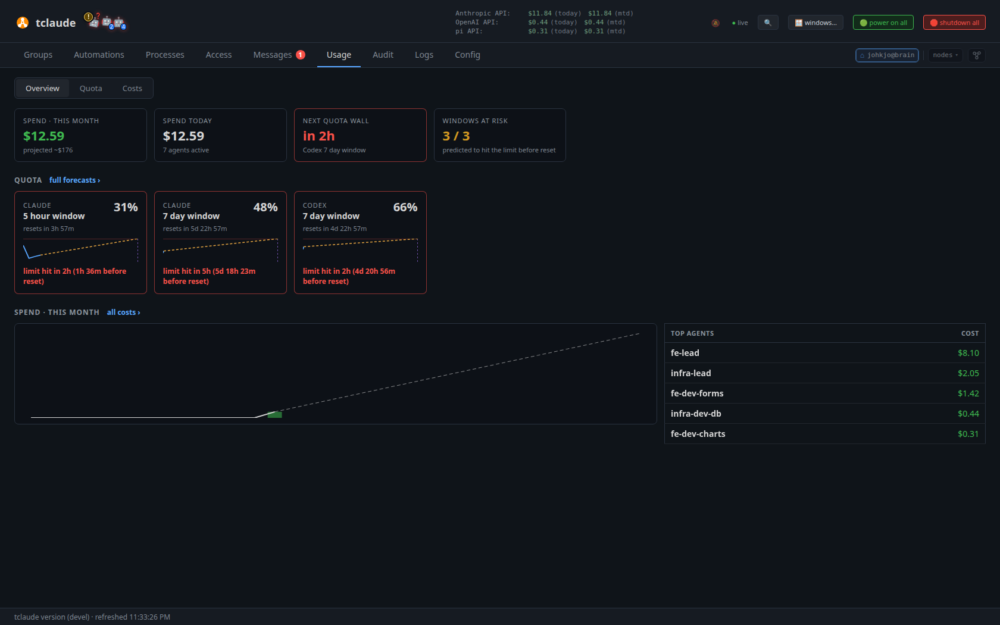
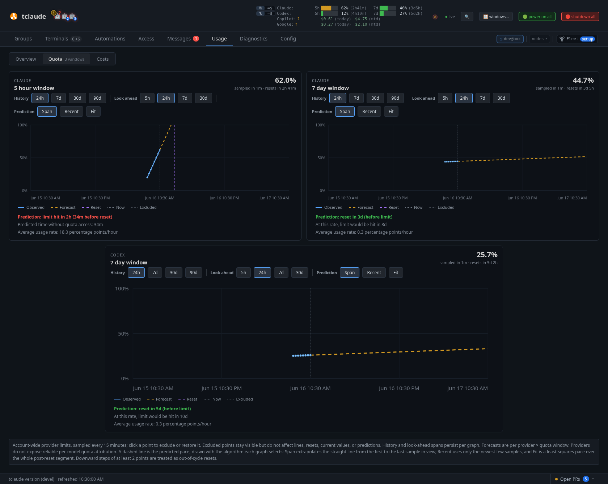
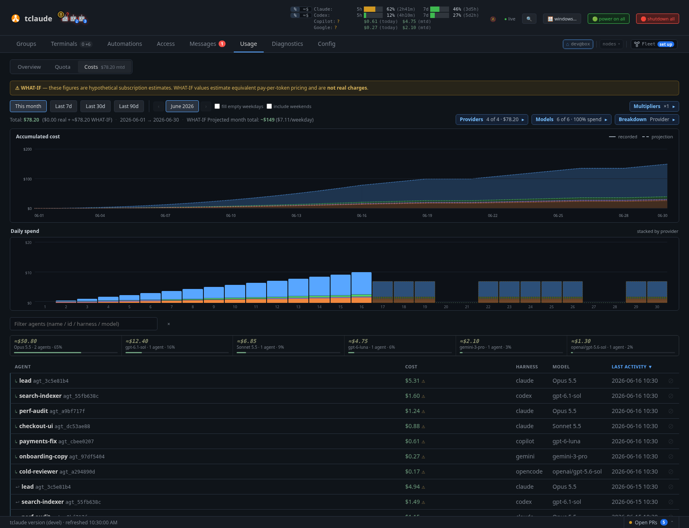

# Dashboard

!!! tip "New to tclaude?"
    The [Learn path](learn/index.md) walks through the everyday parts, starting from [Get started](learn/get-started.md).


The dashboard is the browser operations console for your agent fleet. Its
design thesis is observability with zoom on demand: one screen shows every
group and agent at a glance — status, context pressure, cost, branch and CI
state — and any row can be zoomed into a fully interactive live terminal
attached to the agent's real tmux pane. You go from "the whole fleet looks
healthy" to "typing into this one agent's session" in two clicks, and back.

It is served by the `agentd` daemon and is human-only: agents talk to `agentd`
over its API, not through this UI. For the daemon itself and how agents relate
to it, see [Agents and groups](agents-and-groups.md).



*The Groups home view: a mixed-harness group with per-agent state, cost, branches with PR and CI status, roles, task links, the open-PRs popover — and the profile/template/role libraries on the right rail*

## Opening it

```bash
tclaude agent dashboard          # open in your default browser
tclaude agent dashboard --print  # print the one-shot URL instead
tclaude agent ui                 # alias
```

The command asks the daemon for a one-shot URL and opens it; the single-use
token expires in about a minute, so treat a `--print`ed URL as
use-immediately. `--slop` and `--wizard` open the cosmetic re-skin themes
(mutually exclusive; slop wins).

The dashboard listens on loopback only by default (`127.0.0.1`). By default
the port is random per `agentd serve` (so the URL changes across restarts);
set `agent.dashboard_port` for a fixed port, which then fails loudly if
taken.
Whether `tclaude agentd serve` auto-launches a browser is configurable in
Config → agentd daemon & server. For reaching the dashboard from another
machine or a phone, see [Operating remotely](remote.md).

## Saved prompts

Saved prompts are reusable task text, shared globally across groups on this
daemon and stored in SQLite. They work like roles when starting agents: pick
one or more as chips, and their bodies open the new agent's task brief, in
order and separated by blank lines, ahead of anything typed in **Initial msg**.
A composition over the 16,384-byte initial-message limit is refused.

Prompts can be selected at three levels; the highest one that names any
prompts wins as a whole (nothing merges):

1. The spawn itself — the spawn dialog's **Saved prompts** chips, or
   `tclaude agent spawn --prompt <name>` (repeatable).
2. The spawn profile — **Saved prompts** in the profile editor
   (`prompt_refs`). The named profile beats the group's default profile.
3. The group — **Saved prompts** in the group settings (`default_prompts`),
   used when neither profile names any; the global default profile is the
   last fallback.

The spawn dialog pre-fills its chips in that same order, so what it shows is
what the agent gets; removing every chip spawns with no saved prompts. A
non-interactive spawn uses only prompts it names explicitly, and an
interactive shell spawn takes none. Renaming a prompt updates every profile
and group that uses it; deleting one is refused while any still do.

Agents started without the dialog follow the same defaults:

- **Template deploys** use the agent's referenced profile's prompts, else the
  group's default profile's, else the group's own, else the global default
  profile's, ahead of the template agent's initial message.
- **Cron jobs, triggers and process workers** use their profile's prompts,
  else the group's own default prompts, ahead of the rendered instruction.

Saved prompts travel with the bundles that reference them. Spawn-profile and
template exports embed every prompt their profiles name, and a group export
embeds the group's default prompts. Import creates the prompts that are
missing here and never overwrites a local prompt of the same name: it keeps
the local text and says so. A group default naming a prompt that is neither
in the archive nor here is dropped. A config bundle carries the whole library
as its own `saved-prompts` section, and a profile item is refused unless the
prompts it names exist here or are selected from that section. Agent bundles
(`.paf`) leave saved prompts out.

The right-side palette has a **Saved prompts** section: **⧉** opens the
manager, and each card's ⚙ menu edits, clones or deletes that prompt. The
manager also creates new prompts and exports or imports them as JSON; an
import previews which names are new and skips existing ones unless you choose
to overwrite those that differ. The terminal's **✉ Message** composer keeps
its **Insert prompt…** picker, which inserts a prompt's text at the cursor
for editing and never sends the message.

Names use the same short handles as groups (for example, `cold-review`);
bodies contain up to 16,384 UTF-8 bytes. A saved prompt is task text, while a
role supplies agent guidance and permissions.

The dashboard manages prompts as the human. The daemon also exposes
`GET/POST /v1/saved-prompts` and `GET/PATCH/DELETE /v1/saved-prompts/{name}`;
PATCH replaces the complete name/body pair. Reads are open to agents, and
mutations require `prompts.manage`, which is not granted by default. Setting
a group's `default_prompts` requires the group startup-context permission.

## The tabs

In order across the top:

| Tab | What it is |
|---|---|
| Groups | The home view: fleet roster, spawning, live status |
| Terminals | Web-terminal multiplexer; hidden until a pane is open |
| Automations | Exports, cron jobs, standing orders, triggers, and (feature-flagged) Processes |
| Plugins | Shell-step plugin lists with status lamps |
| Access | Permissions, slug registry, sudo (three subtabs) |
| Messages | All agent mail, human notifications, access requests |
| Usage | Overview, subscription quota forecasts, and real/what-if costs |
| Activity | Audit trail, daemon log, and poll performance (three subtabs) |
| Config | Visual editor for `~/.tclaude/config.json` |

With trusted federation peers, node chips and **⌘ Fleet** join the tab bar,
and ⌘ Fleet opens the Groups · all nodes / Map / ⚙ Fleet config views; see
[Fleet UI](#fleet-ui-linked-nodes).

`[` and `]` cycle tabs; Ctrl/Cmd-K opens a command palette covering tab
navigation, window focus, spawn, retire, power, and every manager dialog.
Type `spawn luna` to find saved profiles by partial name or alias. Add `fast`
to select a fast-mode shortcut for a supporting harness (for example,
`spawn luna fast`). Selecting a result opens the spawn dialog with the profile
and speed prefilled; the group remains editable and defaults to the last used
group. Fast mode uses a higher-cost service tier.
Type `terminal <group>` (or `shell <group>`) to open a web terminal in a
group's default directory — the same pane as the group ⚙ menu's **open web
terminal**, offered only for groups that have a default directory.
Automations' Processes subtab appears only with `features.processes`. A theme-gated **Vegas** button appears in the slop and
wizard themes (or via `slop.vegas_in_regular_mode`).

The **wizard** theme renames everything (Parties, Scrying, Labours, Rites,
Contraptions, Wards, Missives, Reserves, Coffers, Chronicle (Deeds, Runes, Alchemy),
Almanac, The Tavern) and the **slop** theme goes full casino; both are
re-skins of the same dashboard, not different feature sets. The header icon
toggles regular ↔ wizard; the slop theme is unfinished and left out of that
cycle, but Ctrl/⌘+Alt+Shift+S still toggles it (the same chord with W toggles
wizard), or force one with `?slop=1` / `?wizard=1`.

## Groups — the home view

The default view is a compact roster: groups, and under each group its member
agents, one row per agent. An optional read-only route-map island
(feature-flagged) draws the group topology.



*Activity badges on a busy fleet: sub-agents, background shells, and monitors counted next to each state pill*

The filter bar holds query/visibility/column controls, a `💲` toggle for
per-row cost badges, default spawn- and sandbox-profile pickers, `+ new
group`, and a `⚙` actions menu (type-to-filter) with **import…** (an agent or a
group, see [Exporting and importing](#exporting-and-importing)), clean up (bulk unjoin / retire /
delete / reinstate), delete retired, and managers for profiles, templates,
roles, sandbox profiles, cross-harness spawns, and **links** — links is a
modal opened from here, not a tab. Drag and drop works throughout: nest and
reorder groups, move rows between groups, drag a row to the bin to retire it,
drag it back to reinstate.

For repo-wide cleanup, choose **🧹 cleanup worktrees…** in a group's `⚙`
actions menu, or **🧹 Review worktrees across all groups…** from the top-level
**clean up** dialog. See [Dashboard cleanup sweep](worktrees.md#dashboard-cleanup-sweep)
for discovery scope, selection defaults, and removal safeguards.

With `features.processes` on, a **Both | Agents | Processes** switch sits
beside the group filter (deep links `/groups`, `/groups/agents`,
`/groups/processes`). Agents is the roster above, with run counts on each
group header and an opt-in Process column (under "▾ view") of *run › node*
badges on member rows.
Processes shows each group's runs as live graph cards with *+ start process*
(template, params, explicit program-profile authorization); *open ›* focuses
one run with its graph, a node inspector for decisions, a performer dock to
drag-reassign agent nodes, and pause (⏸) / resume (⏵).

Both, the default, shows each group's members and runs together as an
**Agents** and a **Processes** section. Each section's header line carries
its own controls (spawn, subgroup, power on, shutdown for
Agents; agent process, group process, resume, pause for Processes), which
stay usable while it is folded; the counts are on the group's header row
(its member bots and run counts). Each section folds from its header line, and
the choice is remembered per group; with no choice made, a group
with nothing running shows its Processes section as a single line. In Both,
clicking a group header's run counts opens that group's Processes section
instead of switching lenses. In a real group, hovering links the two halves with dashed
lines: an agent row to every step it performs, a step to its performers, and
anywhere else on a run card to all of that run's agents. Lines start at the
agent's state pill, stay within the hovered group, and an end that is off
screen becomes a small tag that scrolls to it. See
[Processes › In the dashboard](processes.md#in-the-dashboard).

### The member row

The row's `⚙` menu includes **export debug info**, a direct JSON download that
separates the requested, resolved, and running configurations: original spawn
parameters, durable/composed sandbox settings, and latest launch evidence,
including executable/mount exposure, PATH construction, and agentd/host/sandbox
UID and GID identities. On Linux a live harness PATH and process identity are
observed from `/proc` when available. It
works while the agent is offline. The export includes environment values and
local paths, so treat it as sensitive; task text and one-time authorization
tokens are redacted.

Columns are hide/showable via "▾ view" (persisted server-side):

- **ctl** — status dot, row actions, and the harness line:
  `CC · Opus 4.8 hi $0.42` — harness mark, model, effort short code
  (lw/md/hi/xi/mx), and session cost. Real spend shows as `$x.xx`;
  subscription usage shows a what-if `≈$x.xx` — an estimated
  pay-per-token-equivalent, hypothetical, not a real charge.
- **Name** — inline-renameable; a `!` glyph marks unread notifications.
- **State** — the context meter, a state pill (working / idle / `idle + work`
  when the main agent is idle but background work runs / awaiting_permission /
  awaiting_input / error / crashed / restarting / crash loop / offline /
  waking), and activity badges.
- **Last** (last hook), **Age**, **CWD** — startup dir and current dir stacked
  as `init`/`now`; click opens a terminal there.
- **Branch** — `⎇ branch` GitHub link, PR pill, CI pill, and any PRs presented
  via `tclaude agent present-pr`.
- **Role** (with `owner` badge), **Task** — a clickable 🔗 work-item URL set
  via `tclaude agent task`, with inline `✎` edit — and **Description** with
  tag chips.
- **ID** — the short agent id, hidden by default.

The status dot is clickable: `●` online (click to turn off — soft exit or
force kill), `○` offline (click to wake), with error and waking variants.

### Exporting and importing

An agent's `⚙` menu has **⤓ export (PAF)…**: choose whether the conversation
travels and in which copies (native history, harness-neutral context), then
download a [PAF](paf.md). When the credential scan flags something, the
download waits until you either tick *Export anyway; I have checked the
findings* or choose **Redact…**. The redact step previews what it masks or drops
and what the scan still finds, then downloads a redacted copy. Nothing is
written on this node. A group's `⚙` **⤓ export…** offers a group `.paf` (the
default) or a legacy `.zip` for importing into an older tclaude.

**⤒ import…** in the toolbar `⚙` menu takes either. The file decides which
preview opens. Dropping a `.paf` or `.zip` onto the page opens the same dialog.
- **Agent:** shows the agent's provenance and lets you choose:
  - the group it joins;
  - its working directory, or keep the recorded paths;
  - the harness and model it lands on.

  It also shows how its history lands (native, translated with the expected
  losses, or configuration only), this node's credential scan and the security
  posture. **Import (offline)** lands the agent with its conversation without starting
  it; wake it (or `tclaude agent resume`) to start it. It needs a conversation
  that lands and is not yet available on OpenCode. **Import & start** also
  starts it. An import is always a fork.
- **Group:** keeps the collision preview and adds a per-member table.
  - Each member can land on another harness or model, or all members can be
    changed at once.
  - Each member shows its history rung and expected losses.
  - Imported members land offline.

### Snapshots

**📸 Snapshots…** in the toolbar `⚙` menu (or the command palette) opens this
node's snapshot library. An agent's `⚙` **📸 snapshot…** opens the same view
with the create form filled in for that agent. Each row lists the snapshot's
agent, harness, size, expiry and credential findings. From a row you can:

- **spawn** a new agent from it into a group, with a working directory (or the
  recorded paths) and an optional harness and model;
- **export** it as a [PAF](paf.md) download;
- **share** it on a Board for named members. **Review** shows the consent
  summary (size, turns, recipients, findings, expiry) first, and the share
  needs the word `share` typed. A snapshot with suspected credentials cannot
  go on a board as it is: **Redact…** masks the findings and path names and
  shares that copy instead;
- **publish** a public copy. Publishing always masks suspected credentials,
  replaces paths with placeholders and strips identity; the copy is previewed
  and needs an acknowledgement before the `.public.paf` downloads;
- **remove** it. **prune expired** removes every expired snapshot.

When resilience policies exist, a read-only table shows each policy's agents
with the last good snapshot, whether it is deferred or failing, and when the
next one is due. Policies are managed with `tclaude agent snapshot policy`.
Snapshots and their routes are local-only; peer view hides the menu item.

### Badge glossary

Badges appear on rows only while relevant (activity badges only while online
with a non-zero count):

| Badge | Meaning |
|---|---|
| 🤖+N | N sub-agents still running |
| ⚙+N | N background shell commands still running |
| 👁+N | N monitors still watching (log tail, CI poll, websocket) |
| 🚫 | agentd has refused N brokered callbacks from this session |
| 🔒 | Sandbox confined |
| 🔒² | Sandbox stacked (two layers) |
| ⚠ | Sandbox off, unknown, or not enforced |
| 📱 | Remote control armed (Claude Code; best-known state) |
| ⚡ | Codex fast mode |
| 🔓 | N active sudo grants (click to manage) |

The 🚫 broker-refusal badge deserves attention: when it shows, the entire row
— status, model, cost, context, directory — is frozen at its last accepted
value. The usual cause is a dead session row on the same pid or a session-id /
ancestry mismatch. Refusals also produce throttled `broker: refused a
brokered callback` WARN records in the daemon log (Activity › Logs) with the
caller pid, the row the daemon resolved, the id the caller claimed, and, for
a failed live-pane proof, which fact was missing (pane probe, launch
generation, or ancestry). The first refusal of an episode always logs; later
ones within ten seconds are counted per resolved row (per caller pid for
callers no row resolved for), and the next permitted line reports how many
were suppressed. A caller that had already exited when the daemon got to it
is not a refusal: the client timed out and will retry, so no badge is set and
the daemon logs `broker: caller exited before its callback could be verified`
instead. Seeing that line regularly means the daemon is too slow to answer a
statusline render within its client's three-second budget; the companion
`broker: slow brokered request` WARN, written when a brokered callback takes
over a second, breaks the time down by phase (process-table resolution,
database reads, pane facts and whether the shared tmux cache or a live probe
answered them, ancestry walk, applying the event) so the stall can be placed.
The sandbox badge's tooltip breaks down status,
implementation (TClaude / CC+TClaude / CC / None), profile, and cgroup memory
and CPU limits; clicking it temporarily disables or restores the sandbox
(not available for Codex built-in sandboxes). See
[Sandboxing](sandboxing.md). Clicking 📱 opens the live session in a web
terminal; its tooltip notes the value is tracked, not read back from the
harness — see [Operating remotely](remote.md).

Group and global activity summaries show as rows of little 🤖 faces with
corner tags — ❓ asking, 💥 error, 💀 crashed, 💤 offline — with a hover panel
grouping workers by state.

### The context meter

Each row carries a five-segment context meter running green → yellow → red.
The tooltip reads like `context: 120k / 200k tokens (assumed cap) — 60%`, and
the suffix tells you where the cap number comes from: configured, reported by
the harness, from the model catalog, or assumed. There is no per-row quota
column — subscription quota lives in the header usage island and the Usage
tab.

The header usage island shows one line per provider (Claude / Codex / Copilot
/ API) with an 8-block bar, percentage, and remaining amount: Claude tracks
the 5-hour and 7-day rolling windows, Codex 5-hour and weekly, Copilot the
monthly premium-request allowance, plus API cost month-to-date and today
(click through to the Usage tab's Costs view). When subscription what-if pricing is
enabled, use the compact selector to switch between quota percentage and
estimated pay-per-token cost. Copilot also offers its native AIC allowance in
the same selector: `% / ≈$ / AIC`.

### PR, CI and review pills

The PR pill (`#1234`) is colored by state (open / draft / merged / closed).
The CI pill reads `✓ 12/14` with glyphs ✓ ✕ ◐ · (the denominator excludes
skipped checks). Hovering or focusing either opens a checks panel that
re-polls every 6 seconds while open: failures first, then running, pending,
and passed/skipped, with live elapsed timers and a link to the GitHub checks
page. The data comes from `git` and `gh` off the snapshot path, cached with a
90-second TTL. The footer's **Open PRs** popover reuses the same badges with
Open / Needs attention / Unattached / Closed filters and an "Open all on
GitHub" action. Drafts are muted grey and stay out of **Needs attention** by
default; select that filter to reveal its **Include drafts** checkbox. Open PRs
are ordered by repository name, then numeric PR number, so CI and activity
updates do not move rows. Titles come from GitHub; newly discovered PRs show
`repo#number` until their title is fetched. The Closed filter stays newest first.

A review pill follows the CI pill on open, non-draft PRs: a person icon
coloured by state, so it never reads as a second CI ✓. Green with a count means
approved (`👤2`), red with a count means changes requested, amber means branch
protection still requires a review, and grey means no reviews yet with none
required. Approvals count human reviewers
only; bots are listed but never counted. Hovering opens a reviewer panel with
each reviewer's latest review (linked), GitHub's review decision, and links to
the conversation and the changed files. The panel reads the snapshot and makes
no GitHub call. GitHub's `reviewDecision` rides every existing PR read for
free. The reviewer list costs one extra GraphQL point, so the Open PRs search
fetches it at most once a minute. Reviewer lists come only from that search of
your own PRs; another author's PR shows a pill only when its repository's
branch protection requires reviews. In the footer, **Ready to merge** lists
approved PRs with passing CI, and requested changes count toward **Needs
attention**.

### Zooming into a terminal

Row actions:

- **terminals & windows…** (⚙ menu) — a dialog with four options: attach to
  the agent's live harness TUI, or open a fresh shell in its directory, each
  as a native window or in the browser.
- **👁 focus** — jump to the agent's web pane by default, or its native window
  when `dashboard.default_terminal` is `"native"`; the crossed-eye variant
  hides the native window (detaches the tmux client; the agent keeps running).

Browser terminal actions open panes in the **Terminals** tab, including native-window
fallbacks and scribe launches.

Web terminals are fully interactive attached PTYs (xterm.js over WebSocket,
backed by a real tmux client) — there is no read-only mode; what you type
lands in the agent's session. Ctrl/Cmd-click opens a pane in the background.
`✉ Message` (Ctrl/Cmd+M) sends a queued message to the agent instead of
typing into its pane. Reconnection is deliberately conservative: bounded
auto-retries, then only a proven `agentd` restart earns one automatic
reattach; otherwise you get a manual Reconnect button.

When a terminal's own tmux client goes away, the pane says why — **session
ended** (the shell or agent exited, or the session was killed) or **detached**
(the session lives on) — and `dashboard.close_terminal_tabs` decides whether
the tab closes by itself. It is a matrix of event × terminal kind (group
terminal, agent-dir terminal, agent window), editable under Config → Web
terminal tabs. By default only shell tabs close, and only when their session
ended: reconnecting would just start a fresh shell. Agent windows and detaches
keep their tab.

Directory fields also use the in-dashboard web picker by default. Set
`dashboard.default_directory_picker` to `"native"` to use the host OS chooser
on a local dashboard; remote dashboards always use the web picker.

All tclaude-managed harness windows enable tmux passthrough so application
terminal sequences, including OSC 52 clipboard writes, can reach the attached
terminal. The setting applies only to each managed window, leaving the shared
tmux server's global policy unchanged. The web terminal accepts clipboard
writes only after a supported copy gesture; passthrough alone does not enable
every harness-specific copy command.
This is configured when a harness window is created; existing windows need
`tmux -L tclaude set-option -w -t SESSION:WINDOW allow-passthrough on`
(substitute the target window) or a new harness session.
To make a browser-owned selection instead, use Option-drag on macOS or
Shift-drag on Linux/Windows.

### Creating a group workspace

The new-group dialog can either point the group at an existing directory or
clone a GitHub repository over SSH or HTTPS. For a clone, agentd creates any
missing parent directories, runs `git clone` with the credentials available to
the daemon process, and makes the checkout the group's default working
directory. The repository's web URL can also be stored as the group's
persistent attachment link. Clone failures stay in the open dialog so the
draft can be corrected and retried. The dashboard remembers the last selected
SSH/HTTPS transport for the next group.

### The spawn dialog

`+` on a group (group pinned) or the top-level spawn action (with a Group
select) opens the spawn dialog. It fronts the same spawn path as
`tclaude agent spawn` — see
[Spawning and lifecycle](spawning-and-lifecycle.md) — with fields for: a
reusable **Profile** bundle (save-as/clear), name, initial message,
attachments (upload, drag, or paste — they become the startup briefing), roles
and display role, make-owner, a birth-permissions editor (grant / deny /
inherit per slug), description, task link, harness, model (curated or custom
id), effort, Codex fast mode, auto-compact window and context max, sandbox
implementation + harness sandbox mode + sandbox profile, approval policy /
permission mode with autonomy warnings, approval reviewer, OpenCode tool
governance, question timeout, pre-trust directory, CWD with a browser,
worktree repo / worktree / new branch and base, auto-focus terminal, include
group default context, a **Start with remote control** checkbox (Claude Code
only; default resolved from group policy, then profile; the per-spawn value
wins), Claude context-features trim, keep-CC-auto-memory, and the
experimental Copilot API and Codex app-server drives.

## Terminals

The 💲 toggle after the last terminal tab shows or hides session costs next to
agent names. It is independent of the Groups tab's 💲 (until first used it
starts from that one's setting). API spend is green; subscription WHAT-IF
estimates use muted italic `≈$…` and follow the existing WHAT-IF setting.
Hover a cost for its exact value and explanation. Hovering a tab shows its
session cost in the tab's tooltip whether or not the toggle shows it.
Terminals without reported costs show no amount.

Each agent's tab has a ⚙ next to its status glyph: the same menu as the
agent's ⚙ in Groups (agent-level, so no group-specific items). It's a
shortcut to morph, move, clone, and so on without finding the agent in
Groups. A tab attached to an agent on another node offers moving it here.
Plain shells have no ⚙, and opening or using it never switches or closes the
tab.


The Terminals tab is the in-dashboard terminal multiplexer. It is always
shown, even with nothing open; its badge counts live panes, plus `+N`
background sessions. Each pane's tab carries a live status glyph. Tabs drag-reorder, and
drag onto each other to form named, collapsible tab groups. Drag a tab off
the strip to detach it into its own browser window; drag the pop-out's header
back to reattach — `⧉ tab` / `↩ dashboard` buttons are the explicit path.

Background sessions are tclaude tmux sessions with no client attached:
agents, plain sessions, and agent or group shells that were minimized or
whose tab was closed. A counter to the right of the tab strip counts them so
idle sessions are not left running by mistake. Hovering it peeks a breakdown
by kind with each session's idle time; clicking pins it open. `Attach` opens
the session as a normal tab, and `Attach all` opens every one.

With `features.processes` on, a pane whose agent takes part in a process run
shows a collapsible top-right cluster of run icons (also on its tab). An icon
opens a popover with the run's mini-graph, the agent's node lit, and the run
actions: decide, reassign node, promote, pause / resume. A run bound to the
pane's agent opens as a vertical stepper with the agent's bounds strip.

## Automations

Subtabs All / Exports / Cron jobs / Standing orders / Triggers:

- **Exports** — conversation-summary export jobs with a step stepper and a
  download action; started from an agent row's ⚙ → "📋 summary…".
- **Cron jobs** — scheduled ✉ message or ⚡ spawn actions (spawn profile,
  roles, concurrency Forbid/Allow with a max-live-workers cap), on an
  interval (≥30s) or cron expression, with run-now, a recent-runs log
  inspector, edit, duplicate, enable, and delete. The CLI equivalent is
  `tclaude agent cron`.
- **Standing orders** — trigger-driven standing instructions bound to
  portable events (session.start with source narrowing, user.prompt,
  tool.before/after) or per-harness hook catalogs, with an optional RE2
  condition on cwd / prompt / tool name / tool input, same-continuation vs
  next-turn delivery, cadence, minimum interval, and debounce. Each target
  shows a capability pill (supported / degraded / unsupported).
- **Triggers** (feature-flagged) — rules on PR opened/updated/merged, CI
  failed/succeeded, or agent idle / awaiting-input (with dwell), firing spawn
  or templated-message actions; armed / cooling / disabled states.

See [Teams at scale](teams-at-scale.md) for the automation workflows these
surfaces drive.

## Processes

A subtab of Automations (`/automations/processes`), feature-flagged behind
`features.processes`. A single Templates view lists templates (rename,
describe, versions, delete), creates new ones, and can hand one to a process
scribe agent via "Edit with agent". The graph editor covers Task / Decision /
Parallel / Wait / Subprocess / Start / End nodes, human | agent | program
performer slots, optional plan-before-work and review-gate stages,
retry-on-fail modes, outcome-labelled edges, a node inspector, live server
validation, undo/redo, snippets, a params dialog, a ⌘K command palette, and
versioned saves with external-change detection. In the editor:

- **Edit with agent** docks the scribe beside the canvas (💬 chat or ⌨
  terminal), with context actions for the selection, a node, the focused
  issue, or a description. A version the scribe saves is reviewed on the
  canvas, change by change (A accept, R reject, J/K walk).
- **Subprocess (▣) nodes**: double-click to drill in (breadcrumb, parent
  minimap, port panel, outline in the palette, Esc / Alt+↑ to leave), ⇪
  extract a body as its own template, ⊞ expand it in place as a framed group,
  ▣ wrap a selection as a subprocess, ⇲ unwrap one.
- The palette lists your other templates as subprocess references; dropping
  a palette item onto a connector splices it in.

Runs are not listed on this tab; they live in the Groups **Processes** focus
and the Terminals overlay below. See [Processes](processes.md#in-the-dashboard)
for the whole flow.

## Plugins

Named lists of shell steps (check / run / stop) with per-plugin status lamps
(active / not active / off / still active), per-step control, a minute-cadence
re-check, an editor, and catalog install. A warn badge on the tab counts
problems.

## Access

Three subtabs:

- **Permissions** — default slugs from config.json plus permanent per-agent
  grant/deny overrides. A tri-state dialog per slug (Default / Grant / Deny —
  deny is an explicit veto), effective-source display, 👑 owner-implied
  markers, and scope drawers for scoped slugs. Sibling dialogs edit group
  permissions (immediate; an agent-level Deny still wins) and role
  permissions (grant-only).
- **Slug registry** — a read-only list of every registered capability with
  slug, owner, and description, plus ownership badges.
- **Sudo** — active time-bounded grants with live expiry countdowns, reason,
  granted-by, and revoke, plus a proactive "+ Grant sudo" dialog (default
  5 minutes; permissions.grant/revoke are blocklisted from sudo).

Pending permission requests are not here — they live in Messages under
🔐 Access requests. The model behind all of this is documented in
[Permissions and audit](permissions-and-audit.md).

## Messages

Three draggable panes: sidebar → list → reader. It shows every `agentd`
mailbox — agent-to-agent mail and the human-notification channel
(`tclaude agent notify-human`) — with an all-messages firehose, a human-
notifications folder, per-group folders expandable to members, and per-agent
folders. The list is newest-first with direction glyphs, unread and pending
markers, attachment counts, and bulk actions; the reader renders Markdown,
offers downloadable agent-published attachments with image preview, and can
reply (human folder), focus the sender's terminal, or toggle read state.

The image and Markdown attachment viewers zoom with the usual inputs: a
trackpad pinch, Ctrl+scroll, or Ctrl/Cmd and `+` / `-` / `0` (bare `+`, `-`
and `0` work too). Images zoom around the pointer and pan by dragging; the
footer offers Fit and 1:1 (actual pixels), and a double-click toggles between
them. Markdown zoom scales the text and reflows it. Both viewers resize from
their corner grip, maximize to the window, and go full screen (button or
`F`).



*The Messages tab: mailbox tree on the left, thread list and reader on the right*

The **🔐 Access requests** folder is where blocked permission requests
(`--ask-human` and friends) arrive as Approve / Decline / scoped Always-allow
cards with an auto-decline countdown and a "+5m" extend button. A banner and
blinking badge surface pending requests from any tab, requests are actionable
remotely, and history survives restarts. Compose paths: a group's cog
✉ message (whole group or a ticked subset, with role filtering and
attachments for offline recipients), and ✉ Message (Ctrl/Cmd+M) on an
agent's pane in the Terminals tab.

Federation mail: in Human notifications, **✉ peer** writes to a peer's
operator, or to agents on a peer (`agent@peer`, or `group:<group>@peer`
optionally by role), with the recent outbox and its delivery state below.
Mail from a peer's operator (it starts with the remote-message banner) gets a **reply** button. While a peer's operator
is away with you as their cover, the requests they forward arrive here with
**Approve once** / **Deny**: one answer for that one request, nothing lasting.
CLI: `tclaude federation notify|send|outbox|answer`.
A peer operator's request for access to this node (see
[Requesting access](#requesting-access-from-a-peer)) lands in the same folder,
naming the peer, the permission, the scope and how long it asked for, plus
its reason. Only you decide these — an away cover never does. A group
permission requested without a group covers every group on this node,
including future ones. Approve can shorten the grant (never lengthen it) or
narrow an any-group request to one group the peer already holds grants in,
and there is no Always-allow for peers. CLI:
`tclaude federation access list|approve|deny|extend --id … [--ttl …] [--group-id …]`.

## Usage

One tab, three views: **Overview** (`/usage`), **Quota** (`/usage/quota`)
and **Costs** (`/usage/costs`). Each view is its own history entry, so
deep links, reload and browser Back/Forward land on the same view; the old
`/costs` path (and `?tab=costs`) still works and settles on `/usage/costs`.
Quota and Costs keep their own visibility rules: with only one of them
available the tab shows it directly without the view switcher, and the tab
hides only when neither has anything to show.

Agents and operators can also query quotas and costs through the daemon with
[`tclaude usage` and `tclaude costs`](usage-and-costs.md), including JSON output.

### Overview

The glance page: headline cards for spend in the Costs view's current span
(with the month projection), spend today, the next predicted quota wall, and
how many quota windows are predicted to run out before they reset; a compact
card per quota window (current percentage, reset countdown, sparkline with its
forecast, prediction status); and the span's spend chart beside the top
agents. Every card links into the full Quota or Costs view. The spend figures
follow the span and provider/model filters chosen on the Costs view.



*The Usage overview: spend and quota headline cards, a compact card per quota window, and the month's spend beside the top agents*

### Quota

Subscription quota and forecasting: one card per provider × quota window
(Claude 5-hour / 7-day / 7-day-Sonnet; Codex 5-hour / weekly; Copilot monthly
premium requests). Each card shows the current percentage, sample age, and
reset countdown over an SVG chart with the observed line, a dashed forecast
line, reset markers, a now marker, and excluded points. Sampling runs every
15 minutes with 90-day retention; history spans 24h to 90d and look-ahead 5h
to 30d, persisted per series. Copilot cards can switch the headline, chart,
tooltips, and forecast pace between percentage and native AIC credits; the
choice is remembered per series.



*Per-provider quota windows with least-squares forecasts — here predicting the Claude five-hour window goes dark 1h38m before reset*

The forecast detects resets (a declared boundary, or a downward step of at
least 2 points), then estimates a pace on the post-reset segment, yielding
%/hour and an ETA to 100%. Each card picks which estimator draws its dashed
line with its own **Prediction** control, next to the span controls, and the
choice persists per series:

- **Span** (default) extends the straight line through the first and last
  sample inside that card's history range. Narrowing the range to 24h is how
  you ask for a more recent pace.
- **Recent** uses only the newest few samples, so a burst that started minutes
  ago is not averaged against the idle hours before it; it reaches further back
  only when those samples are bunched too close together to divide by.
- **Fit** is a least-squares slope on the post-reset baseline — a running max,
  so brief dips don't lower the pace. It is the smoothest and the slowest to
  react: a long idle stretch holds it down well after usage starts climbing.

All three are computed server-side for every card and ride on the same
response, so switching is instant; all are anchored at the latest sample and
clipped to the current segment, so no line is drawn across a reset. A forecast
needs at least 3 samples over 30 minutes in its own window before it commits
("Prediction warming up"), and reports statuses such as "limit hit Xh before
reset" with the predicted no-quota window. **Click any point to exclude it**
from all the math (and click again to restore) — useful when a one-off spike
would poison the forecast. There is no per-model quota breakdown; providers
do not expose reliable attribution. OpenCode activity raises a coverage-lag
warning banner.

### Costs

Spend over time: an accumulated-cost line graph, a stacked daily bar chart
per provider, a per-model rollup strip, and a sortable per-agent table with
totals and cross-day agent chains. Provider and model selectors narrow every
figure in the tab, including both graphs and the projection. The selectors are
linked dropdowns with cost-share and agent-count context: turning off a
provider also turns off models recorded only through that provider, while a
model shared by another selected provider stays available; turning the provider
back on selects its models again. The accumulated
and daily graphs use the same date domain and plot width. Hover either the
solid recorded line or the dashed month-projection line for the day's change
and accumulated value. Spans are: This month (the only span with a projection),
7d/30d/90d, and a month browser going 24 months back. Model attribution uses
the last model recorded for each agent-day slice; a model switch within the
same session and calendar day is therefore grouped under the final observed
model.



*The Costs tab: month bars, per-model breakdown cards, and the per-agent table*

Real API spend and subscription **what-if** estimates are kept visually
distinct throughout: totals split into `$real + ≈$whatif`, a banner appears
whenever estimates are mixed in, and estimated rows carry ⚠︎ with a hover
breakdown (Copilot credits show as "N credits — $X subscription value").
The month projection extrapolates spend over elapsed weekdays, with toggles
for filling empty weekdays and including weekends. The **Multipliers** menu sets a display-only default and overrides for Claude Code,
Codex, OpenCode, Copilot, Gemini CLI, and pi. Overrides replace the default: leave a harness blank
(or choose **Use default**) to inherit it; explicitly enter `1` to disable
adjustment for that harness. OpenCode uses one multiplier across all its providers.
**Reset all to ×1** removes all adjustments. Changes save automatically and apply
to dashboard dollar amounts, including agent badges, charts, projections, and
top-bar totals. Recorded costs and native credits remain unchanged. The same
settings are available under Config → Usage, costs & rate limits. On subscription accounts the
Costs view appears only when enabled in Config.

## Activity

Three subtabs, each with its own address: **Audit** (`/activity/audit`, the
default), **Logs** (`/activity/logs`) and **Performance**
(`/activity/performance`). Switching subtabs adds a Back/Forward step.
Bookmarks to the old top-level `/audit`, `/logs` and `/debug` pages still open
the matching subtab. The command palette has a direct entry for each
(“Go to Activity › Logs”). On a linked peer's view only Audit is available.

### Audit

The trail of daemon-proxied **mutating** actions — spawns, messaging,
lifecycle verbs, group and permission changes, sudo grants, proxy calls,
power operations, and more; read-only polling is not recorded. Columns: When,
Actor (operator / agent / tclaude / unknown), Action (color-coded, ⊞ marks
dashboard origin), Target, Detail (clipped and privacy-bounded; spawn rows
carry a `?` popover with request, resolved params, and response), and an
Outcome pill — ok / denied / rejected / err, with **denied attempts
included**. Server-side search plus source and outcome filters. Retention
defaults to 30 days (`audit.retention_days`; negative keeps forever). The
full recording policy is in [Permissions and audit](permissions-and-audit.md).

### Logs

A paged viewer over `~/.tclaude/output.log` and its rotated files: level
pills, structured fields, search, a level floor, a since filter, and a
2-second live-stream toggle. **⤓ export** downloads every line matching the
current filter (search, level, since, rotated, hide raw) as JSON lines,
oldest first, verbatim from disk. The download ignores paging and the view's
64 MiB tail cap, so it can cover more history than the tab can page through.
Turn on **rotated** to include the rotated files.

### Performance

**Daemon profiling** comes first: **⏱ Profile daemon…** captures CPU, heap,
goroutine, block and mutex profiles and an execution trace of this agentd. The
list shows each capture's CPU split and subprocess rate and links to pprof's
web UI for it in a new tab. **zip** downloads a whole capture, and **share…**
sends its files to an agent you pick. See [Profiling agentd](profiling.md).

Below it are in-memory poll-latency self-diagnostics per endpoint:
p50/p90/p99/max, a sparkline, and a per-phase breakdown. They reset on daemon
restart or with the reset button.

## Config

A visual editor for `~/.tclaude/config.json`. Save shows a line diff before
writing anything; the filter hides sections, never individual keys. Sections
cover terminals and windows, dashboard behavior, usage/costs/rate-limits,
context and compaction, notifications, spawn and clone policy, ask and scribe
defaults, the daemon and server (dashboard port and bind, tray,
operator-token persistence), logging, retention, slop mode, experimental
features, and the remote-access panel described in
[Operating remotely](remote.md).

**Ask & scribe defaults** includes an **Ask — sandbox** selector next to the ask
agent profile. It defaults to the dashboard global sandbox profile, with no
confinement added when that default is unset. Choose **Auto** to combine global
and directory-matched group policy, a library profile for exactly that profile
and its includes, or **Off** to skip profiles. Existing ask threads take the
current choice on every turn. See [Ask sandbox policy](ask.md#sandbox-policy)
for directory ambiguity, supported harnesses, refusals, and cleanup behavior.

## Fleet UI: linked nodes

Once this node trusts at least one federation peer (see
[Federation](federation.md) and its [setup walkthrough](federation-setup.md)),
the dashboard can show and manage the whole fleet. A peer only ever shows what
it shares with you: the peer grants it gave you decide what its cards, views
and pages can read or change.

### Node chips and switching

The right end of the tab bar picks the nodes the dashboard shows. With up to
four nodes there is a button for this node (⌂) and one per trusted peer, with a
dot for its presence; past four they fold into one dropdown that names the node
on screen, filters as you type and keeps this node first. Click a node to open
its own dashboard; ⌂ returns to this node. Alt+1 is this node and Alt+2…9 the
peers in order; the shortcut never fires while you type in a field or a web
terminal has focus. The row is always there and adds no height to the page, but
it is greyed out (its tooltip says why: federation is off, or the hub is
unreachable, still connecting or refused the connection) until this node is
connected to its federation hub, and greys out again if that connection drops;
it follows the connection within about five seconds, without a reload. Once
connected, ⌂ works with no peers at all; each trusted peer adds a button.
**⌘ Fleet** ends the row: the third place you can be, after this node and
another node. It is lit on the fleet views and opens the one you used last
(the map, or ⚙ Fleet config). It is never greyed out on this node: while the
hub is not connected it opens ⚙ Fleet config, where the hub connection and the
first peer are set up. On a node that was never set up it reads **set up**
until you have opened the setup guide once. In a peer's view it opens the map,
and hides while there is none.
**nodes ▾** stays greyed out until there is a linked node to show. ⌂ always
works where it leads somewhere: home from a peer's view, and back from the
fleet views.

### Fused nodes

**nodes ▾**, after the node buttons, shows several nodes together: tick the
nodes (all by default), and **Groups** lists the ticked nodes' groups as one
tree (see [Groups on several nodes](#groups-on-several-nodes)),
**Terminals** shows the open terminals on the ticked nodes, a peer's labelled
with its node — its initial on the tab, the full name in the pane header — while
this node's go unlabelled (the others stay open, out of sight), and **Messages**
their mail (see [Messages on several nodes](#messages-on-several-nodes)); the
button reads e.g. `2/3`. Clicking a node's name (or its **only**) shows that node
alone, as does unticking all but one. Every other tab still shows one node, the
primary: the node of the page you fused from. It says so in a strip at the top,
whose buttons switch the primary without leaving the fused view, and the tab
label carries a dot in the primary's colour. The fused set is part of the
address (`?nodes=all`, or the ticked instance IDs), so a reload keeps it.

### The map

**⌘ Fleet** at the end of the node row opens the fleet views, and the tab
strip turns into their switch: **Groups · all nodes** (the fused Groups view
of every node), **Map** and **⚙ Fleet config**. The right end stays the same,
with ⌘ Fleet lit.
`[` / `]` step back to the tab you came from.

The map draws this node and each peer as a card joined by link edges (solid:
reachable; dashed: unreachable or stale). A card shows the shared agents and
how many are online, agents waiting for input, cpu/mem/disk, the tclaude
version (↑ when a newer release is known), health, and what the peer hides
from you. **Open dashboard** opens that node's view. Cards are polled only while
the map is on screen; an unreachable peer keeps its last data, marked with its
age.

Trust between two nodes can differ by direction, so the map always names both.
A peer card shows **You trust it** (what the peer may do on this node; you set
it) and **It trusts you** (what this node may do on the peer; its operator sets
it). Each link's label has one row per direction, such as `forge → desk full
access` and `desk → forge limited · 3 hidden`. Click it for a plain-language
explanation and a shortcut to Fleet config. A peer on an older tclaude does not
report its side ("not reported").

**Show untrusted** (in the legend) adds the instances visible on the hub that
this node has not trusted, as dotted cards with their self-reported name,
instance ID and fingerprint. **Trust…** opens the same dialog as ⚙ Fleet
config → Peers: compare the full fingerprint with that node's operator, pick a
label and a trust level, and confirm. The box is remembered per browser.
Trusting an instance from the map also asks it to trust this node back.

An instance that asked to be trusted shows on the map even with the box off,
as an amber card first in the untrusted section with its note (its own words)
and whether it already trusts this node; the top bar counts the requests.
**Dismiss** forgets a request. **Ask to be trusted…** on any other untrusted
card sends this node's own request, with an optional note.

To update a node: click **update…** (or **manage…**) on its card, check the
version and warnings, then **Update to vX…** and confirm. The node replaces its
binaries (keeping the old ones for **Roll back…**) and restarts its daemon;
agent sessions keep running and the dialog follows the job through the
restart. Updating a peer needs its `node.update` grant. CLI:
`tclaude update [--node PEER] --check|--apply|--rollback`.

### A peer's dashboard (remote node view)

Opening a peer shows the normal per-node dashboard, served through this
daemon's peer proxy (the URL carries `?node=inst_…`). The peer's name replaces
the title, a thin line in its colour runs along the top, its chip is current,
and a peer-view pill lists what it shares.

Greyed-out tabs, buttons and menu items are ones the peer does not offer you.
They stay in place so the layout does not jump; hover or click one to see why.
The peer-view pill names both directions of trust and lists what is hidden
from you, with the grant each needs. Usage
and costs say when they are not shared.

If the peer granted you lifecycle actions, its agents' stop (the status dot),
retire and clone controls open a peer action dialog instead of the local one.
It lists only what the peer allows — Stop (optionally force kill), Retire
(its session exits; its worktree is kept), Clone, **Move here** and **Teleport here** (always to
a group on this node; groups that receive agents from that peer are listed
first) — and confirms what will happen. CLI:
`tclaude federation action <action> --node PEER --agent ID`.

A group's spawn button (and any other way of opening the spawn dialog on a
peer view) opens the regular spawn dialog, aimed at the peer. Every control
stays in place; the ones the peer decides are disabled with the reason on
hover. You always set the name, display role and initial message (the brief);
a profile from the peer's selectable list; and the directory, harness, model,
effort, roles and sandbox profile only where the peer allows it (an
unrestricted peer, or its `groups.members.spawn.*` grants). With
`node.spawn.read` the dialog pre-fills and shows what the peer applies, and
offers the peer's and this node's profiles and saved prompts (see
docs/federation.md, "The remote spawn dialog"). Without a spawn grant the
request waits for the peer's operator, who decides those settings when
approving. The
directory is typed as a path on the peer — the folder browser reads this
machine. After submit, a toast follows the request until the peer decides.

Terminals in a peer view are not opened in the browser: clicking a terminal control copies
`tclaude federation attach <agent-id>@<instance-id>` to run in your own
terminal.

#### Requesting access from a peer

Each feature in the pill's "Hidden from you" list has a **request…** link. It asks
the peer's operator for the grant that feature needs: how long it lasts (1
hour to 30 days, or permanent) and a reason. A group permission asked for
without a group covers every group on the peer, including future ones; the
peer's operator may narrow it to one group (the CLI's `--group-id` asks for one
directly). Local-only features such as terminals have no link. The
dialog follows the request until the peer's operator approves or declines it,
or it times out after 5 minutes; an approved grant shows up on the view's next
refresh. A peer only takes requests from nodes it already shares something
with. CLI: `tclaude federation access request --node <peer> --permission <slug>
[--group-id …] [--ttl …] [--reason …]`, then `access status`.

### Groups on several nodes

In a fused view, Groups lists every group on the ticked nodes, named
`group@node` with the node's colour on the suffix. It is the same Groups view
under the same toolbar: the filter, the Both / Agents / Processes lens, and
**▾ view** (offline members, columns) apply to every node's groups, and the
filter counts them all. This node's virtual groups (Ungrouped, Retired, …)
are left out. Process runs show on this node's own groups; a peer's runs are
not shared across nodes, so its groups say so instead. On a peer's rows, the
controls that peer shares with you run through its peer routes, exactly as on
its per-node view: the status dot (stop, or wake a stopped agent), restart,
sandbox restart, retire, clone, the group's spawn button (the regular spawn
dialog, aimed at that node, as above) and its ✉ message button (one agent at a
time). Everything else — and every control on this
node's own rows — stays an overview: click a group's `@node` suffix to act on
it in that node's dashboard. An unreachable node keeps its last rows, marked
stale; a node no longer trusted drops them. The old `/fleet` address opens this
view with every node ticked. CLI: `tclaude agent groups ls --all-nodes`; actions are
`tclaude federation action ... --node NODE`.

An agent that teleported off its home node is marked on both ends, in single-node
and fused views alike:
- **Where it runs now:** its row carries an `away from <home> · hop N` badge in
  the home node's colour.
- **At home:** it leaves a dimmed `away → on <node>` placeholder in each of its
  groups, with no controls. The placeholder is not counted in the group's
  member count; the header shows `+N away` instead. In a fused view, `↓ show`
  scrolls to its live row; in a single-node view, `open on <node> ↗` opens that
  node.
- **Back home:** once it returns, its row shows a `back home` tag for ten
  minutes.

The markers come from the agent's federation presence (`tclaude agent whoami`
shows the same).

To send an agent elsewhere without dragging, use the **send elsewhere** section of
its row's ⚙ menu (single-node and fused views). Each item opens one dialog with
a mode bar: **Move** to a group on another node, **Clone** (here, continuing in
the clone dialog), **Morph** into another spawn profile (a dry run previews the
change and what happens to the history), **Teleport** to another node (its home
keeps a placeholder), and **Recall home** (from the placeholder at home, or ⌂
send home where it runs: straight to its origin, retaking its home identity). Dropping an agent
onto another node's group opens the same dialog on Move, pre-filled. Nodes a
mode cannot use stay listed with the reason; the right-hand panel says what
carries over. Until this node is connected to a hub with a linked peer, **move
to…** and **teleport to…** stay in the menu greyed out, saying why (as the
node chips do); connect under ⚙ Fleet config → Hub. CLI: `tclaude federation move-agent`, `tclaude agent clone`,
`tclaude agent morph`, `tclaude agent teleport`.

Cloning on this node has one entry: **send elsewhere → clone…**, whose
**Clone** mode continues in the clone dialog. The dialog can start the clone in
another worktree, skip the conversation copy, and also copy the source's group
ownerships (**Copy group ownership**, off by default).
Ctrl/⌘-dragging an agent onto a group clones it into that group in one
request: the clone and its new membership land together or not at all. In a
peer's single-node view, the ⚙ **clone** item asks the peer instead.

### Messages on several nodes

In a fused view, Messages shows the ticked nodes' mail with the same panes and
controls as one node's Messages: the folder and message filters, the bulk bar,
the pager and page size, the reader's headers, the footer toggles (retired,
empty and previous-generation agents) and the resizable panes. The node chips
above the folders narrow everything to one node (**All nodes** shows them all
again); a chip carries the node's unread notifications and its state when it
is not answering. **All agent messages**, **Human notifications** and **Access
requests** span the nodes in view, newest first (access requests oldest
first), each row carrying its node's pill. Under them each node has a foldable
section with its own folders: its all and human folders, its groups (expand
one for its members) and its agent folders. A merged folder pages through the
nodes' newest 500 messages each; pick one node to page further back. A peer's
mail is shown only if it grants you `node.messages.read`; otherwise its chip
and heading say "not shared". An unreachable node keeps its last page, marked
with its age; a node no longer trusted drops it. Bodies are shown as text.

Actions go to the node that owns the message. Mark read/unread on agent
messages (one, the selection, or an agent folder's mark all read) needs that
node's `node.messages.manage`; only this node's messages can be deleted from
here. A reply to an agent goes through its `operator-message` route
(`message.direct`). Human notifications
(mark read, reply) and access requests (approve once, deny) are answered here
on this node and on peers that trust you unrestricted; approving says exactly
what it lets through on that node. Anything a node does not allow from here
says so, and **Open on NODE** shows that node's own Messages. CLI:
`tclaude federation human-inbox PEER` (with `reply` and `decide`) and
`tclaude federation action message --node NODE --agent ID --body TEXT`.

### The 🌐 marker

A group linked to federation peers carries a 🌐 after its header chips (a green
dot: a linked node is live). Click it for the links — a direct or pool grant,
or a route mirror — with what each allows and a jump to that node's dashboard.
CLI: `tclaude federation links [--group NAME]`.

### Cross-node group links

The inter-group link dialog's **To** row has a **This node | Peer node 🌐**
switch on nodes with cross-node links. **Peer node** lists only known peers you
trust at least *limited* and only the groups they share with you; an older peer
is listed but unavailable. With no hub connection the switch is greyed out with
the reason, and local links work as before. The note under the pickers says
what happens: if the peer granted you `groups.link.accept` for that group, the
link needs no prompt and shows **connecting** until the peer acknowledges this
exact edge; otherwise it sends a link request that the peer's operator approves
or declines within 24 hours. *Also ask for the reverse link* asks for the other
direction separately.

The Inter-group links list then gets **This node** and **Peer side** columns.
Each row is one directed edge. A peer that is offline shows its side as
*unknown*, with what it last reported, never as active or revoked. Deleting a
cross-node edge stops delivery on this node immediately, including queued
messages; a pending request reads **cancel request** instead. The 🌐 popover
lists the same edges.

An incoming request appears in **Messages → Access requests** as a 🌐 link
request naming the exact edge and mode, with **Approve**, **Approve + allow
future links into** the group (which also grants that peer `groups.link.accept`
for it), and **Decline**. Approving authorizes only that edge, never broader
messaging from the peer. A request this node sent shows read-only, waiting for
the peer's operator.

### Peer proposals

A proposal offers a peer several items in one go: groups of yours they may see
(name, description and member count; the member list only when you tick
*include member list*) and link edges between your groups and theirs, one
direction or both (each direction is a separate edge). Open it with
**Propose…** on a trusted peer in **⚙ Fleet config**, or **Propose several items…**
in the link dialog's Peer node mode. A preview lists exactly what is offered.
Nothing changes on either node until the peer's operator accepts.

The proposal appears on both nodes in **Messages → Access requests**. The
receiver ticks what to accept and gets **Accept all**, **Accept selected**
or **Decline all**. Unticking *member list* on a share keeps only its name,
description and count. Changing a link mode or sharing some of your own groups
back sends a **counter-proposal** instead, and the turn passes to the other
side. While the peer decides, the sender can **Withdraw**. When some edges were
already accepted, the button reads **Withdraw pending items**: accepted edges
stay until they are removed in Inter-group links. Each node applies only its own
items. Accepting grants nothing beyond them.

### Fleet administration (⚙ Fleet config)

**⚙ Fleet config** (⌘ Fleet at the end of the node row, then ⚙ Fleet config,
or "Fleet administration" in the command palette) manages this
node's federation. The identity bar at the top shows
this node's instance ID and full fingerprint (copy it to compare out of band),
the hub connection with **Disconnect**, **version & updates…** for this
node, and away cover: **away…** picks a trusted peer's operator (and an
optional end) who, while you are away, receives your agents' access requests
as they arise (and may answer each once; the first answer wins), every
message your agents send you, and waiting-session notices; **return…** ends
it. Peer operators' access requests are never
forwarded. **settings…** (or **connect…** before a hub is set) edits the hub
connection — URL, display name, a single-use invite, a CA file on this node —
and this node's labels, which automatic placement matches and peers with
`node.read` see. It also holds the fleet health notice policy
(`tclaude federation nodes health`): the defaults, or one trusted peer's own
policy, with offline/back, resource and failure notices and their thresholds
(empty = built-in default). Saving a peer's policy stops it following the
defaults. Every action that widens trust, overwrites state or runs code confirms
first and says what will happen. Most pages name their CLI.

- **Setup guide** — where Fleet opens until this node is joined to a hub,
  trusts a peer and shares a group with it (the tab counts the steps done);
  afterwards it is one tab away, for linking more nodes. Each step shows its
  state, does the step in place and names its CLI:
    1. **Join a hub**: paste the join code from the hub admin; the guide
       shows what the daemon read from it (hub, space, invite expiry, the
       SHA-256 of a certificate it trusts, and the hub it replaces) before
       one Join confirmation. A hub address and a bare invite work too (a
       pasted `tchi_` invite moves to the invite field; a self-signed hub's
       CA file folds away), and this node's instance ID and fingerprint are
       there for an admin who admits nodes directly. A refused or
       unreachable hub is explained, and a refusal takes a new invite or
       join code in place.
    2. **Trust your peers**: the nodes waiting in your spaces with their full
       fingerprints, and the same Trust… dialog as Peers; your own fingerprint
       to read to the other operator.
    3. **Share groups**: a peer, one of your groups and presets of ordinary
       peer grants on it (Mail: `message.direct`, roster and presence;
       Status: `agents.status.read`, `sessions.read`; Watch terminals:
       `sessions.watch`; Spawn workers: `groups.members.spawn`, cap 2), with
       what the peer already holds there left out. Peer grants has the rest.
    4. **Let agents use peers** (optional): what each trusted peer shares with
       this node, per group, which of your groups and agents already use it,
       and **Give access…** for another group (every member) or agent. That
       merges `peer=<peer>/<group>` into their grants of the slugs that use
       it (`tclaude agent permissions peer-reach add`), keeping the rest; ✕
       removes it again. A grant held for local use is refused with the way
       out rather than replaced.
- **Peers** — while a peer views an agent terminal here, a panel on top shows
  who watches or drives which agent; **Disconnect…** closes that view (the peer
  can reopen it while any sessions.watch/attach grant covers that group, or at
  once if it is unrestricted). Below: trusted peers (level, grants, pools) and hub-visible instances
  waiting to be trusted. To trust one: **Trust…**, compare the fingerprint
  shown in full with the other operator, tick the check, pick the level and
  confirm. Unrestricted repeats that it grants every peer permission on all
  groups, including ones created later. Restrict, unrestrict and untrust from
  the row. A peer whose signing key is changing is marked next to
  its fingerprint (and on its map card): **new key pending** is information
  only — the successor waits out this node's detection window and is not yet
  accepted; **⚠ competing keys** needs explicit recovery, and its dialog shows
  both fingerprints in full plus the `tclaude federation identity recover-peer`
  preview and the apply to run only after verifying the new fingerprint with
  the peer's operator. Key rotation and recovery stay in the CLI.
- **Harnesses** — each node's harnesses in one table: version, ↑ when an
  update exists, 🔑 when a login is present. Click a cell to install or update
  (if workers are busy, choose to run now or when they are idle), or, for
  login-file harnesses, to push your login to a peer (agents there then act as
  you), back up or restore the node's login files. **Update all…** updates a
  node's harnesses when its workers are idle. A peer needs to share
  `node.harnesses.read` (and `.install`, `node.credentials.receive` to change
  anything).
- **Run scripts** — run one shell script on several nodes. Tick nodes (or
  **all online**), write the script, set the timeout, **Run** and confirm. Each
  node gets a pane with state, exit code, duration and output; **full stdout**
  / **full stderr** load the whole log, and **Re-run on N failed…** repeats it
  only where it failed. A peer runs your script only if it granted you
  `node.exec` and turned on **Accept remote scripts** on its own Run scripts
  page — that switch is full remote code execution as the tclaude user, and the
  limits beside it cap each script's memory, cpu and processes.
- **Spawn requests** — workers peers asked this node to start in its groups.
  **Approve…** starts the worker in that group as you (optionally overriding
  name, profile, cwd, harness or model); **Deny…** declines with an optional
  reason. A launch that never confirmed can be abandoned back to pending, but
  the original worker may still appear late. **Request a worker on a peer…**
  sends a brief to a peer's exported group, or to automatic placement (any
  trusted node or a pool, with requirements; the dialog shows why each
  candidate was chosen or skipped). A peer that granted you
  `groups.members.spawn` on the group starts the worker right away. The outbox below shows delivery
  of the spawn requests and operator mail this node sent; decisions arrive in
  Messages. CLI: `tclaude federation spawn-request`, `requests`, `outbox`.
- **Invites & joining** — **Create invite…** issues an enrollment token for a
  node profile (uses, lifetime, the trust the joining node grants back) and
  shows it once; revoke active tokens from the list. To join a master:
  **Join with a token…**, pick the master, paste the token, check both
  fingerprints in the preview, tick the check and **Enroll**.
- **Peer grants** — pick a peer or a pool, see each grant with where it
  applies (a group, or all groups including future ones, flagged) and what it
  allows, **Revoke…** it, or add one: permission, group, cap, **Grant…**.
  Spawn and job grants have **launch settings** (profile, selectable
  profiles, harness, model, directory, requester pays, job approval) that
  decide how this node starts workers for the peer; `models.proxy` grants
  take one gateway name or cover them all. Sensitive grants (spawning,
  attach, `node.exec`, …) say what they let the peer do.
- **Model gateways** — this node's model gateways, which peers with a
  `models.proxy` (or, for requester-paid workers, `models.proxy.leased`)
  grant use to send model requests charged to this node's provider account.
  See each gateway's models and limits — a gateway missing a model allowlist,
  a budget or a cap refuses every request and says so — turn one off or on,
  block or unblock a peer on it, or **Turn off all…**. Turning anything off
  revokes the matching leases at once, so requester-paid workers using them
  lose model access. Below that are the leases (**Revoke…** one) and a day's
  usage per gateway, peer and model. Gateways themselves (provider,
  credentials, limits) are configured in config. CLI: `tclaude federation
  models`.
- **Profiles & pools** — pools group nodes so one grant covers every member;
  add or remove members and open a pool's grants. Profiles bundle a trust
  level, pools and grants: **Apply to peer…** previews the plan, **Make
  default…** applies it to newly trusted peers. **New profile…** / **Edit…**
  edits a definition: trust level, pools, labels, requester-pays default and
  peer grants, with worker permissions, the teleport landing and the config
  bundle as JSON. Saving makes a new revision; peers it was applied to keep
  their settings until it is applied again.
- **Offers** — config and agent bundles peers offered this node, and the ones
  it sent. **Preview…** shows what an incoming offer would change: per config
  item new / overwrites yours / unchanged with security-relevant items marked
  and a tick to leave each out, or for an agent its name, history and any
  suspected credentials in it, plus placement and the values it needs here.
  **Apply…** / **Start agent…** confirm what changes (a move or teleport says
  the peer retires its source); **Decline…** deletes the payload. **Offer my
  config…**, **Offer an agent…** and **Offer a profile's config…** send new
  ones; flagged credentials are listed and need an explicit send-anyway.
  CLI: `tclaude federation offers`, `offer-config`, `share-agent`.
- **Jobs & repos** — remote jobs: those peers sent here (⇠) and those this
  node sent (⇢), with repo@ref, group, command and state. **Approve…** runs a
  job a manual-approval `jobs.run` grant holds (jobs otherwise run on
  arrival); **Cancel…**, **Resend…** (same job ID, never runs twice),
  **Acknowledge stopped…** for a job this node lost track of, and **Output**
  once finished — each confirm says what happens. **Run a job…** sends one to
  picked nodes or an automatically placed one. Below, the repositories peers
  may run jobs in here: **Allow…**, **Edit…**, **Disable…**. **Live output**
  on a running job this node sent shows its output as it arrives (like
  `job run --follow`), read every 2 s only while the dialog is open, Fleet is
  shown and the browser tab is visible; once the job ends it shows the stored
  output. CLI: `tclaude federation job`, `repos`.
- **Moves** — agent moves and teleports in both directions (⇢ leaving, ⇠
  arriving) with peer, group, state and expiry. **Abandon…** stops an outgoing
  move that has not started retiring the agent here; the agent is not retired
  (a copy the peer already made stays there). **Freeze teleports…** stops teleports leaving or landing
  on this node until you allow them again; plain moves are not affected.
  **Move an agent to a peer…** is `tclaude federation move-agent`: it sends a
  local agent with its conversation history to a peer's receiving group, and
  the agent retires here once the peer confirms its copy is running (it leaves
  its groups and loses its grants here). The confirm says so, and keyboard
  focus starts on Cancel.
- **Audit** — this node's federation activity, newest first: a peer acting
  here (⇠) or this node acting on a peer (⇢), with actor, target, group and
  outcome; refused or failed requests in red. Filter by peer and time window.

The full federation model, grants and CLI are in
[Federation](federation.md).

### Boards (⚙ Fleet config → Boards)

The page opens on **Browse content**: everything posted to every board this
node is a member of, in one list. **List** is a dense table with a detail
pane; **Cards** shows the same items as cards with facets (kind, board,
publisher) that count and filter. The filter box matches name, description,
publisher and board in both views; it also takes `kind:skill|config`,
`publisher:trusted|unknown|mine` and `board:NAME`, which the facets and kind
tabs write for you. Sort by name, kind, publisher, board, version or last
update: click a List column header (ascending, descending, then posted
order), or use the Cards **Sort** dropdown and ▲/▼. The view and the sort are
remembered. Each item shows who signed it and whether that is a peer this node
trusts (*trusted peer*), this node, or an *unknown publisher*. An unknown
publisher's detail also says that a valid signature proves the version is
unaltered, not who runs that node. Selecting an item fetches and verifies it,
then lists every file; scripts and executables are flagged and open as text.
**Install…** on a config item is the board's import preview. On a skill it
offers four targets: a harness user skill directory, a group's default
directory (as a project skill under `.claude/skills`), a custom directory
(human-only: it must exist, symlinks and `..` are refused, and the resolved
path is shown), or a plain browser **Download**. Every target but Download
previews the exact paths written and any overwrite first, and installs only
on confirm; keeping executable bits and overwriting are separate opt-ins.
**Upload…** posts to a board you can post to. **Manage boards** holds
everything below.

Boards share content with other nodes through the hub, without linking the
nodes or giving anyone access to this machine. To join, paste an invite and
press **Join**; to start one, type a name and press **Create** (you become its
owner). Each board lists your role in plain words — owner, can post, can read —
and its limits. Open a board to see its members. An owner can also invite
someone who can read or post (the invite is shown once, with **cancel
invite…**), change members' roles, remove members, and **Change key…** so that
members removed earlier cannot read anything posted afterwards. **Leave…**
ends this node's membership.

An open board also lists its **shared config**: signed, versioned roles,
profiles, sandbox profiles, templates and process templates its members
posted. **Open…** fetches and verifies a version on this node and shows its
files as text (or **Download**); **Import…** previews what would change in
this node's config — new, overwritten, security-relevant — and applies only
what you confirm, with any values it needs. Nothing on a board is applied
automatically. **Versions…** lists older versions and **Keep…** pins one (the
list then flags newer ones as *update*). Members who can post use
**Post config…** (whole sections, or named items such as `roles/reviewer`)
and **New version…**; anything that looks like a credential is refused.
Skills can also be posted as `skills/NAME`: one directory containing `SKILL.md`
and its supporting files. **Post config…** lets you select its local source
(Claude Code, shared `~/.agents/skills`, or Codex home). The import preview lists every
file, marks scripts and executables **security-relevant**, and shows their
contents as text. Choose the destination skill root(s), preview again, and
confirm. Existing skills require overwrite confirmation. Executable bits are
removed unless you explicitly confirm preserving them; scripts can still be
invoked through an interpreter. Symlinks and special files are refused. Group destinations
install project skills under the group's default directory at
`.claude/skills/NAME`; custom destinations must be existing absolute directories
without symlink components or parent traversal. The preview shows the resolved
path before confirmation. A verified archive download contains the skill files
(or `bundle.json` for configuration items), with executable bits stripped
unless explicitly confirmed.

**Post to…** (on an item or one of its versions) posts that version, unchanged
and still signed by its author, to another board you can post to. An
item whose signed details cannot be verified shows the error and cannot be
opened or imported. The hub decides who is a member: a dishonest hub
operator could block a board or keep a removed member getting new posts, but
cannot read anything or fake a post, so use a hub you trust. Hub admins
holding `hub.boards.manage` see **Boards** on the Hub page to freeze, limit
or delete boards; they never see content or keys. CLI:
`tclaude federation boards …` and `tclaude federation hub boards …`.

When an item you keep has a newer version on its board, the **Boards** tab
shows a count, and the page lists those items with **Open board**. Tick
"Also leave a note in Messages…" to get one Messages note per new version
(off by default). Neither fetches nor imports anything. CLI:
`tclaude federation boards updates [--refresh] [--notify on|off]`.

## Shared behavior

The dashboard polls a full snapshot every 2 seconds (10 when the tab is
hidden); two consecutive failures raise a full-screen "Disconnected from
agentd" overlay that clears itself on recovery.

**Auto-reload**: the daemon fingerprints its embedded frontend assets and
sends the fingerprint with every snapshot. When you upgrade tclaude and
restart the daemon, every open dashboard notices the mismatch, shows
"tclaude updated — reloading…", and reloads itself. An open terminal pane can
refuse the reload (its beforeunload prompt fires so you don't lose an
attached session); a cancelled reload adopts the new baseline after a few
seconds rather than nagging.

Browser notifications ride a separate 3-second poll with server-decided
delivery; the header bell is the master toggle with per-type switches, and
groups have 🔔/🔕 mutes with per-agent overrides. The footer shows the daemon
version, refresh time, and the Open PRs popover.

### The library panel

The right edge holds the library, top to bottom: spawn profiles, roles,
saved prompts, group templates, (with Processes enabled) process templates,
and sandbox profiles. Profiles, roles and templates drag onto a group to spawn; a
process drags onto a group to pin it there.

- **Search.** The field on top filters every section at once. Each word must
  match an item's name or any of its values (a model, a path, a prompt
  line); a word naming a section ("roles", "sandbox") keeps the whole
  section. Sections without a match hide while you search.
- **Card ⚙ menu.** Every kind offers Edit, Clone, Rename…, Pin to top, Copy
  name, Export and Delete. Templates add Deploy…; spawn and sandbox profiles
  add Set as default. Rename changes only the name: profiles, templates,
  groups and sandbox includes that use the item follow it. A process rename
  is saved as its next version.
- **Section header.** ＋ creates a new item, ⧉ opens the kind's manager, and ⋯
  imports a file or exports the whole section. Dropping a file on a section
  imports it too.
- **Export and import.** Exports are config bundles, the same format as
  `tclaude config export`: paths are written home-relative, and suspected
  credentials stop the export until you confirm. Importing a bundle opens a
  review of every item (new, replaces existing, unchanged) where you can
  leave items out, allow replacing, and say where the bundle's paths are on
  this machine. A kind's older export file (spawn profiles, sandbox profiles,
  a group template) opens that kind's own importer. Processes also share as
  `.pwf`.
- **Pins** are saved with this daemon's dashboard preferences; a pinned item
  leads its section.

## The TUI dashboard

A terminal fallback for when a browser is unavailable — a fleet list, not the
full console.

```bash
# in-daemon, local:
tclaude agentd serve --tui

# standalone, against a running daemon (local or over the network):
tclaude agent tui-dashboard --connect-to <url|host[:port]>
```

`--tui` replaces the web dashboard unless you also pass a dashboard flag. The
standalone form (alias `tui`) requires `--connect-to`; there is no standalone
local mode. Standalone auth, in order: `--operator-token`,
`--remote-operator-token user@host:/abs/path` (reads the token over ssh; the
two are mutually exclusive), then local operator-token lookup.

It shows six columns — AGENT / GROUP / STATUS / HARNESS / DIRECTORY / BRANCH
— plus plain host tmux sessions (local console only) and a usage/cost status
line, polling every 2 seconds. Keys: ↑↓/jk move; enter attaches (locally via
tmux switch-client, remotely streamed over WebSocket, detach with ctrl-] d)
or resumes an offline agent; `n` opens a spawn form; `s` a local shell (local
only); `delete` steps live → offline → retired with confirmation; `f` filters
to active; `?` help; `q` quits — and an in-process `q` **shuts down the
daemon**, while standalone just exits.

The spawn and shell forms' text fields take your terminal's paste — a
bracketed paste (`ctrl+shift+v`, `cmd+v`, or tmux's `prefix ]`, which sends
one by default), folded onto the single line each field is. `ctrl+v` is
deliberately not bound: it would read the host's system clipboard, and the
console can be a pane an agent drives through tmux `send-keys`.

Its server surface is a small versioned JSON API plus one attach WebSocket —
no groups tree, automations, processes, plugins, access, messages, costs,
audit, logs, or config, and mutations are limited to spawn, resume, stop, and
retire. The TUI client has no client-certificate options, so it **cannot
connect through the remote-access mTLS listener**; the supported network path
is the plain dashboard listener exposed via `--dashboard-bind` /
`agent.dashboard_bind` behind your own auth or VPN (see
[Operating remotely](remote.md)).

## Frontend ownership and imperative boundaries

Preact is the default owner for operator-facing markup, drafts, validation,
busy/error state, dialogs, lists, and forms. Static dashboard HTML may provide
an empty stable host, but it must not contain a second dialog implementation.
Snapshot polling and reconciliation must not inspect UI draft state or pause
because an editor is open. Cross-feature `data-act` routing snapshots an
immutable plain descriptor before starting an operation; DOM attributes are
not request or application state.

Imperative code remains only at the following explicit boundaries. A module
that directly creates or injects DOM carries a
`dashboard-imperative-boundary` marker naming one of these categories; the
architecture test discovers markers rather than maintaining a filename
allowlist.

| Marker / surface | Ownership | Lifetime and disposal | Behavioral test expectation |
|---|---|---|---|
| xterm terminal core | Preact owns terminal tabs, shells, and stable hosts; xterm owns only the opaque descendants handed to `terminals-core.js`. | Terminal close/unmount disposes the terminal, addons, socket, resize observer, and listeners. Reconciliation may retain or retire a host but never rebuild xterm children. | Mount/close/pop-out and roster reconciliation tests must prove opaque-node identity and teardown. |
| `process-graph` | Preact owns editor/dialog state; `process-graph.js` and `process-graph-adapter.js` exclusively own their SVG/canvas-like host. The connector-drop `process-node-chooser.js` owns its anchored combobox/listbox subtree. | The adapter removes pointer/key listeners, connection bands, and graph instances on keyed replacement/unmount. Closing or disposing the chooser removes its document listener and subtree; cancellation restores focus, while unmount disposal leaves focus to the next owner. | Graph interaction tests cover selection, drag/connect, rerender identity, and disposal; chooser tests cover selection, cancellation, focus, click-away, and idempotent disposal. |
| `cost-chart` | Preact owns filters, data derivation, and the chart host; `costs-chart.js` owns the chart's drawing nodes only. | Each effect clears/replaces the chart host and returns cleanup before the next draw or unmount. | Costs tests cover filtered redraw, empty/error states, and chart cleanup without asserting incidental node layout. |
| drag and drop | Preact emits live keyed producers and semantic `data-*` descriptors; `dnd.js`, `group-reorder.js`, `dock-dnd.js`, and `dock-save-dnd.js` adapt native `DataTransfer` events. | Every binder is idempotent, returns cleanup, resets gesture state on `dragend`/unmount, and rejects detached producers. | DnD tests cover copy/move/delete intent, cancellation, cleanup, and live-source guards. |
| `media-effects` | The Vegas audio player and slop/wizard cosmetic modules are boot-time, page-lifetime effects that own media elements, particles, and the explicitly opaque reel host. They do not own operational state. | Their delegated document listeners intentionally live until navigation and are not `pageCleanups`. Within that page lifetime, transient nodes self-remove, Vegas stops audio and polling timers when inactive, and identity tokens prevent stale timers from overwriting a newer Preact host. | Reduced-motion, stale-timer, inactive-audio, and opaque reel hand-back tests are required. |
| `platform-layout` | Scoped browser effects own focus traps, resize, horizontal scroll, navigation history, overlay stacking, and stable shell/dock re-homing. The dashboard profile controls are Preact-owned inside named stable hosts; the hosts move between the toolbar and dock while each chip can turn into an inline picker. `island-lifecycle.js` owns only its claimed host's load-failure alert. `peer-view-limits.js` owns one generated `<style>` in the head that greys the controls a peer view refuses. | Effects attach to refs/stable shell nodes and return cleanup. Focus returns to the remounted chip after keyboard cancellation. Island failure rendering replaces only the claimed host; successful cleanup releases host ownership. The peer-view style is recomputed with the snapshot and removed by the limits' disposer. | Binder lifecycle, inline-picker focus, overlay stack, dock identity, refresh-generation, and island rollback/ownership tests cover these contracts; peer-view limit tests cover the generated rule and its removal. |
| `browser-io` | Operation modules may create a short-lived download anchor, clipboard textarea fallback, or standalone Preact host solely to invoke a browser API. `xterm-loader.js` owns the non-visual script node used to fetch the classic xterm runtime on first valid terminal intent. | Temporary operation nodes and object URLs are removed/revoked in the same operation; no draft or request state is stored on them. The xterm script and installed global intentionally live for the page lifetime, while an in-flight promise deduplicates concurrent opens and a failed load is retryable. An auth-aware HEAD preflight preserves the dashboard's expired-session redirect before script injection. | Payload/download/clipboard tests assert the invoked browser contract and cleanup. The xterm loader test proves imports cause no fetch, auth failure causes no injection, concurrent requests append one script, and a ready runtime is reused; facade tests prove canceled/invalid requests do not prepare it. |
| `config-adapter` | `config-form-adapter.js` and `remote-admin.js` are bounded adapters for server-described native controls embedded in Preact-owned config surfaces. | Activation is generation-guarded; option/list replacement is scoped to the supplied control, and the Config island owns activation cleanup. | Config activation and retry tests must prove stale loads cannot publish into a replacement control. |
| `preact-compat` | Preact remains the visual owner. This marker covers trusted legacy readback HTML and standalone process-dialog wrappers used outside the main editor tree, not permission to build new imperative UI. | Injected markup is escaped/trusted at its model boundary; standalone hosts unmount Preact and remove themselves on completion. | Readback escaping and standalone-dialog close/disposal tests are required. New uses need explicit review and documentation here. |

One surface sits just inside that allowance and is worth naming, because it
reads at a glance like an exception: `menu-filter.js`, the type-to-filter core
behind the ⚙ cog menus, decides which items a query keeps by **reading the
rendered menu** rather than from data. It is not new imperative UI — it creates
no nodes, and Preact still owns the box, the query and every item — but it does
mark items on a Preact-rendered subtree. Two properties keep that safe. Its
three `data-menu-*` attributes are declared by no vnode, so Preact never diffs
them and a snapshot publish cannot fight them; and `ActionMenu` re-applies the
filter after every render, so items that appear or disappear with the snapshot
are re-evaluated. Reading the DOM is also the only complete option here: several
items (`NotifyMenuItem`, `RemoteMenuItem`, `RestartMenuItem`,
`SandboxRestartMenuItem`) compute their own label inside the component from live
member state, so no call site knows what they say — and matching the rendered
text means the filter cannot drift from the labels the operator can see.

The guard intentionally allows ordinary ref-based effects (`focus`, measure,
scroll, browser APIs) and rejects undocumented DOM ownership. If a new surface
needs imperative ownership, first prove that Preact cannot own the ordinary UI,
add a documented category/lifecycle/test contract, and then add the source
marker. Do not solve a guard failure with a compatibility re-export, static
dialog markup, or a blanket filename exception.

## Visual smoke testing (contributors)

`TCLAUDE_DASHSNAP=1 TCLAUDE_DASHSNAP_SHARD=1/4 go test ./pkg/claude/agentd/
-run TestDashSnap -v -count=1 -timeout 600s` renders the dashboard matrix
with the host's Chrome/Chromium and writes screenshots for manual review; run
shards 1/4 through 4/4 (a few minutes each; an unsharded run needs
`-timeout 1800s`). Optional, environment-dependent, and not wired into CI.

The Groups screenshot at the top of this page and in the README comes from a
separate, realistic mixed-harness fleet: `TCLAUDE_DOCSHOTS=1 go test
./pkg/claude/agentd/ -run TestDocShots -v -count=1` writes it under
`dashsnap-out/docshots-*/`; copy it into `docs/assets/` to refresh the docs.

### Pull or sync group repositories

Use the command palette's **Pull all repositories…** or **Sync all repositories…**
commands to update group home directories. Search `pull tclaude` or `sync tclaude`
to target a named group, or use **pull repositories…** / **sync repositories…** in its
cog menu. Wizard mode calls these **Summon latest code** and **Harmonize
repositories**; ordinary Git search terms still work.

The dialog scans each configured group home directory, its immediate
subdirectories, and their subdirectories (two levels below the home). It follows
directory symlinks within that depth and excludes Git’s internal `.git` directories.
Repositories are deduplicated by canonical absolute checkout path, so overlapping
group homes and symlink aliases appear once, with all matching groups listed.
A third-level repository is excluded unless another group home or a shallower
directory symlink brings it into scope. It does not scan every agent worktree. Select repositories
individually, or filter by repository, path or group and select/deselect the shown
rows. Selections survive filtering; the footer always counts all selected repos.
Discovery is local-only: it makes no remote requests. It shows checkouts on the
locally cached remote default branch, or `main`/`master` when that hint is absent;
feature-branch and detached worktrees are excluded. Group directory walks share
request-scoped filesystem reads and run up to eight at once. Local Git inspection
also uses up to eight workers, including for a single container home with many
repositories. The response includes `Server-Timing` measurements for discovery
and local Git inspection. Updates default to four repositories concurrently. The dialog’s **Parallel updates**
selector (**Parallel invocations** in wizard mode) accepts 1–100 and remembers
the latest choice in the dashboard preference store, which survives daemon
restarts and is shared across browsers.
The setting is locked for the duration of a batch. The backend runs the selected
number of workers; the browser sends one batch POST and receives incremental
progress over that response, so browser connection limits do not limit Git workers.
Scope is validated once per batch. Each started repository gets a two-minute
execution budget. Closing the connection cancels queued work and active Git
commands; completed steps are not rolled back, and interrupted work is never
automatically retried.

The dashboard batch streaming pattern uses `application/x-ndjson`: the server
flushes one JSON record per line, followed by an explicit `complete` record.
`stream-json.js` reads arbitrary UTF-8/chunk boundaries and rejects truncated
records. The Git controller preserves finished results and marks unresolved rows
failed if the stream is interrupted. Keep the audit response wrapper compatible
with `http.ResponseController` so records are flushed through middleware.
The compact list scrolls independently of the options and action buttons.
Press **Ctrl+Enter** (or **Cmd+Enter** on macOS) to submit the selected repos.
**Escape** closes the dialog before starting or after completion; dismissal is
disabled while a batch is running.

**Switch to default branch first** starts checked and uses each repository's
remote default branch (including names other than `main` or `master`). The branch
shown in the preview is a local hint; starting an update verifies the live remote
default and refreshes the hint after a successful update. Uncheck it
to pull the current branch's upstream. **Discard uncommitted changes** starts
unchecked. Selecting it resets tracked edits and removes untracked files with
`git clean -fd`; ignored files and nested Git repositories are retained. Without
it, dirty checkouts are skipped.

Pull fetches updates and fast-forwards the selected branch. Sync also prunes stale
remote-tracking references. Neither command pushes, rebases, or merges divergent
history. Diverged branches, branches checked out in another worktree, and
in-progress merges/rebases are skipped with a reason. The dialog reports each
repository's progress and outcome; failures do not stop the remaining repos.
Operations are not atomic: a failed later step may leave an earlier fetch,
branch switch or explicitly requested discard completed. Review the reported
checkout before retrying a failed or disconnected request.
