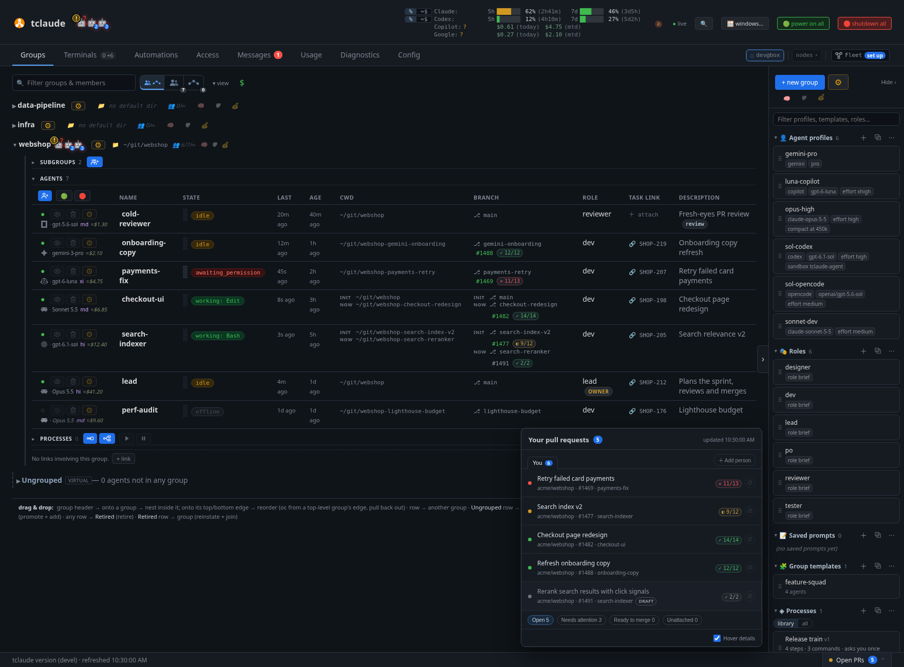

# tclaude

`tclaude` is a self-hosted agentic dev environment: a Go CLI plus daemon that
wraps vendor coding CLIs ("harnesses") in tmux and adds the operations layer
for running many agents seriously — durable sessions, conversation history
and search, an operations dashboard, agent-to-agent mail, teams, identity and
permissions with audit, sandboxing, and automation.



*The operations dashboard watching a mixed-harness fleet*

Six harnesses are supported behind one workflow: Claude Code, OpenAI Codex
CLI, OpenCode, GitHub Copilot CLI, Google Gemini CLI, and pi. Gemini CLI and pi
support is **beta**: it is new and less battle-tested than the others (see
[Gemini CLI](harnesses.md#gemini-cli) and [pi](harnesses.md#pi)). tclaude records the harness on every
conversation, so listings, resume, lifecycle operations, and the dashboard
route through the correct CLI automatically. Where harnesses expose different
primitives, tclaude reports the difference instead of pretending the
capability exists — see [Harnesses](harnesses.md) for the capability matrix.

Everything beyond solo sessions routes through one daemon, `agentd`: identity,
permissions, audit, spawning, and mail. The daemon is fail-closed — there is
no path around it. For the mental model behind sessions, conversations,
agents, and the daemon, read [Architecture](architecture.md).

!!! tip "New here?"
    Follow the [Learn](learn/index.md) path: short hands-on tutorials from
    your first session onward. The rest of these docs are reference.

## Start with the workflow you need

| Goal | Start here |
|---|---|
| Understand the moving parts | [Architecture](architecture.md) |
| Pick and configure a harness | [Harnesses](harnesses.md) |
| Keep coding sessions alive and move between them | [Sessions](sessions.md) |
| Find or resume past work from any harness | [Conversations](conversations.md) |
| Ask a quick, resumable question from the shell | [Ask](ask.md) |
| Work on branches in parallel | [Worktrees](worktrees.md) |
| Get alerted when an agent needs you | [Notifications](notifications.md) |
| Form agent teams that talk to each other | [Agents and groups](agents-and-groups.md) |
| Keep a short list of what each group does next | [Task boards](taskboard.md) |
| Spawn agents and manage their lifecycle | [Spawning and lifecycle](spawning-and-lifecycle.md) |
| Control what agents may do, and see what they did | [Permissions and audit](permissions-and-audit.md) |
| Deploy whole rosters from templates, on a schedule | [Teams at scale](teams-at-scale.md) |
| Watch the whole fleet from a browser | [Dashboard](dashboard.md) |
| Operate away from the host machine | [Remote](remote.md) |
| Link your instance with colleagues' or your other machines | [Federation](federation.md) |
| Export, snapshot, share or archive an agent's state | [Portable Agent Format](paf.md) |
| Confine what agents can touch | [Sandboxing](sandboxing.md) and [network filtering](network-filtering.md) |
| Give tokenless agents git/GitHub/Linear access | [Proxies](proxies.md) |
| Run enforced multi-step workflows | [Processes](processes.md) |
| Share a workflow as a file | [Portable Workflow Format](pwf.md) |
| Status bars, usage reports, DB inspection | [Utilities](utilities.md) |

## Platform support

| Platform | Support |
|---|---|
| Linux | Supported |
| macOS | Supported |
| WSL | Supported as Linux, with some window-focus limitations |
| Native Windows | Not supported |

tmux is required for session management. You also need at least one harness
CLI installed and authenticated: Claude Code, Codex CLI, OpenCode, Copilot
CLI, Gemini CLI (beta), or pi. On Linux, tclaude's sandbox, the default for new
installs, also needs `bubblewrap`.

## Installation

Installing tclaude has two parts: install the binary, then run setup. Setup
is required because hooks provide live status and notifications, and because
the local protocol and statusline integration is not part of the binary
itself.

### 1. Install the binary

There are three ways to install tclaude. They differ mostly in how it is
updated later; [Keep tclaude updated](#5-keep-tclaude-updated) covers that.

=== "From source"

    Requires Go 1.27+ and tmux:

    ```bash
    go install github.com/tofutools/tclaude@latest
    ```

    The daemon is built into that binary as `tclaude agentd serve`. It also
    ships as a standalone `tclaude-agentd` binary, which is a separate
    package path and therefore a separate install:

    ```bash
    go install github.com/tofutools/tclaude/cmd/tclaude-agentd@latest
    ```

    From a source checkout, `go install . ./cmd/...` installs both at once,
    plus the `tclaude-hub` [federation](federation.md) relay.

    **Updates:** tclaude's own updater, once you opt in. `go_install`
    rebuilds a `go install` build at the new release. `source_checkout`
    fetches your checkout and rebuilds it, at the release tag or following a
    branch such as `main`.

=== "Release binary"

    Download a Linux amd64/arm64 or macOS arm64 archive from the
    [Releases page](https://github.com/tofutools/tclaude/releases), extract
    it, and move `tclaude` onto your `PATH`. Each binary and platform gets
    its own archive, named after the build that produced it: take a
    `tclaude-no-cgo_linux_*` or `tclaude-darwin_*` archive for the CLI, and
    the matching `tclaude-agentd-*` one if you also want the standalone
    daemon. The two are never packed together, so put both binaries on your
    `PATH` — that is how the daemon finds `tclaude`.

    **Updates:** tclaude's own updater, once you opt in. `release` downloads
    the new archives and checks them against the release's SHA-256
    checksums.

=== "Homebrew"

    On macOS or Linux:

    ```bash
    brew install tofutools/tap/tclaude
    ```

    The formula installs tmux and builds tclaude from source. It builds only
    the `tclaude` binary; if you also want the standalone `tclaude-agentd`
    daemon, add it through the Go or prebuilt path.

    **Updates:** `brew upgrade tofutools/tap/tclaude`. tclaude never writes
    into Homebrew's Cellar. It can tell you when a release is out, or run
    `brew upgrade` for you if you allow it.

**Other methods.** tclaude also recognizes installs owned by Nix, mise, asdf,
dpkg (apt) or rpm (dnf). Like Homebrew, the package manager updates those.

### 2. Run setup

For the standard integration plus the coordination skills and permissions
most users want:

```bash
tclaude setup --install-agent-skills --install-default-agent-permissions
```

The baseline setup (always runs):

- checks for tmux;
- installs Claude Code hooks in `~/.claude/settings.json` and offers the
  command-backed Claude Code status bar;
- when Codex is on `PATH`, offers Codex hooks and a curated Codex status
  line — no flag needed on a machine that has Codex;
- when Copilot CLI is present, offers enabling its copy-on-select clipboard
  bridging;
- when Gemini CLI is on `PATH`, installs its hooks in `~/.gemini/settings.json`
  and offers its alternate-screen renderer so the mouse wheel scrolls;
- registers the `tclaude://` protocol handler on WSL for clickable
  notifications; and
- asks once, on first run only, whether desktop notifications should be
  enabled.

`tclaude setup --harness codex` installs or repairs Codex hooks explicitly
(useful for scripted installs); the flag accepts any harness with a hook
installer (`claude`, `codex`, `copilot`, `gemini`). OpenCode has no hook
installer, pi needs none (tclaude loads its own extension per launch), and the baseline already installs hooks for every hook-capable
harness found on `PATH`. See [Harnesses](harnesses.md) for per-harness setup details.

Optional extras are additive and idempotent:

| Flag | Adds |
|---|---|
| `--install-agent-skills` | Bundled skills (`agent-*`, `human-*`, `process-templates`, `process-runs`, `taskboard`, `present-pr-to-operator`, `reincarnate`, `tclaude-setup`, `tclaude-fleet`) for every coding harness through Claude Code, shared `~/.agents/skills`, and Codex home directories |
| `--install-proxy-skills` | Skills for the configured [credential proxies](proxies.md) (`proxy-git`, `proxy-linear`, `proxy-awb` and `proxy-http`); not included by `--install-all` |
| `--install-utility-skills` | Optional utility skills from the repo's `skills/` directory, such as `demo-recording` (record a narrated demo video of a feature built end to end and send it to the operator); not included by `--install-all` |
| `--install-default-agent-permissions` | Low-risk permission slugs the bundled skills exercise, as agent defaults in `~/.tclaude/data/config.json` |
| `--install-sandbox-hardening` | Append-only sandbox and deny entries in `~/.claude/settings.json` that protect agentd's private state |
| `--install-resume-threshold-override` | A `claude_resume.threshold_minutes` override that suppresses Claude Code's interactive resume-from-summary prompt for scripted resumes |
| `--install-all` | All standard extras above, excluding `--install-proxy-skills` and `--install-utility-skills` |

Proxy skills require explicit opt-in even under `--install-all`, so agents
are not shown proxy capabilities on installations where those services are
not configured. Utility skills are opt-in too: they are workflows you choose
to give your agents, not part of the baseline.

To prepare hooks before installing the harness CLIs, add `--all-harnesses`.
It creates missing configuration directories for every harness with a hook
installer (Claude Code, Codex, Copilot and Gemini CLI); `--install-all` alone
keeps the usual harness detection. Codex hook trust still needs its CLI:
after installing Codex, rerun `tclaude setup --harness codex -y` to grant it.

```bash
tclaude setup --install-all --all-harnesses -y
```

!!! note "Skills do not start the daemon"
    The extras install skills and permissions. To use `tclaude agent`, also
    start the daemon; see [Run the daemon](#3-run-the-daemon).

Verify the installation whenever you upgrade or change harness versions:

```bash
tclaude setup --check
tclaude setup --check --harness codex
```

### 3. Run the daemon

Everything beyond solo sessions goes through the daemon, `agentd`. Start it
in a terminal outside any sandbox. There are four ways to keep it running:

- **In a terminal.** `tclaude agentd serve` runs in the foreground and stops
  when you close the terminal or log out. Good for trying tclaude out.
- **Start on login.** **Config › Installation › Start automatically** in the
  dashboard has **Start on login…**, or run `tclaude service install` while
  agentd is running. It writes a systemd user unit (Linux) or a LaunchAgent
  (macOS) that runs agentd with the flags it runs with now, and takes effect
  at your next login. Agents keep running when the unit restarts agentd. On
  Linux, agentd also stops at logout unless lingering is on, which needs
  root; `tclaude service install` prints the `sudo loginctl enable-linger`
  command to run.
  See [systemd](server/systemd.md#let-tclaude-write-the-unit) and
  [launchd](server/launchd.md).
- **App launcher.** `tclaude service launcher install` adds tclaude to your
  desktop's app menu (a `.desktop` entry on Linux, `~/Applications/tclaude.app`
  on macOS). Picking it starts agentd if it is not running, through the login
  unit when there is one, and opens the dashboard. Without a unit it runs
  `tclaude agentd serve` with the launch profile's flags, or by default
  `--persist-operator-token --dashboard-port=<port> --no-print-human-token`
  (the running daemon's fixed port, or 7878); `install --serve-args "…"`
  sets your own. To sign you in, it needs a persisted operator token, in the file or
  the keychain (see [The operator token](#4-the-operator-token)).
  `tclaude service launcher status` and `install` warn when the running
  daemon's token is not persisted, or when the launcher's flags lack
  `--persist-operator-token`. See
  [App launcher](dashboard-config.md#app-launcher).
- **A service on a server.** For a headless machine, see
  [Running tclaude on a server](server/index.md).

**Recommended flags.** For a daemon that starts on its own, use a fixed port
and a persisted token:

```bash
tclaude agentd serve --dashboard-port 7878 --persist-operator-token --no-print-human-token
```

| Flag | Config key | What it does |
|---|---|---|
| `--dashboard-port 7878` | `agent.dashboard_port` | A fixed dashboard port, so bookmarks and SSH tunnels keep working. The default picks a new free port each start. A port already in use fails startup. |
| `--persist-operator-token` (`-p`) | `agent.persist_operator_token` | Keeps the same operator token across restarts, in a 0600 file the CLI reads itself. The default mints a new one each start. |
| `--persist-operator-token-keychain` | `agent.persist_operator_token_keychain` | Keeps it in the OS keychain instead of the file. Terminal commands do not read the keychain; only the app launcher does. |
| `--no-print-human-token` | | Does not print the token at startup. It is still minted and accepted. The default, `--print-human-token=auto`, prints it only when stdout and stderr are terminals. Never use `always` under a supervisor: it writes the token to the journal or log file. |
| `--no-tray` (`-n`) | `agent.disable_tray` | No system tray icon, for headless hosts. On a desktop, the tray's **Open dashboard** is a way in that needs no token. |
| `--dashboard-bind <host>` | `agent.dashboard_bind` | Also serves the dashboard on another interface. The default is loopback only. Its only gate is a cookie plus the operator token, so bind only to a network you trust; see [Operating remotely](remote.md). |

The config keys are set in **Config › Daemon & network** and apply however
agentd is started. To pin the flags and environment that the login unit and
the app launcher start agentd with, set a **launch profile** in **Config ›
Installation** (**Use what's running now** fills it from the running daemon),
or with `tclaude service launch`. See
[Launch profile](server/systemd.md#launch-profile).

### 4. The operator token

The operator token (`tclo_…`) is how agentd knows that a command comes from
you, the operator, and not from an agent. The daemon mints it at startup.
Sandboxed agents cannot read your environment or `~/.tclaude/data`, and a
caller running under a harness is never treated as you, even if it has the
token.

**When you need it:**

- for `tclaude agent dashboard` and every other operator command you run in
  a terminal, such as granting permissions, `tclaude service` and
  `tclaude update`;
- to sign in in a browser without a one-time link: a bookmark, another
  browser, or an expired link shows a sign-in page that asks for it;
- for the [TUI dashboard](dashboard.md#the-tui-dashboard) against a running
  daemon (`tclaude agent tui-dashboard --connect-to …`), which takes
  `--operator-token`, reads it over ssh with `--remote-operator-token`, or
  uses the local one;
- for the dashboard on another machine, over `--dashboard-bind` or an SSH
  tunnel.

You don't need it for the tray's **Open dashboard**, for
`--auto-launch-dashboard`, or for `tclaude agentd serve --tui`, which shows it
inside the UI.

**How to get it:**

- **From the startup banner.** In a terminal, `tclaude agentd serve` prints
  `export TCLAUDE_HUMAN_TOKEN="tclo_…"`. Run that line in the shell you work
  in. The CLI uses `TCLAUDE_HUMAN_TOKEN` before anything else.
- **From the file.** With `--persist-operator-token`, the token is in
  `~/.tclaude/data/operator_token` (mode 0600). The CLI reads it there when
  `TCLAUDE_HUMAN_TOKEN` is not set, so you need not export anything.
  `cat ~/.tclaude/data/operator_token` prints it for a browser sign-in.
- **From the keychain.** With `--persist-operator-token-keychain`, it is
  stored under service `tclaude`, account `operator_token`. Export it
  yourself:

    ```bash
    # macOS: the entry holds "go-keyring-base64:" plus the token in base64
    export TCLAUDE_HUMAN_TOKEN="$(security find-generic-password -s tclaude -a operator_token -w \
      | sed 's/^go-keyring-base64://' | base64 -D)"
    # Linux (Secret Service)
    export TCLAUDE_HUMAN_TOKEN="$(secret-tool lookup service tclaude username operator_token)"
    ```

    If the keychain cannot be reached, agentd logs an error and uses a fresh
    token for that run.

Once the CLI has the token, `tclaude agent dashboard` opens the dashboard
already signed in, through a one-time link that expires in about a minute.
`--print` prints the link instead.

**Rotating it.** Without persistence, restarting agentd mints a new token.
With the file, delete `~/.tclaude/data/operator_token` and restart agentd;
with the keychain, delete the `tclaude` / `operator_token` entry and restart.
Then export the new token wherever you exported the old one.

### 5. Keep tclaude updated

tclaude's updater is opt-in. Nothing updates on its own until you choose an
update method and turn on a schedule or updating when agentd starts. Set it
in **Config › Installation › Updates**, or with the CLI:

```bash
tclaude update config show                  # how tclaude was installed, and the method it recommends
tclaude update config set method release    # or go_install, source_checkout, …
tclaude update config set schedule daily    # or weekly, with weekday and window
tclaude update config set update-on-start true
tclaude update config set post-setup on     # rerun tclaude setup with the new version
tclaude update --dry-run                    # test the saved method; installs nothing
tclaude update --apply                      # update now
```

The Updates part has the same Check now, Test method and Update now
buttons.

An update replaces the binaries, checks that they report the expected
version, and restarts agentd gracefully. Agents keep running in tmux.
`tclaude update` checks for a release by hand, `--apply` installs it, and
`--rollback` restores the previous binaries. With a schedule, **Wait while
agents are working** (`defer-while-working`) holds a run until your agents
are idle.

**Package-manager installs.** tclaude never writes into a package manager's
tree (`/usr`, `/nix`, a Homebrew Cellar, mise and asdf installs). For those
installs you can:

- update with the package manager yourself, and pick `manual` to have
  tclaude tell you when a release is out;
- let tclaude run the package manager's command (`homebrew`, `nix_profile`,
  `mise`, `apt`, `dnf`), which you confirm with `--confirm-package-manager`;
  `apt` and `dnf` need passwordless `sudo -n`;
- install tclaude's own build next to it, in `~/.local/bin` by default, after
  acknowledging that the package manager still owns its copy. Untrack that
  copy, or put `~/.local/bin` first on `PATH`.

[How tclaude updates itself](federation-admin.md#how-tclaude-updates-itself)
covers detection, every method, the schedule and rollback.

## First session

Run bare `tclaude` in a project directory to start your default harness in a
session (`tclaude --harness codex` picks another). [Sessions](sessions.md) covers starting, detaching, watching and
reattaching. To work from the dashboard instead, follow the
[Learn path](learn/index.md).

## Quick questions from the shell

`tclaude ask` runs a harness in the foreground — no tmux session — prints
the answer, and returns control to your shell. The thread continues per terminal
and working directory, and piped input is attached as context:

```bash
tclaude ask "explain the data flow in this package"
git diff | tclaude ask "what correctness risks do you see?"
tclaude ask --new "start a fresh topic"
tclaude ask -i "help me refactor this interactively"
```

All six agent harnesses support ask. The [Ask guide](ask.md) covers continuity,
capture safety, and how the harness is chosen.

## Operate a fleet

Solo sessions work without the daemon. For anything multi-agent (groups,
messaging, spawning, permissions, the dashboard), run `tclaude agentd serve`
in a non-sandboxed terminal. The tutorial
[Run a team through a lead](learn/team-lead.md) walks through it step by step.
The reference starts at [Agents and groups](agents-and-groups.md).

Use `tclaude <command> --help` for the live flag reference; these guides
focus on workflows and the behavior that is easy to miss from help text.
