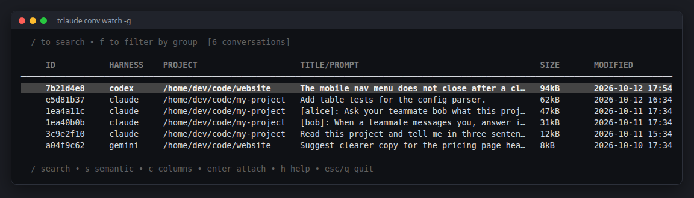

# Find and resume your work

In [Your first agent](first-agent.md) you stopped an agent, but its
conversation was kept. Here you find that conversation again, continue it,
and learn a lighter way to ask quick questions without starting a session.

**You need:** at least one finished conversation, for example `alice`'s from
[Your first agent](first-agent.md).

## 1. List your conversations

From the same project directory:

```bash
tclaude conv ls
```

This lists the conversations started in this project, newest first. tclaude
indexes the transcripts of every harness in one list, so Claude Code, Codex
and other conversations appear side by side, each tagged with its harness.

To see conversations from every project:

```bash
tclaude conv ls -g
```

## 2. Browse them interactively

```bash
tclaude conv watch -g
```

This is a searchable picker over the same list. Press **/** and type part of
your first prompt (for example `three sentences`) to filter, then press
**Enter** to leave the filter box. Pick the conversation with the arrow keys
and press **Enter** again: tclaude starts a new session that continues it.
Detach with **Ctrl+B D** as before.

<!-- Regenerate the images on this page with scripts/docs/learn-images.sh -->


!!! info "Go deeper"
    [Conversations → Watch mode](../conversations.md#watch-mode) lists every
    key, including worktree creation and semantic search.

## 3. Search and resume from the shell

When you remember a word but not where you used it:

```bash
tclaude conv search -g "three sentences"
```

Each match starts with the first eight characters of its conversation id.
Those eight characters are enough to resume it:

```bash
tclaude conv resume -g <conv-id>
```

`-g` looks the id up across all projects, so this works from any directory.
Without it, `conv resume` only looks in the current project. You never say
which harness to use. tclaude recorded it when the
conversation started and relaunches through the same one, in the
conversation's own project directory.

!!! info "Go deeper"
    [Conversations → Searching](../conversations.md#searching) covers
    full-transcript search and time filters.
    [Resuming](../conversations.md#resuming) explains what a resume carries
    over.

## 4. Ask a quick question without a session

Not every question needs a session. `tclaude ask` runs the harness, prints
the answer and returns to your shell:

```bash
tclaude ask "what does the main function in this project do?"
```

Ask again from the same terminal and directory, and it continues the same
thread:

```bash
tclaude ask "and where is it tested?"
```

Piped input is attached to the question:

```bash
git diff | tclaude ask "spot correctness risks in this diff"
```

Start a fresh thread with `-n`:

```bash
tclaude ask -n "new topic: summarize the README"
```

!!! info "Go deeper"
    [Ask](../ask.md) covers thread continuity, choosing the harness and
    model, and using ask in scripts.

## What you learned

- `tclaude conv ls`, `conv watch` and `conv search` find past conversations
  across every harness.
- `tclaude conv resume` continues one through the harness that recorded it.
- `tclaude ask` answers quick questions without a session, and keeps a thread
  per terminal and directory.

**Next:** [Your first agent team](first-team.md).
