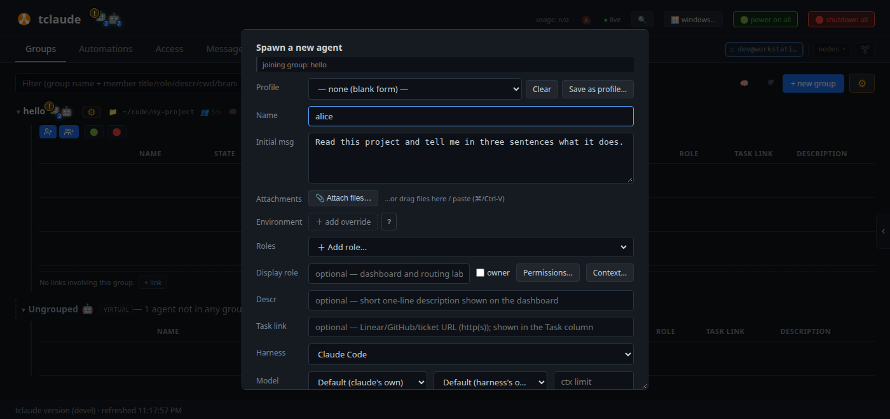
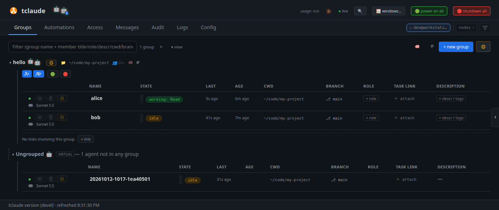

# Your first agent

In this tutorial you create a group, start an agent in it from the
dashboard, give it work, and watch it. You also open its terminal, message
it, and stop and wake it.

**You need:** [Get started](get-started.md) completed: the daemon running and
the dashboard open. You also need a project directory to work in: any git
repository you are happy to experiment in. The examples use
`~/code/my-project`.

## 1. Create a group

Agents live in **groups**. A group is a team with a shared working
directory. In **Groups**, click **+ new group** at the top right:

- **Name**: `hello`;
- **Workspace**: **Use existing directory**, and set **Directory** to
  `~/code/my-project`. Agents you start in this group will work there.

Click **Create group**. The group appears, empty.

!!! info "Go deeper"
    [Dashboard → Creating a group workspace](../dashboard.md#creating-a-group-workspace)
    shows how to clone a repository for a group instead.

## 2. Start an agent

Under the group's name, click the blue spawn button (a person with a plus
sign). The spawn dialog opens, joining `hello`, with the group's directory
as the agent's working directory. Set:

- **Name**: `alice`;
- **Initial msg**: `Read this project and tell me in three sentences what it does.`

<!-- Regenerate the images on this page with scripts/docs/learn-images.sh -->


Leave the rest at its defaults: your default harness and model. To use
another harness, pick it under **Harness**. Click **Spawn**.

**Auto focus** is on by default, so the agent's terminal opens in the
**Terminals** tab. The first time a harness runs in a directory, it asks
whether you trust it. Answer in that terminal. Until you do, the agent waits
in the **Pending spawns** list in **Groups**; its **focus** button opens the
same terminal.

!!! info "Go deeper"
    [Dashboard → The spawn dialog](../dashboard.md#the-spawn-dialog) lists
    every field.

## 3. Watch it work

Go back to **Groups**. `alice` has a row in `hello`:



Your group shows only `alice` for now; the next tutorial adds `bob`. Read the
row from left to right:

- the **status dot**: `●` online, `○` offline;
- the **harness line**: which harness and model the agent runs, and what it
  has cost so far;
- the **Name**;
- the **State** pill: `working` while the agent thinks, `idle` when it waits,
  and `awaiting_permission` or `awaiting_input` when it needs an answer from
  you. A small meter beside it shows how full the context window is;
- **CWD** and **Branch**: where the agent works, with PR and CI status once
  it opens a pull request.

!!! info "Go deeper"
    [Dashboard → The member row](../dashboard.md#the-member-row) explains every
    column, and the [badge glossary](../dashboard.md#badge-glossary) every pill.

## 4. Open its terminal

Click the row's **focus** button (the eye). It takes you to `alice`'s live
terminal in **Terminals**. This is the real session, not a copy: the agent's
answer is there, and what you type reaches the agent. Ask a follow-up
question.

Use focus whenever you want to see an agent or answer it. Ctrl/Cmd-click
opens the terminal without leaving **Groups**.

## 5. Send it a message

In the terminal pane, click **✉ Message** (Ctrl/Cmd+M). This queues a
message for the agent rather than typing into its terminal, so it never
interrupts what the agent is typing. Send:

> When you are done, list the three files you would read first.

The message lands in the agent's inbox and appears in its terminal.

## 6. Stop and wake it

Back in **Groups**, click `alice`'s status dot `●` and choose **Soft exit**.
The agent stops, and its conversation is kept. Click the dot again, now `○`,
to wake it: it resumes the same conversation.

## From the terminal

Everything above has a CLI equivalent, for scripts:

```bash
tclaude agent groups create hello --descr "my first team"
tclaude agent spawn hello --name alice \
  --initial-message "Read this project and tell me in three sentences what it does."
```

[Spawning and lifecycle](../spawning-and-lifecycle.md#spawning-an-agent)
covers the spawn options.

!!! note "Native terminal windows"
    The agent's **⚙** menu also has **term**, **web term**, **open window**
    and **web window**. They are for people who run agents in native terminal
    windows (`dashboard.default_terminal` set to `"native"`) and sometimes
    want a browser terminal. See
    [Zooming into a terminal](../dashboard.md#zooming-into-a-terminal).

## What you learned

- **+ new group** creates a team with a working directory.
- The spawn button on a group starts an agent with a first task.
- A row shows the agent's status, model, cost and context.
- **focus** opens the agent's live terminal; **✉ Message** writes to it.
- The status dot stops and wakes an agent.

**Next:** [Your first agent team](first-team.md).
