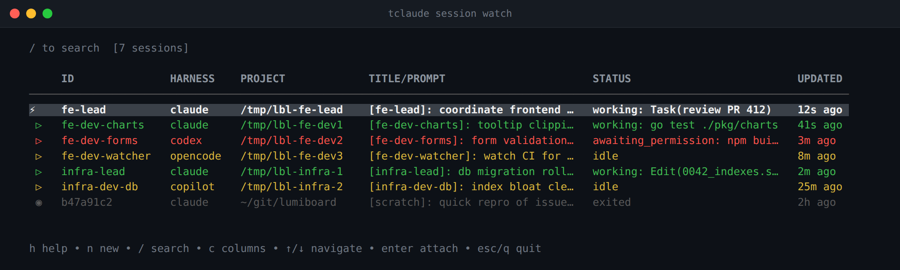

# Your first session

In this tutorial you run a coding agent inside tclaude, leave it working in
the background, and come back to it. That covers what tclaude does for
a single agent: the agent keeps running when you close the terminal, and you
can always find it again.

**You need:** tclaude [installed](../index.md#installation) and one harness
CLI logged in. See [Before you start](index.md#before-you-start).

## 1. Run setup

Setup installs the hooks that tell tclaude what your agent is doing
(working, idle, waiting for you). Run it once:

```bash
tclaude setup
```

It installs hooks for Claude Code and for any other harness it finds on your
`PATH`, and asks about a few optional integrations. Accept the defaults. Then check the result:

```bash
tclaude setup --check
```

Setup has optional extras (agent skills, default permissions, sandbox
hardening). You don't need them yet; the team tutorials add them when they
become useful.

!!! info "Go deeper"
    [Installation → Run setup](../index.md#2-run-setup) lists every setup
    option.

## 2. Start a session

Go to a project directory, any git repository you are happy to experiment in,
and run bare `tclaude`:

```bash
cd ~/code/my-project
tclaude
```

Your harness opens as it normally would, but now it runs inside tclaude's
own tmux server. That running instance is a **session**.

Give it a small task, for example:

> Read this project and tell me in three sentences what it does.

Using another harness? Start it the same way with `--harness`:

```bash
tclaude --harness codex      # or opencode, copilot, gemini
```

!!! info "Go deeper"
    [Sessions → Launching a session](../sessions.md#launching-a-session)
    covers labels, other directories and the default harness choice.

## 3. Detach and let it work

While the agent is still answering, press **Ctrl+B**, then **D**. You are
back in your shell, and the agent keeps working in the background. You can
even close the terminal.

## 4. See what is running

```bash
tclaude session watch
```

This opens a live table of your sessions. Each row shows its status:
`working` while the agent thinks, `idle` when it waits for you, and
`awaiting_permission` or `awaiting_input` when it needs an answer from you.
These are the statuses that setup's hooks report.

Use the arrow keys to select your session and press **Enter** to attach
again. The agent's answer is waiting.



You can also attach directly when you know the session id from
`tclaude session ls`:

```bash
tclaude session ls
tclaude session attach <id>
```

!!! info "Go deeper"
    [Sessions → Watch mode](../sessions.md#watch-mode) lists the keys, and
    [Notifications](../notifications.md) can alert you when an agent needs
    you.

## 5. End the session

Exit the harness the way you normally would (for Claude Code, type
`/exit`). The session ends, but the **conversation**, the transcript of
everything you and the agent said, is kept. The next tutorial shows how to
find it and continue it.

## What you learned

- `tclaude` starts your harness in a session that survives detaching.
- **Ctrl+B D** detaches; `tclaude session watch` finds and reattaches.
- A session is the running process. A conversation is the transcript, and it
  outlives the session.

**Next:** [Find and resume your work](find-and-resume.md).
