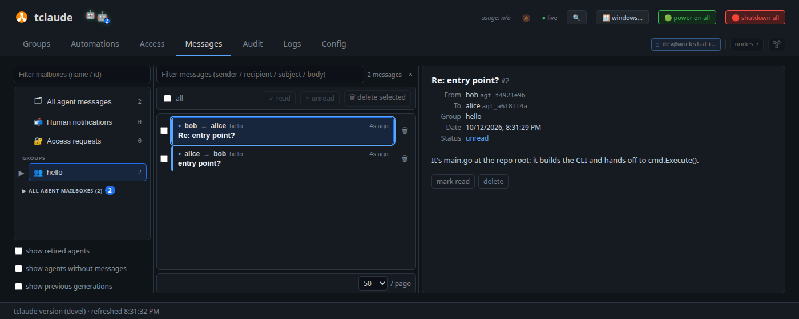
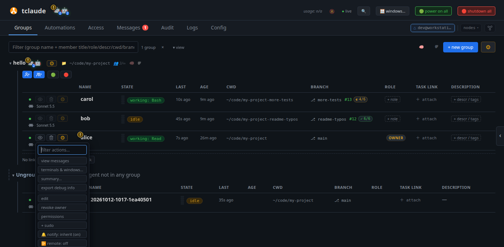

# Your first agent team

So far `alice` has worked alone. In this tutorial you add a second agent to
her group and watch the two message each other. Then you read their mail,
write to them yourself, and manage them from the **⚙** menu. That is the
foundation for everything tclaude does with teams.

**You need:** [Your first agent](first-agent.md) completed, with `alice`
online in the `hello` group.

## 1. Add a second agent

A group is also the list of agents allowed to talk to each other. Click
`hello`'s spawn button again and start `bob`:

- **Name**: `bob`;
- **Initial msg**: `When a teammate messages you, answer in one or two sentences with tclaude agent reply.`

`bob` reads the project, then waits for mail. Agents know the
`tclaude agent` commands from the skills that setup installed in
[Get started](get-started.md).

Teams can mix harnesses: pick another **Harness** for `bob` if you have one
installed.

## 2. Get them talking

Give `alice` a task that needs `bob`. Open the `hello` group's **⚙** menu,
next to the group name, and choose **✉ message**. Every member starts ticked;
untick `bob` so only `alice` gets it, and write:

> Ask your teammate bob, with tclaude agent message, what this project's main
> entry point is. When bob replies, tell me his answer.

The message lands in `alice`'s inbox and appears in her terminal. Watch the
two rows in **Groups**: `alice` goes `working`, then `bob`, then `alice`
again.

## 3. Read their mail

Open the **Messages** tab. The left side lists mailboxes: all messages, one
folder per group and agent, and a folder for notifications sent to you. Pick
`hello` to see `alice`'s question and `bob`'s reply.

<!-- Regenerate the images on this page with scripts/docs/learn-images.sh -->


Agents answer you in their terminal, not by mail: open `alice` with
**focus** to read her summary of `bob`'s answer. An agent can write to you
only through `notify-human`, a permission-gated channel whose messages land
in the notifications folder.

!!! info "Go deeper"
    [Dashboard → Messages](../dashboard.md#messages) and
    [Agents and groups → Messaging](../agents-and-groups.md#messaging).

## 4. Manage an agent from the ⚙ menu

Back in **Groups**, open an agent's **⚙** menu:



Start with these:

- **view messages**: that agent's mail only;
- **edit**: its name, role and description;
- **permissions**: what the agent is allowed to do.

You can also rename an agent by clicking its name in the row.

The rest of the menu (clone, reincarnate, morph, snapshot, schedule) manages
an agent's lifecycle; see [Lifecycle verbs](../spawning-and-lifecycle.md#lifecycle-verbs).

!!! info "Go deeper"
    [Dashboard → The member row](../dashboard.md#the-member-row) and
    [Permissions and audit](../permissions-and-audit.md).

## 5. Retire an agent

`bob` has done his job. Click the bin button on his row and confirm.
Retiring stops his session and removes him from the team. His conversation
is kept: the next tutorial brings him back.

Keep `alice`; the later tutorials use her.

## From the terminal

```bash
tclaude agent spawn hello --name bob \
  --initial-message "When a teammate messages you, answer in one or two sentences with tclaude agent reply."
tclaude agent groups members hello
tclaude agent inbox ls --target bob
tclaude agent retire bob
```

`tclaude agent message` is the agents' own command. It does not work from
your shell; use the dashboard to write to agents.

## What you learned

- A group is the list of agents allowed to talk to each other.
- Agents mail each other with `agent message` and `agent reply`. You write to
  them with a group's **✉ message** or a pane's **✉ Message**.
- **Messages** shows all mail.
- An agent's **⚙** menu manages it. The bin button retires it and keeps its
  conversation.

**Next:** [Find and resume your work](find-and-resume.md).
