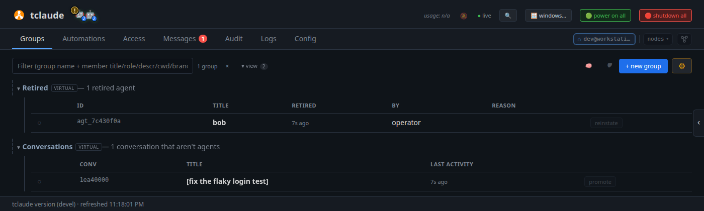

# Keep agents going

A lead like `alice` runs for hours or days. Her context window fills up,
she gets stopped and woken again, and her team needs a nudge now and then.
In this tutorial you keep a long-running agent on track. You watch its
context, schedule check-ins, stop and wake it, give it a fresh session or a
different model, and bring back agents and conversations from earlier.

**You need:** [Run a team through a lead](team-lead.md) completed: `alice`
leading `hello`, and `bob` retired.

## 1. Watch the context

Each row's **State** column has a small meter beside the pill: how full the
agent's context window is. Hover it for the numbers. When it gets high, the
harness compacts the conversation on its own, summarizing it and carrying on,
or you can step in with the actions below.

A compaction can drop the agent's first message, where its identity and
brief live. tclaude sends them again after every compaction: the agent's
name and groups, and the group's startup context from
[Set up your team](team-setup.md). Keep that context up to date, and even a
long-lived lead keeps working the way you want.

!!! info "Go deeper"
    [Dashboard → The context meter](../dashboard.md#the-context-meter) and
    [Agents and groups → Re-injection after compaction](../agents-and-groups.md#re-injection-after-compaction-and-clear).

## 2. Schedule check-ins

A lead waits for mail. If a worker goes quiet, nothing wakes the lead to
notice. A scheduled message does. Open `alice`'s **⚙** menu and choose
**⏰ schedule…**. The dialog targets `alice`. Set:

- **Schedule**: **Interval**, `1h`;
- **Body**: `Check on your workers. Nudge any that have gone quiet, and send the human a notification if one is stuck.`

Click **Create**. Every hour the message lands in `alice`'s inbox. While
she is stopped, the ticks are skipped, so she does not wake up to a pile of
stale reminders.

Agents schedule their own check-ins too: ask `alice` to "check on your
workers every hour" and she sets it up herself. The **Automations** tab →
**Cron jobs** lists every scheduled job, yours and the agents', with edit,
run-now and delete.

## 3. Stop and wake

A stopped agent stays in its group with an empty status dot, `○`. Stop
`alice` from her status dot (**Soft exit**), then click the dot again to
wake her. She resumes the same conversation, through the harness she ran
on, with her groups, permissions and scheduled check-ins.

The two buttons under a group's name act on the whole team: the green one
wakes every stopped member, the red one stops every running one. Stopped
agents are shown by default. If you have hidden them, **▾ view** at the top
of **Groups** has **show offline**.

## 4. Clone or reincarnate

Two actions in an agent's **⚙** menu make a new session from an old one:

- **Clone** forks the agent. The original keeps running, and a sibling,
  `alice-c-1`, starts with a copy of its conversation, groups and
  permissions. Use it to try a second approach in parallel.
- **Reincarnate** replaces the agent. A fresh session with an empty context
  window takes over its identity: agent id, groups, permissions and inbox.
  Use it when the context is full of things the agent no longer needs.

Open `alice`'s **⚙** menu and choose **clone…** under **send elsewhere**.
Pick your own node, marked **(this node)**, and click **Clone here…**. The
clone dialog opens.
Leave **Copy conversation history** ticked, give it a **Follow-up** such as
`List the project's dependencies.`, and click **Clone**. `alice-c-1` appears
next to `alice`. Retire it with its bin button
when you are done.

Now choose **reincarnate** in `alice`'s **⚙** menu. Keep the recommended
**Ask the agent to reincarnate itself**: `alice` writes a handoff for her
successor at her next clean point, then reincarnates. An optional **Focus hint**
tells her what the handoff should cover. Click **Ask agent**. (**Force
reincarnate now** is for an agent that is stuck: it skips the handoff.)

The successor keeps the name `alice`. The replaced session is kept as
`alice-x`: **▾ view** → **show replaced generations**
lists it.


## 5. Change model in place

**Morph** relaunches an agent with a different model, effort or harness. It
keeps the agent's conversation, id, inbox, groups and permissions. The
dashboard morphs into a spawn profile:

1. Save a profile with another **Model** (for example Sonnet), as in
   [Set up your team](team-setup.md#2-save-a-spawn-profile). Name it
   `sonnet`.
2. Open `alice`'s **⚙** menu → **morph…**, and pick `sonnet` under
   **Profile**.

The dialog previews the change, **was** and **now**, before anything
happens. A profile for another harness moves `alice` there: tclaude
translates her conversation, and the preview says what the history keeps
and loses.

Click **Morph at next idle turn**. If `alice` is busy, the morph waits until
she is idle (within 30 minutes, or the request lapses), and her row shows a
**⇢ morph** badge beside the state pill. Tick **now** to stop her at once
instead.

!!! info "Go deeper"
    [Spawning and lifecycle → morph](../spawning-and-lifecycle.md#morph)
    covers everything a morph changes and keeps, and
    [Harnesses → Cross-harness history translation](../harnesses.md#cross-harness-history-translation)
    what a harness move carries.

## 6. Bring back earlier work

Retired agents and past conversations are kept. Open **▾ view** and tick
**show retired** and **show conversations**. Two blocks appear at the
bottom of **Groups**:

<!-- Regenerate the images on this page with scripts/docs/learn-images.sh -->


- **Retired** lists retired agents. **reinstate** makes `bob` an agent
  again, in **Ungrouped**. Drag his row onto `hello` and click his status
  dot to wake him. His old permissions do not come back.
- **Conversations** lists recent sessions that never became agents, for
  example a `tclaude` session in a directory no group uses. (A session
  started in a group's directory joins that group automatically.)
  **promote** turns one into an agent, which you then drag onto a group and
  wake.

With many agents, type in the filter box at the top of **Groups**. It
matches group names and each agent's name, role, description, directory and
branch.

!!! info "Go deeper"
    [Spawning and lifecycle → retire, reinstate, delete](../spawning-and-lifecycle.md#retire-reinstate-delete)
    and [Promote](../spawning-and-lifecycle.md#promote).

## From the terminal

The CLI has a few things the dashboard does not: compacting on demand,
morphing without a profile, undoing a morph, and searching inside past
conversations.

```bash
tclaude agent context-info -g hello           # context of every member
tclaude agent compact -t alice "Continue where you left off."
tclaude agent clone -t alice "List the project's dependencies."
tclaude agent reincarnate -t alice "Summarize how this project is structured."
tclaude agent morph alice --model sonnet --dry-run
tclaude agent morph alice --back              # undo the last morph
tclaude agent cron ls                         # scheduled jobs
tclaude conv search -g "flaky login"          # search inside every conversation
tclaude conv resume -g <conv-id>              # continue one in a new session
```

`conv resume` relaunches through the harness that recorded the
conversation, in its own project directory.
[Lifecycle verbs](../spawning-and-lifecycle.md#lifecycle-verbs) and
[Conversations](../conversations.md) cover these commands.

## What you learned

- The context meter shows how full an agent's window is. After a
  compaction, tclaude re-sends the agent's identity and the group's startup
  context.
- **⏰ schedule…** sends an agent a message on a schedule. **Automations** →
  **Cron jobs** lists every job.
- The status dot stops and wakes an agent; the group's buttons do it for
  the whole team.
- **Clone** forks a sibling, **reincarnate** replaces the agent with a
  fresh session that keeps its identity, and **morph** changes model,
  effort or harness in place.
- **▾ view** shows retired agents (**reinstate**) and past conversations
  (**promote**).

**Next:** [Work in parallel with worktrees](parallel-worktrees.md).
