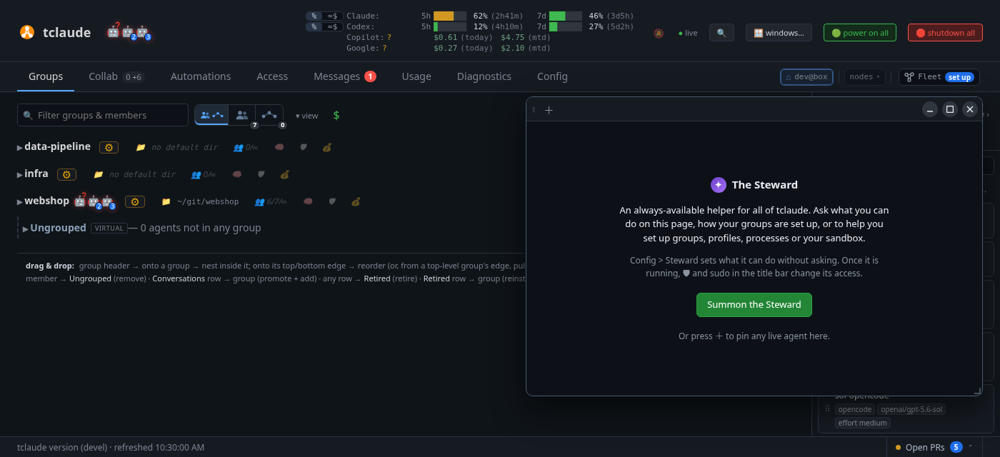
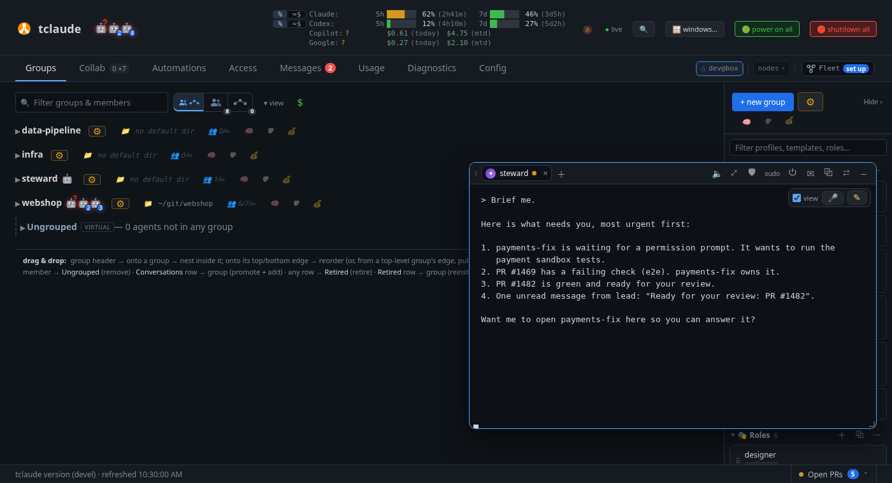
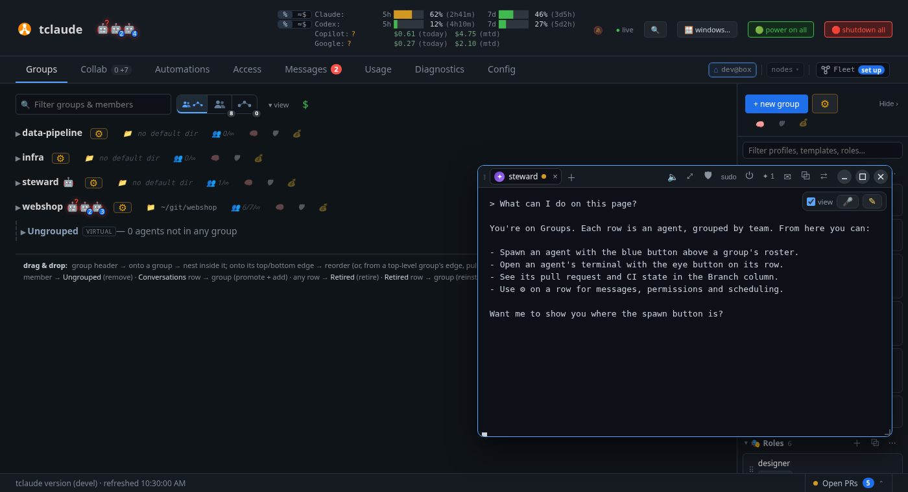

# Ask the Steward

In this tutorial you turn on the Steward, a helper agent that knows tclaude and
can see your fleet. You ask it what needs you, and let it help with setup. It is
optional, and the feature is experimental.

**You need:** [Your first agent](first-agent.md) completed.

## 1. Turn on Collab

The Steward is part of **Collab**, which is off by default.

1. Open **Config**, then **🧪 Experimental**.
2. Turn on **Collab**, and click **Save changes…**.

You don't need to restart. On the next refresh, the **Terminals** tab becomes
**Collab**, and a **✦ Steward** pill appears at the bottom right of every tab.

## 2. Summon it

Click **✦ Steward**, then **Summon the Steward**. It starts as an agent in a
floating window, the **companion**, so it stays with you as you move between tabs.

Or make an agent you already have the Steward: **✦ make Steward…** in its ⚙ menu.
[Making another agent the Steward](../companion.md#making-another-agent-the-steward)
says what changes.

The window has a real terminal, so you type to the Steward as you would to any
agent. Move the window by its title bar, drag it to a screen edge to snap it, and
press **Ctrl+.** to minimize it or bring it back.

## 3. Ask what needs you

Type:

> Brief me.

The Steward lists what's waiting for you, most urgent first: approvals, questions,
failed turns, pull requests and unread messages. It can open a waiting agent right
in your companion window.

Try asking about the page you're on, such as:

> What can I do on this page?

It can see which view you're on, and it can ring a control to show you where it is.
It only points, and never presses anything for you.

Keep asking. The Steward knows tclaude's docs and your setup, so you can learn the
product by talking to it instead of reading about it.

## 4. Let it do something

Ask it for something it needs permission for:

> Help me set up a default profile for my group.

The Steward looks at your setup first, then shows you a plan. When it needs access
it doesn't have, a card appears in its tab with **Approve** and **Deny** and a
countdown. If you don't answer in time, the request is declined. Nothing changes
until you approve it.

Give it an idea and it can do more:

> I want to add a health check endpoint. Get someone on it.

It restates the idea, asks what it can't find out itself, and writes a brief. Once
you approve, it starts a worker and follows the work through to a pull request. When
it needs your taste, it sends a **decision**: a question with one button per option.

## What you learned

- **Collab** under **Config › Experimental** turns on the Steward and the companion.
- **✦ Steward** summons it; **Ctrl+.** opens and hides the window.
- "Brief me" tells you what needs you.
- The Steward asks before it acts, and you approve in the dashboard.

!!! info "Go deeper"
    [Companion and Steward](../companion.md) covers the window, decisions, voice,
    and what the Steward may do without asking. [Boards](../boards.md) are shared
    drawing boards for you and your agents.

**Next:** [Set up your team](team-setup.md).
