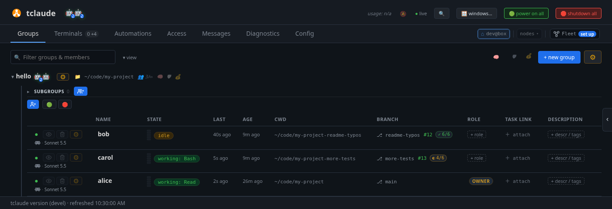
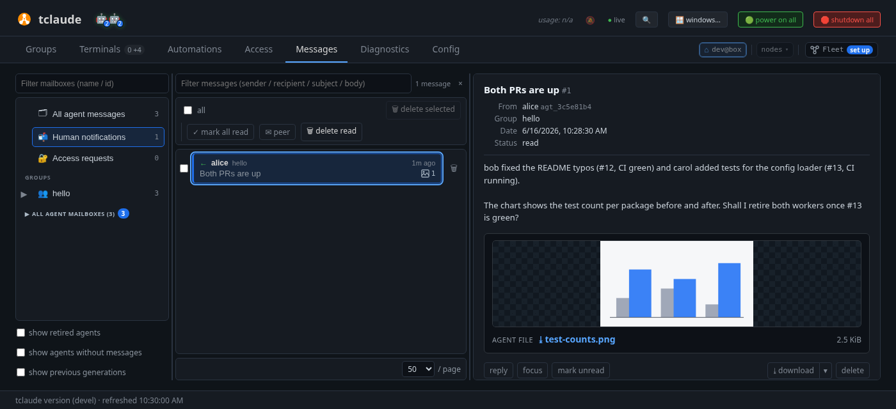

# Run a team through a lead

One agent at a time works, but you stay the one who splits the work,
starts each agent, passes messages between them and cleans up after. A
**lead** takes that job: you give one agent the whole task, and it starts
**workers**, hands each a piece, collects their results and retires them
when they are done. You talk to the lead and watch the rest.

In this tutorial `alice` becomes the lead of `hello` and runs two workers.
You follow the team's mail, see their pull requests on the dashboard, and
get a notification from `alice` when the work is ready.

**You need:** [Set up your team](team-setup.md) completed: `alice` in
`hello`, the group's startup context, and the `worker` profile.

## 1. Make alice the group owner

A lead needs permission to start, stop and retire agents in its group.
Group **ownership** gives exactly that, and only for that group. It also
lets the owner send you notifications.

In **Groups**, open `alice`'s **⚙** menu and choose **make owner**. An
`OWNER` badge appears in her **Role** column.

Without ownership, an agent that tries to start another agent is refused,
or asks you first (see step 6). To start a lead directly, tick **owner** in
the spawn dialog, or set **Group owner** to on in its spawn profile.

## 2. Give the lead a task

Open `alice` with **focus** (the eye) and click **✉ Message**. Send:

> You lead the hello group. Start two workers with the worker profile, bob
> and carol, each in its own git worktree. Ask bob to fix the typos in
> README.md and carol to add tests for the config loader, each in a pull
> request. When both pull requests are up, send me a notification with a
> summary, and retire the workers once I agree.

Adapt the two tasks to your project. Agents know the `tclaude agent`
commands from the skills that setup installed, so `alice` needs no further
instructions.

## 3. Watch the team

Back in **Groups**, `bob` and `carol` appear in `hello` as `alice` starts
them. Each works in its own worktree and branch, so they do not get in each
other's way:

<!-- Regenerate the images on this page with scripts/docs/learn-images.sh -->


The workers got the group's startup context and `alice`'s task when they
started. You can focus or message any of them, as with `alice`.

## 4. Read their mail

Open the **Messages** tab. The left side lists mailboxes: all messages, one
folder per group and agent, your notifications, and access requests. Pick
`hello` to see `alice`'s tasks and the workers' replies.


To write to every agent in a group at once, use the group's **⚙** menu →
**✉ message**. For a single agent, the pane's **✉ Message** is quicker.

## 5. Follow the pull requests

When a worker opens a pull request on its branch, the **Branch** column
shows it next to the branch: a PR pill (`#12`) colored by state, and a CI
pill such as `✓ 6/6` or `◐ 4/6` while checks still run. Hover over either
for the list of checks, with links to GitHub.

Agents can also put a pull request on their row on purpose, with
`tclaude agent present-pr`, for example one opened from another
directory. **Open PRs**, at the bottom right, lists the pull requests open
under your GitHub account, with the agent working on each.

The pills need the [GitHub CLI](https://cli.github.com/) (`gh`) installed
and logged in.

## 6. Answer the lead

When both pull requests are up, `alice` sends you a **notification**. A `!`
appears on her name in **Groups**, and **Messages** shows a count. Open
**Messages** → **Human notifications**:



Agents attach files to notifications, such as screenshots, mockups or
reports. Images show as previews; click one to zoom. **reply** answers the
agent, and **focus** opens its terminal.

Agents that are not owners need permission to notify you. Without it, they
ask: the request lands in **Access requests**, where you approve or deny
it. **Always allow** saves the answer for that agent.

Reply to `alice` that she can retire the workers once the pull requests
are merged. She retires them herself.

## 7. Manage agents from the ⚙ menu

You can manage any agent yourself too. In **Groups**, open an agent's **⚙**
menu:


Start with these:

- **view messages**: that agent's mail only;
- **edit**: its name, role and description;
- **permissions**: what the agent is allowed to do.

The bin button on a row retires that agent. Retiring stops its session and
removes it from the team, and keeps its conversation: the next tutorial
shows how to bring a retired agent back.

!!! info "Go deeper"
    [Agents and groups → Ownership](../agents-and-groups.md#ownership),
    [Spawning and lifecycle → The manager pattern](../spawning-and-lifecycle.md#the-manager-pattern),
    [Dashboard → PR, CI and review pills](../dashboard.md#pr-ci-and-review-pills) and
    [Dashboard → Messages](../dashboard.md#messages).

## From the terminal

```bash
tclaude agent groups grant-owner hello alice
tclaude agent groups members hello
tclaude agent inbox ls --target bob
tclaude agent retire bob
```

`tclaude agent message` and `tclaude agent notify-human` are the agents'
own commands. They do not work from your shell: use the dashboard to write
to agents.

## What you learned

- A **lead** splits the work, starts workers, coordinates them and retires
  them, so you talk to one agent.
- Group **ownership** lets an agent manage its group's members and notify
  you.
- **Groups** shows each worker's branch, pull request and CI.
- **Messages** holds the team's mail, your notifications with their
  attachments, and access requests.

**Next:** [Keep agents going](keep-agents-going.md).
