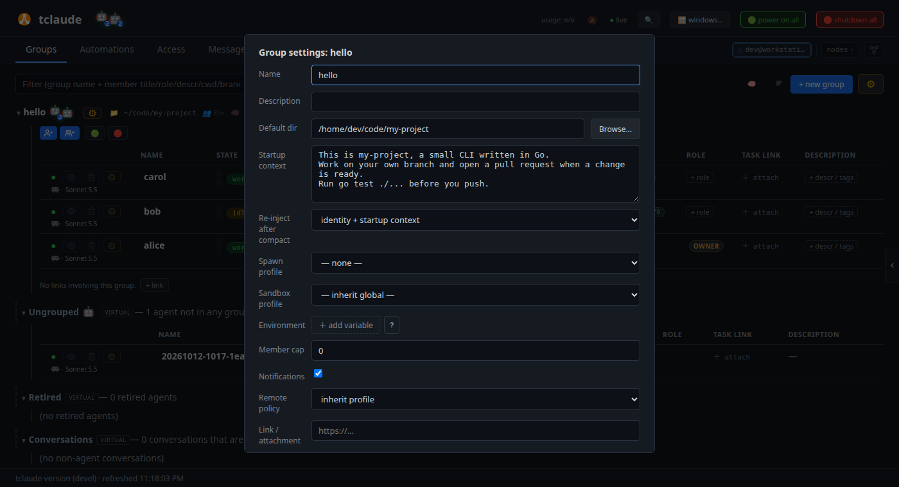
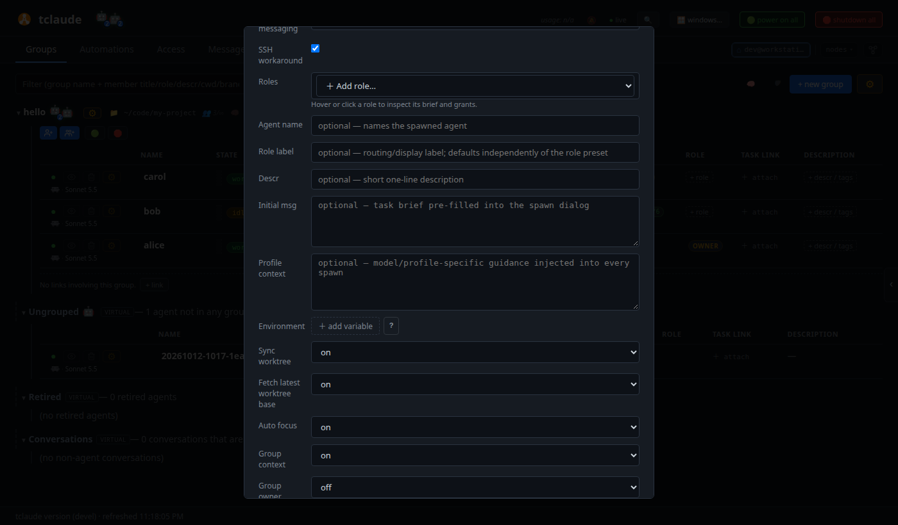

# Set up your team

Before you run more than one agent, save yourself some typing. In this
tutorial you give the `hello` group a **startup context**, a standing brief
that every agent in it starts with. Then you save the spawn dialog's
settings as a **spawn profile**, so every later agent starts the same way in
two clicks.

**You need:** [Your first agent](first-agent.md) completed, with `alice`
in the `hello` group.

## 1. Give the group a startup context

Everything an agent should know about your project, whatever its task,
belongs in the group's startup context: what the project is, how you like
work done, which commands to run before pushing.

Open the `hello` group's **⚙** menu, next to the group name, and choose
**⚙ settings…**. Write the context under **Startup context**:

> This is my-project, a small CLI written in Go.
> Work on your own branch and open a pull request when a change is ready.
> Run go test ./... before you push.

<!-- Regenerate the images on this page with scripts/docs/learn-images.sh -->


Click **Save settings**. Every agent you start in `hello` from now on gets
this text in its first message, next to its own task. Agents that are
already running pick it up after their next compaction.

Long tasks fill an agent's context window, and the harness then compacts
the conversation into a summary. The summary can lose the startup brief.
**Re-inject after compact** makes tclaude send the brief again after every
compaction. Leave it at **identity + startup context**.

## 2. Save a spawn profile

The spawn dialog has many fields, and most of them are the same every time:
harness, model, effort, permission mode, sandbox. A **spawn profile** saves
them under a name.

Click `hello`'s spawn button. Set **Harness**, **Model** and **Effort** the
way you want your everyday agents to run. Then click **Save as profile…**,
next to **Profile** at the top of the dialog. The profile editor opens,
filled in from the dialog. Name it `worker` and click **Save profile**.



A profile stores the launch settings and the agent's identity fields. It
does not store the directory or the worktree, which come from the group.
The editor's last fields are worth a look:

- **Initial msg**: a task brief that pre-fills the spawn dialog. Leave it
  empty for a general-purpose profile, and write the task when you spawn.
- **Profile context**: guidance for every agent started from this profile,
  on top of the group's startup context.
- **Auto focus**: whether the new agent's terminal opens in **Terminals**
  right away. It is optional. Turn it off if you start many agents and
  watch them from **Groups**.
- **Group context**: whether the group's startup context goes into the
  agent's first message. Keep it on.
- **Group owner**: whether the agent owns its group. The next tutorial uses
  it.

To change a profile later, press **Ctrl/Cmd+K** and choose
**Manage spawn profiles…**.

## 3. Start an agent from the profile

Click `hello`'s spawn button again and pick `worker` under **Profile**. The
dialog fills in. Write a **Name** and an **Initial msg**, check that
**Include group default context** is ticked, and click **Spawn**.

A few shortcuts make this faster:

- **Spawn profile** in **⚙ settings…** makes a profile the group's default,
  so the spawn dialog starts from it.
- **Ctrl/Cmd+K** opens the command palette. Type `spawn worker` to open the
  spawn dialog with the profile already picked.

!!! info "Go deeper"
    [Agents and groups → Group startup context](../agents-and-groups.md#group-startup-context)
    and [Spawning and lifecycle → Spawn profiles and roles](../spawning-and-lifecycle.md#spawn-profiles-and-roles).

## From the terminal

```bash
tclaude agent groups set-context hello --file brief.md
tclaude agent profiles ls
tclaude agent spawn hello --profile worker --name dave \
  --initial-message "Summarize the open TODO comments."
```

## What you learned

- A group's **startup context** is the standing brief every new agent in it
  starts with. tclaude sends it again after a compaction.
- A **spawn profile** saves the spawn dialog's settings under a name.
  **Save as profile…** creates one from the dialog.
- Pick a profile under **Profile**, or make it the group's default.

**Next:** [Run a team through a lead](team-lead.md).
