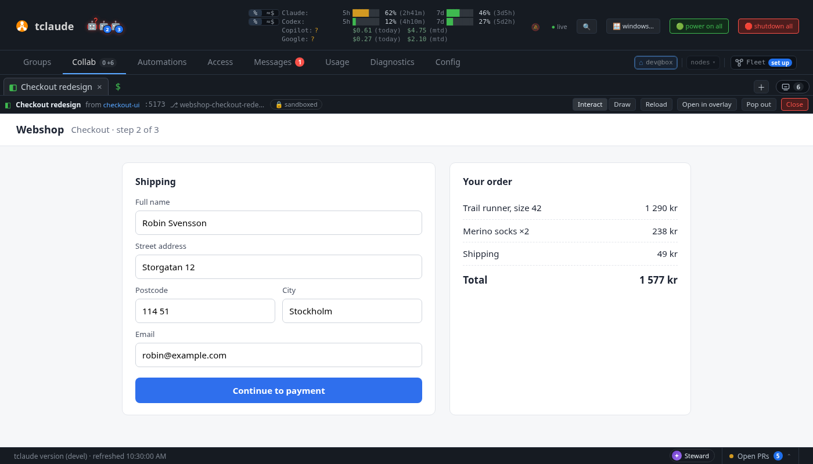
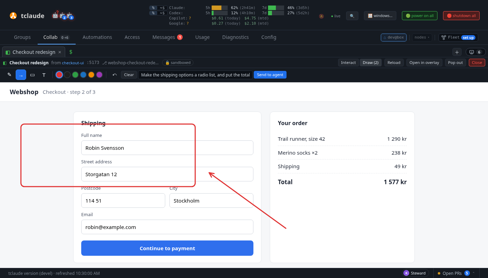

# Live pages

Live pages are part of [Collab](companion.md). They let an agent show
the operator any web page it serves, live and interactive inside the dashboard.
tclaude does not build the page. It renders what the agent serves, in a
sandboxed frame.

!!! note "In progress"
    So far the daemon's stage listener, its page sources, the agent commands and
    the dashboard's Page tab exist: an agent can show, update, list and close
    pages, the operator uses them live in the Collab view and draws on top of
    them, and the agent reads the marks, renders snapshots and reads the DOM.
    Live patches come in a later release.

## Showing a page

An agent shows a page with `tclaude agent show <target>`, short for
`tclaude agent page show`:

```bash
tclaude agent show :5173/app --name landing --title "Fernwood landing"
tclaude agent show ./site            # a static directory, serves its index.html
tclaude agent show ./mock.html       # one HTML file
tclaude agent page ls
tclaude agent page close landing
```

The target is `:PORT[/path]`, `http://localhost:PORT/path`, a directory, or an
`.html` file. A file target must be inside the agent's startup directory, the
one its launch chose. The directory the agent's hooks report it last edited in
is never used, because the agent steers that with any path it touches. The
command prints the source, the page's origin with the token masked, and the
rules.

- **Validation happens before anything is dialled.** A host name or IP is
  refused, and so is `::1`, `https:`, a URL with credentials, a port of the
  daemon's own, a path outside the worktree and a dot-named path. A port target
  is proved once at show time, with the same checks the stage makes for every
  connection. A dev server that is not running, or not the agent's, is refused
  with the reason. The stage connects only to `127.0.0.1`, so a server bound only
  to `::1` is refused too, with a hint to start it with `--host 127.0.0.1`.
- **Update in place.** Showing again with the same `--name` updates that page:
  a new path or port, the same origin, and open views reload. Without `--name`
  the name comes from the target (`:5173` gives `port-5173`, `site/` gives `site`).
- **A new kind of source gets a new origin.** Re-showing a name with the other
  kind of source (a port where it was static files, or the reverse) closes the
  old origin and mints a new one. Page code that read the static files keeps
  them in memory, and it must not keep an origin that now reaches the agent's
  dev server.
- **Own pages, and pages shared in a group.** A bare name resolves among the
  caller's own pages. Another agent's page is reachable only when it is shared
  in a group both agents are in ([Sharing a page with the
  group](#sharing-a-page-with-the-group)), as `<owner>/<name>`. Only the
  agent's current conversation can act (not a predecessor still running after
  a reincarnation). The permission is `self.page`, default-granted with the
  other `self.*` slugs.
- **Lifecycle.** A page belongs to the agent ID, so it survives a
  reincarnation. Retiring or deleting the agent closes its pages. When the operator closes a
  page in the dashboard, the agent gets an inbox message `[page <name>] closed`.
  Page tokens are never written to disk.
- **Saved with the group.** A page shared in a group is saved with it. Closing
  it (the dashboard's Close or tab ×, the agent's `page close`, the agent
  retiring, a daemon restart) keeps it in the group's Resources as closed,
  with why. **Reopen** there brings it back under the same id with a new
  origin, once its source is proved again: a port page needs its dev server
  answering, a static page its files still inside the agent's directories,
  and the agent must still be active and in the group. A page the operator
  locked stays locked while closed, and no show replaces it. Deleting the
  agent removes its saved pages. An agent re-showing the same name in
  that group reopens it too. **Delete** in the row's ⋯ menu removes it for
  good; archiving or deleting the group does as well. A group keeps its 64
  most recent closed pages. A private page (`--private`, or an agent in no
  group) is not saved: closing it, or restarting the daemon, ends it.
  From the group's Resources row the operator can rename a page and move it
  to another group you are a member of, which drops the marks sent before.
  The operator's title stays when you show the page again without
  `--title`; a show with `--title` replaces it.
  A saved page keeps its marks and live patches: a reopened page lists the
  operator's marks in `page marks` as before, and its patches are applied
  again. Shown into another group, it starts without the marks.
- **Limits.** An agent may have 8 pages open, and the daemon 64.

The dashboard snapshot lists the open pages (`live_pages`), each with a revision
that changes whenever the page is shown or updated, and the group it is shared
in (`group_id`, `group`). The Page tab uses it.

The snapshot's `group_resources` lists every active group's pages, boards,
processes and shell in one shape (`kind`, `id`, `group_id`, `title`,
`state`, `owner`, `detail`), where `state` is what the daemon knows:
`running` (a page's stage is live, a process run is active, the group's
shell is up) or `closed`. The dashboard adds what this browser has open
(`resource-model.js`): open as a tab, floating, minimized, or a running page
or shell in the background. Like `live_pages`, it is never in a peer's
snapshot.

### Sharing a page with the group

A page is shared in one agent group: the shower's only group, or the one it
names with `--group <name>` when it is in several. A shower in several groups
that names none, or one that shows with `--private`, shares it with no one.
`show` prints which (`shared: in group …`), and `page ls` lists the pages
other members share with you as `<owner>/<name>`:

```bash
tclaude agent show :5173 --name app --group web   # shared in group web
tclaude agent page ls                             # agt_1234…/app   web
tclaude agent page marks agt_1234…/app
tclaude agent page css agt_1234…/app 'button { color: red }'
```

- **What a member may do** is set by three group-scoped permissions:
  - `groups.pages.read`: marks (with what the operator typed in them),
    `snapshot`, `page dom` reads and the live-patch journal. Default-granted.
  - `groups.pages.patch`: add or drop live patches: `css`, `dom --set-text`
    and `dom --remove`. Default-granted.
  - `groups.pages.manage`: `page eval`, `page close`, and the patches that
    can carry script, `dom --set-attr` (an `onclick`) and `dom --insert-html`
    (an `onerror`). Not a default, and not implied by owning the group: eval
    runs code in the operator's view of the page and returns what it reads,
    so by default only the shower does these. `groups.admin`, which covers
    every `groups.*` slug, does include it. A member's close tells the shower
    in its inbox.

  A deny override, or a grant scoped to other groups, takes a member's access
  away, and the page drops out of that member's `page ls`. The shower always
  keeps its own.
- **Anything the operator types into a shared page is readable by every
  member of its group**, not only the shower. `show` and the page's 🔒 chip
  in the dashboard say so.
- **Never across groups.** Both agents must be members of the page's group at
  the time of each request: when either leaves, or the group is archived, the
  sharing ends at once. To a caller outside the group, a shared page answers
  as if it did not exist.
- **Re-showing into another audience drops the marks.** When a re-show
  changes the page's group (to another, to none with `--private`, or from
  none), the marks the operator sent before are dropped, so what they typed
  for one audience does not reach another.
- **Never to peers.** Only local agents act on a page; a peer or federated
  request never reaches one, and the dashboard snapshot sent to a peer has no
  pages.
- **Read-back is the shower's.** A static page is read back to a member only
  when it would be to the shower: when the shower's view of its files is exact
  (see [Page sources](#page-sources)).

### A page the operator creates in a group

The operator can create a page in a group from the dashboard, as they create
a board (`POST /api/pages` with the group and a name). No agent shows it, so
the group owns it:

- **It serves a blank scratch sheet.** This is tclaude's own fixed page, with
  no script. The operator draws on it and sends the marks to show what to
  build. No agent is told; the group's members read the marks.
- **Members address it as `<group>/<name>`.** For example,
  `tclaude agent page marks crew/sketch`. The same `groups.pages.*` slugs
  apply as for a page another member shared, and a non-member reaches
  nothing.
- **A member takes it over with `--adopt`.** For example,
  `tclaude agent show :5173 --adopt crew/sketch` takes it over, which needs
  `groups.pages.patch` in the group. The page becomes that member's, still
  shared in the group, and keeps its name, its id and the marks drawn on it.
  - Its source changes kind, so it gets a fresh origin, as any re-show with
    another kind of source does.
  - An adopter that already has a page by that name closes that page first.
  - The operator's lock on the page refuses a takeover, as it refuses a
    re-show.

## In the dashboard



A page an agent shows opens as a **Page** tab (◧) in the Collab strip, behind
the tab you are on, so it never takes your focus. The tab has a dot until you
look at it, and a toast says `<agent> showed <title> · Open`. A page shown
again with the same name gets the dot again, and its open views reload. Pages
that were already open when the dashboard loaded open quietly, with no toast.

The header above the page says who showed it (a link to that agent's
terminal), its target and worktree, and carries a **🔒 sandboxed** chip. Hover
the chip for the page's origin and its rules, including that the agent that
showed the page can read what you type in it. Then:

- **Reload** loads the page again. Saved files under a static target and a
  re-show reload it on their own.
- **Open in overlay** floats it in an overlay window, and **Pop out** moves it
  to a browser window of its own. Like a board, a page tab can be reordered,
  grouped, dragged off the strip or onto an overlay window. A separate window
  is the dashboard's own page with the same frame in it: the page's origin
  never loads as a top-level page.
- **Close**, or the tab's ×, closes the page. The agent is told in its
  inbox. A page shared in a group stays in the group's Resources, closed,
  and reopens from there; a private page ends. Moving a page between places
  does not close it.

### Drawing on top



**Interact** / **Draw** in the header switches what the pointer does. In Draw
mode a layer over the page takes the boards' pen, arrow, box and text tools and
colours (red first), with undo and **Clear**. The layer is the dashboard's, not
the page's: the page cannot see or change the marks. Switch back to Interact to
scroll or click; the marks stay where they were drawn on the page, because they
are kept in page coordinates.

When a mark ends, the page's probe names the elements under it: a short CSS path
(`section#pay-area > button.pay`) and a text snippet. Type an optional note and
press **Send to agent**. The marks, the note, the page's path, viewport and
scroll go to the agent: its inbox gets `[page <name>] marks` with your note and
how to read them. A note with no marks is a plain `[page <name>] note`. Nothing
reaches the agent until you press Send. The batches are kept in memory with the
page (the last 50) and end with it.

The element paths and snippets come from the page, so they are treated as the
page's content: checked, shown only as text, and kept out of the inbox message.

### Live patches

An agent can change its open page without touching its source, to ask "like
this?" (see [Live patches for the agent](#live-patches-for-the-agent)). While
a page has live patches, its header says **⚡ live patch #N · not in source**,
and **Show without** reloads the page as its source is; press it again to see
the patches. After the agent drops them the header says **No live patches ·
source**. Patches apply in every open view of the page and come back after
each reload, until the agent drops them or the page closes. They never change
files.

When nothing answers for the page (the dev server stopped, say), the view says
so and offers **Retry**. A page the agent closes leaves the dashboard.

The frame is `<iframe sandbox="allow-scripts allow-forms allow-modals" allow=""
referrerpolicy="no-referrer" credentialless>`: no same-origin, pop-ups,
downloads or top-level navigation, and no browser permissions. Titles and
targets the agent wrote are shown as text. The page's URL, which carries its
token, goes only into the frame.

### The page token is the key

The stage admits a frame's `Origin: null` requests, because a sandboxed frame
has no other origin to send. So the 128-bit token in the page's host name is
what decides who reaches the page. The token goes only to the local dashboard
(its snapshot). It never goes to a linked instance's view, even an unrestricted
one, and not to any agent, including the one that showed the page. That agent
sees its page's origin with the token masked and acts on it by name. This keeps
the token from being handed out; it does not make it unlearnable. The page's
own code can read its host name and write it into what the agent reads back. An agent
holding the token could fetch its page itself, but what a static page serves
it is never read back unless the stage serves exactly what the agent's own
sandbox shows (see Page sources), so it gains nothing it could not read. Keeping the token from it also keeps it out of the agent's
transcript, and out of a clone's.

A page has a second token for dashboards on other machines (see [Viewing
pages from another machine](#viewing-pages-from-another-machine)). The agent
is shown it only for a dev server page, which needs it as its `--base`. A dev
server is the agent's own process, so the token lets the agent read nothing it
could not already read. tclaude never shows the agent a static page's remote
token, and paths the dashboard reports from a remote view are kept without
it. The page's own code can still read its address, as with the loopback
token.

### Viewing pages from another machine

`*.ui.localhost` names resolve only on the machine running the daemon. A
dashboard opened from anywhere else gets each page at a path on the host it
used instead: `/p/<remote token>/`. That covers the dashboard listener reached
by a LAN address or a VPN name, a TLS-terminating proxy in front of it (such
as `tailscale serve`), and the remote-access listener on `:8443`. There are no
new ports or settings. Which address a dashboard gets depends on the `Host` it
was reached at. `127.0.0.1`, `localhost` and `[::1]` keep the page's own
origin. Any other name gets the path. The frame's address is a relative path,
so the browser supplies its own scheme and host.

- **The page's address is a capability URL** on the regular dashboard
  listener. The frame is credentialless and sends no cookie, so the remote
  token in the path is the only key there. Anyone who can reach the listener
  and holds the link sees the page until it closes. The link goes only to
  dashboards that reach this daemon, never to a linked instance. On the
  `:8443` remote-access listener, the client certificate is also required.
- **Isolation rests on CSP path matching and on the dashboard API's own
  checks.** On another machine every page shares the dashboard's origin, so a
  page cannot have an origin of its own:
  - Its CSP names only its own path, for `http` and `https` alike, and never
    `'self'`. A page cannot load or fetch another page's documents or the
    dashboard's `/api`.
  - The stage refuses an upstream redirect that leaves the page's path,
    because browsers stop applying a source's path after a redirect.
  - A request the frame makes to `/api` has no session behind it. The
    dashboard cookie is `SameSite=Strict` and not sent from the frame. The
    frame's `Origin: null`, or a no-cors load with neither `Origin` nor
    `Referer`, fails the dashboard's Origin check either way.
- **Plain http works, by a name that is not loopback** (`http://brain:8123`).
  A browser sends no fetch metadata (`Sec-Fetch-*`) to such an origin, and
  ignores the frame's `credentialless` there, so the frames-only rule below
  cannot be checked. On that path a request with no `Sec-Fetch-Dest` is served,
  and isolation does not depend on the rule:
  - The page's CSP carries `sandbox` without `allow-same-origin`, so a
    document loaded even top level runs at an opaque origin, exactly as in its
    frame. It can reach neither the dashboard's storage nor its API.
  - The stage strips `Cookie` going in and `Set-Cookie` coming out, so the
    dashboard's session cookie, sent with the frame's own load where
    `credentialless` is ignored, never reaches the page's source.
  - `frame-ancestors` still keeps other sites from framing it, and any
    `Origin` but `null` or none is refused.

  A browser that does send metadata (an https origin, whether TLS ends here or
  at a proxy, or a loopback name) keeps the frames-only rule.
- **A dev server needs `--base`:** it writes absolute paths. `tclaude agent
  show` prints the step for a port target. Start the dev server with
  `--base /p/<remote token>/` (Vite: `vite --base /p/<remote token>/`), then
  show it again at `:<port>/p/<remote token>/`, so the local view loads the
  same path. The remote token lasts as long as the page's origin, so it does
  not change when the page is re-shown with the same kind of source. A static
  page needs nothing; its files are served with the prefix taken off.
- A dashboard reached at a bare IPv6 address gets no frame address: CSP has no
  IPv6-literal host source. Use a DNS name (a tailnet name, say) or an IPv4
  address.
- Redirects and start paths with dot segments, spelled any way (`..`,
  `%2e%2e`), are refused, because the browser would resolve them out of the
  page's path.
- A page the operator let load other hosts is not served this way: its wider
  sources would reach every other page on the shared origin.
- A proxy that rewrites `Host` to the backend's address makes each page's CSP
  name the wrong host, so the page fails closed: it is blocked, not opened.
  `tailscale serve` keeps the client's `Host`. tclaude never trusts
  `X-Forwarded-*`.

## Page sources

A page comes from one of two sources, and the stage reaches nothing else. It
never dials a host name or an IP, only the literal `127.0.0.1` at a port that is
not the daemon's own.

- **The agent's own port**, served by a dev server the agent runs (Vite, Next,
  Storybook, anything). The dev server must listen on `127.0.0.1`. A server
  bound only to `::1` (some `localhost` setups) is not found, so start it with
  `--host 127.0.0.1` or the equivalent.
  - *Sandboxed agent with a private network namespace (Linux):* the launch
    record says so, and the stage then connects only inside the agent's own
    namespace, never on the host. That loopback serves the agent's launch alone:
    the agent's processes plus the sandbox's own network helpers. The
    connection is made through util-linux `nsenter`, the same way the sandbox
    supervisor enters the namespace.
  - *Host-network agent:* every listener on `127.0.0.1:<port>` must belong to the
    agent's process tree (its pane, or the OpenCode server it runs under). The
    stage proves this from the kernel's socket tables (`/proc` on Linux, `lsof`
    on macOS) before every new connection. A port another program holds is
    refused, even when the agent shares it through `SO_REUSEPORT`.
  - *macOS:* Seatbelt gives no private network namespace, so a sandboxed agent's
    port is checked like a host-network agent's. An agent whose profile closes
    network access cannot listen on loopback at all, so it cannot serve a page
    from a port. It can still show a static file or directory.

  The stage presents `Host` and `Origin` as `localhost:<port>` to the dev server,
  so Vite's host and websocket checks pass. The dev server's websocket (HMR)
  passes through. When nothing answers, the page shows a plain reason, such as
  "nothing is listening on 127.0.0.1:5173".
- **A static directory or one HTML file in the agent's worktree.** It is served
  read-only. No symbolic link is ever followed, not even one that points back
  inside the worktree. Names that start with a dot (`.git`, `.env`) are refused,
  and only common web file types are served. A directory serves its
  `index.html`. A single-file page serves only that file. The target itself may
  not be a hidden path.

  How the files are reached depends on the agent's sandbox:

  - *tclaude's sandbox on Linux:* the page is served through the agent's own
    view of the file system (its mount namespace, through `/proc/<pid>/root`).
    What the sandbox hides, overlays or binds applies exactly as it does for
    the agent, even after the agent renames a directory. If that view cannot be
    opened, for example because the agent is not running, the page serves
    nothing (503) rather than the host's files.
  - *No OS sandbox* (`off`, `resource-only`, or a harness whose own sandbox is
    recorded off; for Claude Code, its launch-time verdict must say off, since
    a managed policy can keep its sandbox on; Codex, which runs
    `danger-full-access` in all three, counts only when it reports no managed
    requirements at launch, since a
    `requirements.toml`, MDM or cloud requirement can make Codex fall back to
    its own sandbox): the agent reads what the daemon
    reads, so the page is served from the host. The launch is re-read, so a
    sandbox restored on the same conversation stops the read-back at once.
  - *Anything else* (a harness's own sandbox, macOS Seatbelt, or a launch with
    nothing recorded): the page is served from the host, leaving out by path
    what the recorded profile hides, with the same 404 as a missing file. The
    stage cannot see the harness's own rules, or match Seatbelt's exactly, so
    nothing of such a page is read back to the agent (see below).

  tclaude's protected directories are never served. The view is re-read when the
  agent reincarnates or comes back in a new sandbox, and the open views reload.
  The daemon watches the
  source and asks open views to reload when a file is saved. It finds saves by
  walking the source a few times a second with the same no-follow rules, not with
  inotify, so a symbolic link cannot point the watcher outside the worktree.
  Hard links are not served either.

## The stage: how a page is kept away from the dashboard

The page's code runs in the operator's browser. The stage listener makes sure it
never runs with the dashboard's origin, cookies or API.

- **Its own origin.** Each page is served at
  `http://f-<token>.ui.localhost:<dashboard port>/`, on the dashboard's port.
  Browsers resolve `*.localhost` to loopback without DNS. The origin is a
  different site from the dashboard's `127.0.0.1`, so the dashboard's session
  cookie (host-only, `SameSite=Strict`) is never sent to it.
- **A separate handler.** A request for any name under `ui.localhost` is split off
  before the dashboard mux. The stage has no route to `/api`, `/static` or any
  dashboard page. It only passes requests to the page's own source, so
  `/api/...` on a page origin reaches the page's dev server, never the dashboard.
  An unknown or closed token answers 404. The stage answers only connections
  that arrived on the loopback listener.
- **An unguessable token.** The `<token>` has 128 random bits. Closing a page
  forgets it, and showing the page again mints a new one.
- **Frames only.** Documents are served only to requests a browser marks
  `Sec-Fetch-Dest: iframe`. A top-level visit to the page origin is refused, and so
  is a request with no `Sec-Fetch-Dest`. The daemon's own snapshot renderer is the
  one exception: it presents a second, per-page snapshot token. (A remote page
  over plain http is the other: see "Viewing pages from another machine".)
- **No credentials cross.** `Cookie`, `Authorization`, every `Proxy-*` header,
  forwarding headers and `Referer` are stripped from requests. `Set-Cookie` is
  stripped from responses.
- **A daemon-set CSP.** The stage sets the page's Content-Security-Policy itself
  and drops any the page's server sends, so a page cannot loosen it. It allows
  the page's own origin plus `data:` and `blob:`, inline scripts and `eval` (dev
  servers need them), and connections to the page's own origin only
  (`connect-src`). Only the dashboard may frame the page (`frame-ancestors`), and
  `sandbox` keeps the document sandboxed even outside the frame. Other hosts are
  allowed only by a per-page operator toggle, off by default.
- **Its own frame only.** A request whose `Origin` is neither `null` (the
  sandboxed frame) nor the page's own origin is refused, so another site that
  learned a token cannot drive the dev server.
- **Opaque origin and CORS.** In the sandboxed frame, the page's origin is opaque,
  so its own fetches and module scripts are CORS requests with `Origin: null`. The
  stage answers those, preflights included, with `Access-Control-Allow-Origin: null`
  and never with credentials. It drops any CORS headers the page's server sends.
- **The probe.** The stage inserts a small script into each HTML document it
  serves (`stage_probe.js`). It reports the frame's scroll, names the elements
  under a mark and answers read-only DOM reads, all over `postMessage` with the
  dashboard view. It is as untrusted as the page and holds no secret: the page's
  own scripts can read and forge what it sends. So the view reads only messages
  from its own frame's window, carrying the nonce it minted for the frame's
  current load, within size caps (64 KiB a message, 50 elements, 200-character
  snippets) and the schema, and shows them only as text. The daemon checks the
  same again. HTML that is compressed with anything but gzip cannot be
  inspected, so it is refused.

What a page cannot use in the frame: cookies, `localStorage` (until the probe
provides a stand-in), IndexedDB and service workers. An app behind a login needs
a development bypass or a fixture user.

Known limits of the boundary:

- A page can still navigate its own frame to any URL. CSP does not govern
  navigation, so a page can send data out in a GET or make blind GETs to other
  loopback services. Its fetches stay limited to its own origin unless the
  operator allows other hosts.
- The frame may open `alert`, `confirm` and `prompt` dialogs (`allow-modals`). A
  dialog comes from the page, not from tclaude. Never type the operator token
  into one.
- Under a harness's own sandbox, a static page may show the operator a file
  only the harness's rules hide (a `denyRead` in Claude Code's `settings.json`,
  say). It is not read back to the agent, but the page's own script runs with
  it. Put deny rules in a sandbox profile, or use tclaude's sandbox.
- Browsers resolve `*.localhost` to loopback themselves. A browser that hands
  these names to the system resolver instead trusts that resolver for them.

## Marks, snapshots and DOM reads for the agent

```bash
tclaude agent page marks <name> [--since N]       # the batches the operator sent
tclaude agent page snapshot <name> -o page.png    # the page as a PNG, with the marks
tclaude agent page dom <name> <selector> [--text|--html|--styles]
```

- **`page marks`** prints each batch: the note, the path, viewport and scroll,
  and each mark's kind, points in page pixels and the elements under it.
  `--json` gives the same as data. The inbox message names the batch to read
  from.
- **`page snapshot`** renders the page in a headless Chrome on the host, at the
  operator's last viewport and scroll, with the latest batch of marks drawn on
  top (`--seq N` for another, `--no-marks` for none). Chrome is the host's own:
  `google-chrome`, `chromium` or `chromium-browser` on `PATH`, the macOS app
  bundles, or `TCLAUDE_CHROME`. tclaude never downloads a browser; without one,
  the command says so. Chrome runs on a throwaway profile with its background
  networking off, and the daemon drives it over a pipe, not a debugging port.
  A snapshot renders the page's own origin and nothing else: every other request
  (a redirect, a navigation, a frame, an image) is refused inside Chrome, and a
  page that tries to leave its origin gets an error instead of a picture. The
  page's snapshot token goes only on the page's own document requests. A page
  the operator allowed to load other hosts is not rendered for the agent.
  One snapshot runs at a time per agent.
- **`page dom`** reads up to 10 elements matching a selector in the operator's
  open view of the page: their text, outer HTML or computed styles. It is
  read-only, and needs the page open in the dashboard (it is read through that
  view's frame). Otherwise it says no view is open. A large answer keeps the
  first elements that fit and says it was cut.
- **Static pages are read back when they are served exactly as the agent sees
  them:** under tclaude's sandbox on Linux, or with no OS sandbox. Otherwise
  `page snapshot` and `page dom` refuse the page, and its marks arrive without
  the page's own data: no text under them, no path, scroll or viewport, and
  points relative to the frame. The operator's
  marks and note still arrive. After the agent comes back in a new sandbox,
  `page dom` and the text under marks wait until the page has loaded again.
  Serve the page from your own dev server to use them otherwise.

## Live patches for the agent

```bash
tclaude agent page css <name> 'button.pay { background: #1971c2 }' ...
tclaude agent page dom <name> <selector> --set-text T | --set-attr NAME=VALUE | --remove | --insert-html H
tclaude agent page eval <name> '<js>'              # once, in one open view; prints JSON
tclaude agent page patches <name>                  # the journal
tclaude agent page patches <name> --reset [N]      # drop all, or only patch N
```

- **`page css`** and the **`page dom`** patch flags each add a patch, numbered,
  to the page's journal. The daemon keeps the journal in memory with the page
  (at most 100 patches, 256 KiB), sends it to every open view, and each view
  replays it after every load, a full HMR reload included. A css patch is a
  `<style>` after everything else in the document. A dom patch changes every
  element matching the selector once the document has parsed. An app that
  renders its elements later (most client-rendered apps) misses the replay
  after a reload, and one that renders them again undoes it; use css for
  those.
  `page snapshot` renders the page with the patches too.
- **`page eval`** runs a script once, in the open view `page dom` reads from,
  and prints its value as JSON (a promise is awaited; at most 16 KiB). It is
  listed in the journal as not replayed (the last 20, scripts clipped; they
  do not count toward the patch limits). With no view open it is refused,
  where a css or dom patch is kept and reported as not open.
- Patches never write files. Port what the operator approves into source,
  then `--reset`. Open views reload without the dropped patches.
- **The channel:** the daemon takes patches only from the agent that showed the
  page; the dashboard view relays to its frame only what its socket delivered;
  the probe in the frame takes a command only from its parent window with the
  nonce of the frame's current load, so another frame cannot drive it. What a
  view answers comes from the page and is checked. For a static page that is
  not read back, the agent learns only how many views a patch went to, and
  `page eval` is refused.

There are no MCP tools for live pages; the CLI is the agent's surface.
