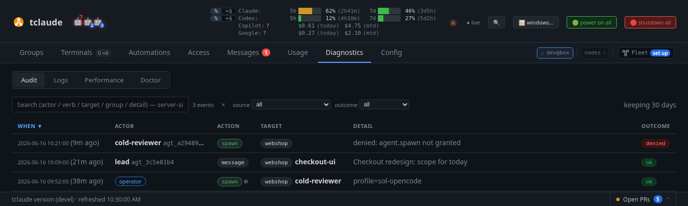

# Permissions and audit

Running many agents seriously means giving them real autonomy without losing
the ability to answer, later, exactly who did what and under which authority.
tclaude's answer is a single choke point: every mutating `tclaude agent`
action — from the CLI or the dashboard — goes through the `agentd` daemon,
which decides the request against a permission model and writes the outcome
to an audit trail. The daemon is fail-closed: the CLI refuses to fall back to
direct database access when `agentd` is down, so killing the daemon never
bypasses authorization.

The one exception to process identity is an [external steward](external-steward.md),
which proves itself with a credential and is still judged as an ordinary agent.

Identity is resolved from the kernel, not from tokens agents could leak or
forge — see [Agents and groups](agents-and-groups.md). A human caller passes
every gate; an agent caller is checked against permission slugs.

## Start here

**An agent got a 403.** The refusal names the permission it needed. You can:

- answer once: the agent reruns with `--ask-human <duration>`, and you approve it in
  the dashboard;
- grant it for a while: `+ sudo` in the agent's ⚙ menu, or the [Access tab](dashboard-access.md);
- grant it for good: `tclaude agent permissions grant <agent> <slug>`.

**To see what an agent can do:** `tclaude agent permissions ls <agent>`.

**To see what happened:** [Diagnostics › Audit](dashboard-diagnostics.md#audit).

## The slug model

Every gated action maps to a named **permission slug**. The live registry —
192 slugs — is the source of truth:

```bash
tclaude agent permissions slugs
```

Slugs fall into recognizable families: `self.*` (an agent acting on itself),
`agent.*` (acting on any other agent), `groups.*` (roster and settings
administration, including `groups.members.*`, `groups.settings.*`,
`groups.link.*`, and `groups.triggers.*`), `permissions.*`, `human.*`
(channels to the operator), `message.direct`, `templates.*`, `process.*`,
`profiles.manage`, `roles.manage`, `routes.publish`/`routes.consume`/`routes.publish-host`,
`sandbox-profiles.*`, `triggers.*`, and `proxy.*`. Don't memorize the list;
query the registry.

An agent may perform an action when the slug appears in its **effective
set**, the union of:

- global defaults (`agent.default_permissions` in
  `~/.tclaude/data/config.json`),
- live group grants (membership policy — effective immediately, gone the
  moment the agent leaves the group),
- per-conversation grants,
- active [sudo](#sudo-time-bounded-elevation) elevations,
- grants contributed by group ownership (see below).

An explicit per-agent **deny** beats everything except sudo. If no source
supplies the slug, the request is refused.

### Managing grants

```bash
tclaude agent permissions ls                  # defaults and overrides
tclaude agent permissions ls <agent>          # effective set for one agent
tclaude agent permissions grant <agent> <slug>
tclaude agent permissions deny <agent> <slug>
tclaude agent permissions revoke <agent> <slug>
tclaude agent permissions grant default <slug>   # edit global defaults
```

`slugs` and `ls` are open reads. `grant`, `deny`, and `revoke` are themselves
gated, on `permissions.grant` and `permissions.revoke` — which in practice
keeps them human-only, since those two slugs are also blocklisted from sudo.
The magic target `default` edits the global defaults list; `deny` blocks an
otherwise-default slug for one agent; `revoke` clears either back to the
inherited state.

### Defaults installed by setup

`tclaude setup --install-default-agent-permissions` (idempotent) grants the
self-management baseline: `self.rename`, `self.compact`, `self.interrupt`,
`self.clone`, `self.schedule`, `self.remote-control`, `self.task`, `self.pr`,
`self.tags`, `self.dir-repair`, `self.process`, plus `process.templates.read`, `usage.read`, and `costs.read`.
The account read permissions expose quotas/forecasts and cost history through
[`tclaude usage` and `tclaude costs`](usage-and-costs.md).
Self-reincarnation deliberately needs no slug at all. These defaults let an
agent manage its own conversation without letting it touch anyone else's —
every cross-agent verb still needs a separate grant. See
[Spawning and lifecycle](spawning-and-lifecycle.md) for the `--target`
manager pattern and the slugs it checks.

### What ownership contributes

Owning an active group structurally contributes grants scoped to that group:
the `groups.*` roster/settings/link/attachment/nest/archive/schedule slugs
and the `groups.members.<verb>` manager slugs, `process.runs.start` (binding
a new process run to the group), plus unscoped `human.notify` and
`process.runs.read`. Ownership never confers slugs that mutate shared
configuration (`process.templates.manage`, `agent.sandbox-impl`,
`sandbox.harness-config`, `human.clipboard`, `usage-rules.manage`, and similar). `groups set-owner-scopes` can narrow what
owning a particular group confers — it only takes reach away, never adds.

## Scoped grants

A grant can be narrowed to part of what its slug reaches:

```bash
tclaude agent permissions grant builder groups.members.spawn \
  --scope group=dev,staging --scope sandbox_profile=locked-down
tclaude agent permissions grant lead agent.retire \
  --scope target_agent=@self-spawned
```

`--scope` takes `dim=v1,v2` and repeats for multiple dimensions. The
evaluation rules:

- Within a dimension, matchers **OR** (`group=dev,staging` matches either).
- Across dimensions, scopes **AND** (every mentioned dimension must match).
- An unmentioned dimension is unconstrained.
- For local actions, scopes union within a tier, and one unscoped row
  **absorbs the tier** — an unscoped grant of the same slug makes the local
  scoped ones redundant.
- A non-matching scope decides nothing: the check falls through to the other
  sources, and if none passes, the request gets a 403.

The registry advertises which dimensions each slug supports (`group`,
`spawn_profile`, `sandbox_profile`, `process_template`, `target_agent`, and proxy-specific
dimensions). Two relational matchers exist on `agent.retire`,
`groups.members.retire` and `agent.standdown`: `target_agent=@self-spawned` (agents the grantee spawned)
and `@descendants` (its spawn lineage, up to 64 generations). Lineage is
recorded only for agent-initiated spawns made after the feature existed;
reincarnation preserves descendants, but a clone is not a child.

Both `agent.spawn` and `groups.members.spawn` accept the three spawn dimensions.
A `sandbox_profile` scope is matched against the profile the spawn will
actually run under: the caller's explicit selection when it makes one, and
otherwise the ambient assignment it inherits — the group's sandbox profile,
else the global one. So a grant naming the profile an operator already set as
the group or global default admits a plain `tclaude agent spawn` that selects
nothing, and it is what lets a cron or trigger managed spawn — which never
selects a profile — fire under a scoped grant at all. Ambient global and group
layers compose underneath an explicit selection either way.

A group with no sandbox profile assigned and no global default leaves the
dimension undescribed, so a scoped grant there still fails closed.

A `sandbox_profile` scope also has to keep binding the child after the gate, so
a spawn admitted by such a grant is refused when the resolved launch would not
enforce the profile — whether because the mode omits the profile tiers outright
(Codex `danger-full-access`) or because the implementation stands the OS
boundary down while still composing them (`off` and `resource-only`). This
binds only the caller whose authority was *conditioned* on the profile. An
unscoped grant, an ownership-derived one, or a scope over `group` alone never
traded on it and is unaffected — the presence of a group or global assignment
somewhere in the deployment is not by itself a restriction. The same rule
applies to a cron/trigger managed spawn, where it is evaluated at fire time
against the launch the spawn profile resolves.

An unscoped spawn grant may select any saved sandbox profile, subject to
sandbox lineage. Omitting all inherited profiles remains human-only.

### Federation scopes

Remote actions use ordinary slugs with `--scope peer=<trusted-peer>[/<group>]`:
`message.direct`, `groups.members.spawn`, `agent.spawn` and `routes.consume`.
`agent.spawn` accepts only the peer, without a group suffix. Labels resolve
to trusted instance ids at grant time; `peer=` cannot be combined with any
other scope dimension.

Local and remote grants are disjoint: unscoped grants, local scopes, defaults
and group ownership never authorize remote actions, and peer-scoped grants
never authorize local actions. A deny blocks the slug in both cases. The
receiving operator must also grant the sending instance access to its local
groups. See [Federation](federation-peers.md#peer-grants-what-a-peer-may-see-and-do)
for the two grant sets and worked examples. `tclaude agent permissions
peer-reach add|remove` merges one `peer=` matcher into an agent's or group's
grant without replacing the others; see
[Federation](federation-peers.md#discovery-what-your-agents-may-address).

### Denies are never scoped

`permissions deny` takes no `--scope`, by design. A deny is a hole punched in
an agent's authority, and a *scoped* deny would be a hole with edges you have
to reason about: it would remove one slice while silently leaving every other
slice granted, which reads like a narrowing but isn't one. If you want an
agent to have less, grant less — use a scoped grant. A deny means "not this
agent, not this slug, regardless of what any grant says."

## How a request is decided

Putting the pieces together, one request — say agent `builder` running
`tclaude agent spawn dev` — is decided like this:

1. `agentd` resolves the caller's identity from the kernel. A human passes
   immediately; `builder` is an agent, so the gate applies.
2. The daemon collects every source that could supply
   `groups.members.spawn`: global defaults, `builder`'s group grants,
   per-conversation grants, active sudo elevations, and
   ownership-contributed grants.
3. Scoped rows count only if their scope matches this request (here, the
   `group` dimension must cover `dev`). Non-matching rows decide nothing.
4. An explicit deny on `builder` for the slug refuses the request unless an
   active sudo elevation supplies it.
5. If a source passes, the command runs and the audit row records which
   scope (if any) authorized it. If none passes, the result is a 403 — also
   recorded — unless the call carried `--ask-human`, in which case the
   human gets the last word.

`tclaude agent permissions ls <agent>` shows the effective set the daemon
would consult, and for messaging specifically,
`tclaude agent groups why-can-i-message <target>` explains which path
authorizes a send.

## Sudo: time-bounded elevation

For work that needs a slug an agent doesn't hold — and shouldn't hold
permanently — the agent requests a bounded elevation:

```bash
tclaude agent sudo request agent.stop groups.members.spawn \
  --duration 30m --reason "winding down the review team"
tclaude agent sudo ls          # my active elevations
tclaude agent sudo ls --all    # everyone's (human view)
tclaude agent sudo revoke <id> # end one early (or --conv <agent>, or --all)
```

Every agent-originated request raises a human-approval popup — there is no
silent path. On approval, the slugs join the agent's effective set until the
window expires or a human revokes early. Duration is capped at **1 hour**
(default 5 minutes). The permanent-escalation slugs `permissions.grant` and
`permissions.revoke` are blocklisted from sudo: the audit trail of a
time-bounded grant is the whole point of the model, and a sudo that could
mint durable grants would defeat it.

The human form `sudo request --target <agent> <slugs…>` grants proactively
with no popup — the operator's own shell is the consent. Agents cannot use
`--target`.

The dashboard grants through the sudo variant of the permission editor (see
[Access](dashboard-access.md)). It can also narrow a grant with a scope and extend
one that is running. An extension keeps to the same maximum, measured from now,
and is recorded as `sudo.extend`.

### Use limits

A dashboard grant of a countable permission can also carry a use limit, for example
any group for 10 minutes, at most 5 agents. It ends at whichever runs out first, the
time or the count, and the daemon enforces both.

One permitted action is one use. The daemon takes the use atomically before the
action, so parallel requests cannot exceed the limit, and gives it back when the
request is refused or fails. Reading (`GET`), dry runs, import previews and a remote
control status check are free, and uses are only spent where sudo is what allowed the
action: standing access leaves the grant untouched.

These count:

- spawns: `agent.spawn`, `groups.members.spawn`. One use per launch, given back if the
  launch fails. A spawn that started and later died has used its count, and so has one
  whose pane was not seen to come up in time.
- an agent's own actions, such as `self.rename`, `self.compact`, `self.clone`,
  `self.task` and `self.tags`.
- actions on other agents, as `agent.*` and `groups.members.*`: stop, resume, retire,
  delete, rename, compact, interrupt, clone, morph, promote, reincarnate, remote
  control, task, tags, PR and process.
- group changes: `groups.create`, `groups.delete`, `groups.rename`, `groups.clone`,
  `groups.archive`, `groups.nest`, `groups.attachment`, `groups.import`,
  `groups.owners.manage`, `groups.link.add`, `groups.link.remove`,
  `groups.members.add`, `groups.members.remove`, `groups.members.update`.
- group settings: every `groups.settings.*` slug, from `groups.settings.description`
  to `groups.settings.owner-scopes`. One save spends one use of each setting it
  changes, so a save of the description and the default directory spends one of each
  grant. A rejected save changes nothing and gives both back, but a save that fails
  after writing some fields keeps its uses. Reads spend nothing, and neither does an
  agent also covered by `groups.admin` or, for most of these slugs, by owning the group.
- `message.direct`, `human.notify`, `human.clipboard`.
- `templates.manage`, `templates.instantiate`, `profiles.manage`, `roles.manage`,
  `prompts.manage`, `process.templates.manage`, `process.runs.start`,
  `process.runs.manage`, `process.advance`, `usage-rules.manage` and
  `settings.default-model`.

Everything else takes no limit, and the editor says why on the row:

- slugs that only read, or are part of a spawn such as `groups.members.spawn.model`.
- `groups.admin`, which covers many actions: limit the specific permission.
- schedules and triggers, which act later with no request to count.
- slugs one task checks many times: boards, dashboard marks, the proxies, sessions and
  routes.
- slugs that act across a peer link, such as moves, teleports and remote jobs.

A limited grant only works where a use can be counted. Triggers, schedules, moves and
other checks made outside a request refuse it, and a grant scoped to a peer takes no
limit.

## Asking the human at the moment of denial

Most mutating commands accept `--ask-human <timeout>` (capped at 300s;
timeout means deny). When the permission check fails, instead of a flat 403
the daemon creates an **access request** the operator sees in the
[dashboard](dashboard.md) Messages tab, with **Approve**, **Decline**, and
**+5m** actions (**Approve**, **Deny** and **+5 min** in the companion). The agent's command blocks until the human answers or the
timeout expires.

At most 8 requests from one agent, and 64 in all, wait for you at a time. Past
that a new request is refused at once with a message to ask again later, and the
requests already waiting are not affected.

An archive has nothing you could read in its bytes, so a workflow, agent or group
import asking this way shows you a review instead: what the file holds, who signed
it, what importing changes here and any elevated items, in the words the CLI uses
for its own preview. The file is held in memory while you decide, so one agent may
hold 128 MiB and all of them 256 MiB. A larger file is refused, and needs the
permission granted first or the operator to import it. A file the node cannot read
says so, and you should decline it. Any other request body that is not text is
left out of the card rather than shown as raw bytes.

For exactly two slugs — `human.clipboard` and `human.notify` — the card also
offers **"Always allow for this agent"**, which persists an allow keyed to
the stable agent id (recorded as granted by `human:popup-always`). These are
the two agent-to-human channels, where "this agent may always reach me" is a
sensible durable decision; no other slug gets an always-allow shortcut. Gates
that describe a scope dimension offer a scoped variant of the same card.

## The audit trail

The daemon records a symbolic `audit_log` row for every daemon-proxied
command, from both the CLI and the dashboard: **who** ran **what** against
**which target**, when, and with what outcome. Rows are symbolic — actor,
verb, target, group, a short bounded detail — never pane content, prompts,
or subprocess output.



*An audit row recording a rejected spawn: actor, verb, target, detail, and outcome*

Three properties make the trail defensible rather than decorative:

- **Denials are recorded too.** A 403 or any other failure writes a row, so
  the trail answers "who *tried* to do what", not only "what landed". An
  agent probing for authority it doesn't have is visible.
- **Scoped authorization is attributed.** When a command passed its gate on a
  scoped grant, the row records which scope matched. "Spawned into dev"
  reads very differently once you know the same agent is barred from prod.
- **Sudo is visible.** Requests, the operator's decision, the stated reason,
  and every command executed under the elevation all land in the trail.
- **Environment values are not kept.** A spawn row lists the names of the
  environment variables it set, with each value as `[redacted]`. Upgrading
  redacts the spawn rows already stored the same way, though scraps of the old
  rows can stay in the database file's free pages. Rotate a token you believe
  was exposed.

Browse and filter the trail in the dashboard's **Diagnostics › Audit** view. Retention
defaults to 30 days; set `audit.retention_days` in
`~/.tclaude/data/config.json` to keep more, or a negative value to keep
forever. The hourly sweep re-reads the config, so changes apply without a
restart — and a corrupt config skips the sweep rather than pruning against a
guessed policy.

### The exit audit

Separately from command rows, the daemon keeps an exit ledger for managed
sessions: when a pane ends, a `managed_pane.exit` row records the bounded
evidence — cause (normal exit, signal, launch failure, or disappeared), exit
code or signal, which observer saw it, and the launch phase it died in. When
the exit was requested (stop, force-stop, retire, reincarnate), the row links
back to the lifecycle command that asked for it, so a dead agent is never
just "gone": the trail distinguishes an ordered shutdown from a crash, and a
crash from a launch that never came up. Spawn failures surface this evidence
directly ("managed pane exited during startup (signal …)"), with the pane's
output tail in the dashboard's Diagnostics › Logs view.

Empty cause fields mean the evidence was unavailable — the ledger never
infers a cause it didn't observe.
