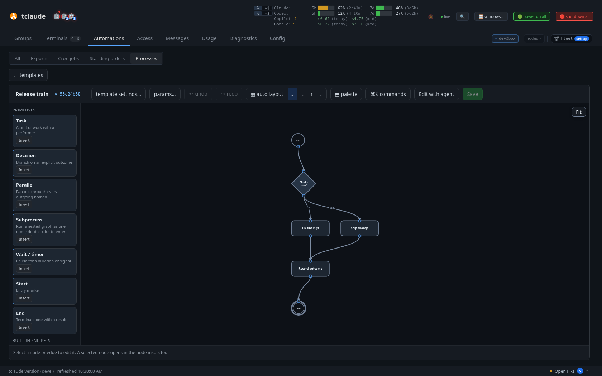

# Processes

Processes are reusable, versioned workflow templates — task chains, decisions,
parallel fan-out, retries, human approvals — authored once and executed as
daemon-owned runs with durable state and an auditable evidence trail.

The runtime is partially implemented: a substantial subset of the engine is
live, and the rest of the CLI surface is stubbed. This page states exactly
which half is which.

!!! note "Not `tclaude agent process`"
    `tclaude agent process` shows and advances a *group's* advisory phase list
    from a task-force template — a checklist for coordination, never enforced.
    That is a different feature; see [Teams at scale](teams-at-scale.md). This
    page is about `tclaude process`: executable templates run by the daemon.

## Start here

1. Create a template under **Automations › Processes**, or let **Edit with agent** draft it.
   Or, in a group's Resources section, the **＋** menu › **◈ New process** opens a new one in place.
2. Start a run from a group's Resources section: the **＋** menu › **▶ Run a process…**.
3. Follow it in [Groups](dashboard-groups.md#agents-and-processes).

[In the dashboard](#in-the-dashboard) covers all of this. The next sections are
reference for the format, the engine and the CLI.

## Built-in ways of working

tclaude ships seven processes in the binary:

| Id | Name | Steps |
|---|---|---|
| `plan-vet-build` | Plan → vet → build → review → merge | the lead frames the task, a planner plans it, a usability vet checks the plan, a developer builds it, two reviewers who did not build it both approve, and the lead who framed it merges ([the example](examples/ways-of-working.yaml)) |
| `build-review-ship` | Build → review → ship | a developer builds and opens a PR, a reviewer who did not build it approves or sends it back, and the lead ships it |
| `bug-fix` | Bug: reproduce → fix → verify | a tester reproduces the bug, a developer fixes it, the same tester verifies the fix, and the lead merges it |
| `quick-change` | Quick change + one review | a developer makes the change, one other reviewer approves or sends it back, and the developer merges it |
| `plan-fan-out` | Plan → fan out → integrate | the lead splits the task into three parts, three different developers build one each at the same time, and the lead integrates them |
| `ask-me-first` | Ask me first | you give the go-ahead, a developer does it, and you accept it or send it back |
| `check-fix` | Check → fix if red | good on a schedule: a tester runs the checks, and when they are red a developer fixes them and the same tester checks again |

Each takes the `task` it is run for. Steps pick members by role (`planner`,
`ux`, `dev`, `reviewer`, `tester`) and spawn one when the group has none. The
lead's steps go to the group's lead (a member with the role `lead`, else an
agent that owns the group) and wait when it has none. Running out of rounds,
or a performer choosing escalate, fails the run, so a board task it runs for
is blocked with the reason; only your own stop or reject in Ask me first
cancels one. Plan → fan out → integrate has no decision to escalate from: a
part that fails blocks its branch, and the overseer is told once the step
has been stuck past its patience. Check → fix if red takes what to run as its
`task` (a schedule passes it, for example `--param task='make test'`). Each names the group's lead as its overseer (`overseer: lead`),
and a step stuck longer than its patience (an hour; two for building or
fixing) raises a concern to it (see
[Oversight and escalation](#oversight-and-escalation)). Your own decisions in
Ask me first wait for you as long as it takes.

A built-in is never run as it is. A group that uses one gets its own copy:
a template saved to the group (not published to the library), with its own id.
The group's edits stay with that copy, and using the built-in again makes
another copy.

- In the dashboard, a new process offers them first in its **Start from** row,
  before *✨ Describe it*, *↥ Import .pwf* and *More ways of working ›* (the
  library).
- From the CLI: `tclaude process templates builtin ls`, then
  `tclaude process templates builtin use <id> --group <group> [--name <name>]`,
  which prints the copy's template id to run with `tclaude process run`.
  This takes what saving a process to the group takes (`process.templates.manage`).
- The API: `GET /v1/process/builtins`, `GET /v1/process/builtins/{id}` and
  `POST /v1/process/builtins/{id}/use` with `{"group": "...", "name": "..."}`.

## Authoring templates

Templates are YAML documents with `apiVersion: tclaude.dev/v1alpha1` and
`kind: ProcessTemplate`. The primary authoring surface is the dashboard's
Templates library and drag-and-drop editor, which covers parameters,
performers, edges, layout, snippets, version history, authorship, and
source-hash CAS checks. Agents author the same templates from the CLI:

```bash
tclaude agent process-templates ls [--json] [--library]   # group drafts included unless --library
tclaude agent process-templates show <template-id>
tclaude agent process-templates validate --file template.yaml
tclaude agent process-templates save --file template.yaml \
    --expect-source-hash <hash>
```

Saves are compare-and-swap: `--expect-source-hash` must match the current
stored version, so two writers cannot silently clobber each other — a stale
hash is a refused save, and the caller re-reads with `show` and merges. The
bundled `process-templates` agent skill and the CLI's `--help` are the deep
reference for the authoring shape and the safe show-edit-validate-save loop;
this page does not repeat them. The bundled `process-runs` skill is the agent
reference for starting, watching and steering runs (see [Running](#running)).

Two permissions govern authoring, and neither executes anything:

- `process.templates.read` — list, show, validate, export. Installed as an ordinary
  agent default by `tclaude setup --install-default-agent-permissions`.
- `process.templates.manage` — save, import. Never a default.

A template pinned to a group is also one of that group's resources. Its
members, with neither slug, list and show it (`groups.resources.read`, which
membership confers), and save a new version of it (`groups.resources.write`)
when they are members of every group it is pinned to: a save changes it for
all of them. Creating a template, deleting one, its library listing and its
pins stay `process.templates.manage`'s, and a lock on the template refuses a
member's save as it does any agent's. See
[Drawing boards › Group drawing boards are their members'](drawing-boards.md#group-drawing-boards-are-their-members)
for how the membership source works.

Pins say who edits a template, not who runs it: a run in any group may start
any template, and a subprocess without a pinned version follows its head. So
a member's save also changes what later runs of that template, elsewhere,
execute. Program steps still need `--authorize-program-profile` when a run
starts, so a save alone runs nothing on the host.

### Sharing workflows

A process can be shared as a `.pwf` file that carries the template and every
template its subprocess steps reference:

```bash
tclaude agent process-templates export <template-id>     # writes <template-id>.pwf
tclaude agent process-templates inspect <file.pwf>       # offline check and summary
tclaude agent process-templates import <file.pwf> --yes  # review, then import
```

Importing stores templates and never starts a run. The review lists every
command the workflow would run, the roles it asks for and the signer, and an
`--ask-human` popup shows the human the same review. See
[Portable Workflow Format](pwf.md).

In the dashboard, **share** downloads a `.pwf` from a template's row, the full
editor (saved versions only) or a group's process strip. Import one from the
Processes toolbar, the dock, or a group: use *↥ Import .pwf* under a new process's canvas,
or drop the file on the group in Groups › Processes. A group's import offers to
pin the process to that group.

### Saved to a group, or to the library

Every process is a stored template, one versioned artifact, however it was
saved. A group keeps an ordered list of the processes saved to it, shown as
one-click chips that ask only for the start inputs. The library lists a
template unless it was saved to a group without being published:

- **Save to group** saves the template unlisted and pins it to the group
  (`POST /v1/process/templates[/{id}]` with `"listed": false` and
  `"pinGroup": "<group>"`).
- **Start now** on a step list that was never saved saves it unlisted and
  not pinned, so one-off runs leave no chip behind. The run still references
  the template by its ref.
- **Publish** lists it in the library:
  `POST /v1/process/templates/{id}/listing {"listed": true}`, or a save with
  `"listed": true`.
- **Pin / unpin** an existing template:
  `POST /v1/process/groups/{group}/processes {"templateId": …}` and
  `DELETE /v1/process/groups/{group}/processes/{templateId}`.

The library read (`GET /v1/process/templates`) hides unlisted templates
unless asked with `?all=1`. The process context lists each group's saved
processes in pin order, with their start params (whether each is required)
and the program profiles a start must authorize.

Pins and the listing live in tclaude's database, never in the template: a
template's hashes are the same whether or not it is pinned or listed, and an
exported template carries no group. Deleting a template removes its pins.

### Review loops

A process graph is acyclic, except where a decision sends work back for
another round. The canonical shape — implement, review, then decide: approve,
or go back with changes at most three times, and escalate once the rounds are
used up:

```yaml
start: implement
nodes:
  implement:
    type: task
    performer: {kind: agent, role: dev, prompt: "Implement {{ params.issue }}."}
    next: review
  review:
    type: task
    performer: {kind: agent, role: reviewer, prompt: "Review the change."}
    next: decide
  decide:
    type: decision
    performer: {kind: human, ask: "Approve, or send it back with changes?"}
    next: {approved: merge, changes: implement, escalate: ask-owner}
    loops:
      changes: {maxIterations: 3, onExhausted: escalate}
  # merge, ask-owner, and the end nodes follow
```

`loops` bounds a decision outcome that goes back, keyed by outcome.
`maxIterations` (2..100) is the most rounds the loop's body runs: the nodes on
the paths from the outcome's target (`implement`) to the decision. Taking the
outcome with rounds left starts the next round — every body node runs again as
a fresh attempt, attempt numbers keep counting up, and the decision opens a
new window. Past the last round the decision follows `onExhausted` instead;
with no `onExhausted`, the outcome is refused and the decider picks another.

The decider can be an agent instead of a person — `performer: {kind: agent,
role: reviewer, prompt: "Review the change and decide."}` — so a review loop
runs without anyone in it. See [Agent deciders](#agent-deciders). Several
deciders can decide together, with every one of them needed to approve: see
[Agreement gates](#agreement-gates).

A loop can also start at its decision. In that shape the work arrives at the
decision, and the steps that repeat run only when the decision sends the work
back:

```yaml
review:
  type: decision
  performer: {kind: agent, role: reviewer, prompt: "Review the change and decide."}
  next: {approved: signoff, changes: fix}
  loops:
    changes: {maxIterations: 3}
fix:
  type: task
  performer: {kind: agent, sameAs: implement, prompt: "Address the review."}
  next: {next: review}
```

Round one is the decision alone. Each time the decision goes back, its body
(`fix`, then the decision again) runs one more round. If the decision approves
first time, the body never runs and is skipped. A step that loops this way
must not be entered from outside the loop; only the decision is.

The same shape works outside software too. A stall's buyer can check a
delivery of fruit (`decide`) and send a crate back to the grower
(`replace → decide`) at most twice before accepting what came.

Every cycle needs a bounded outcome; an unbounded one is a `graph_cycle`
error that says how to bound it. To keep a round well defined, a loop body is
entered only at its target or only at its decision, left only through
decisions, holds no `join: any`, and two loops' bodies nest or are disjoint.
An inner loop starts its count over with each round of the loop around it. A
loop that starts at its decision may sit inside another loop, but holds no
loop of its own.

### Tracks

Loops that start at their decision can run alongside each other, as tracks
of a parallel fork, and join before the run goes on:

```yaml
tracks:
  type: parallel
  next: {a: review-a, b: review-b}
review-a: # a decision looping on fix-a, as above, approved → signoff
review-b: # the same with its own reviewer and fix-b
signoff:
  type: task
  join: all
  ...
```

Each track runs its rounds at its own pace and never waits on another track.
The join (`join: all`) waits until every track has left its loop. A track that
approved stays approved, even when another track's later round changes what
it approved. A step after the join (a sign-off) is where that gets looked at
again. A track whose rounds run out follows its own `onExhausted`. Tracks
whose steps share one performer (each fix `sameAs: implement`) hand that
performer their work one at a time, while the decisions still run alongside
each other.

Three worked examples live in the repo under `docs/examples/`
(`code-change-with-review.yaml`, `parallel-any-review.yaml`,
`ways-of-working.yaml`). All pass template validation.
`ways-of-working.yaml` is a whole way of working that runs as is: the group's
lead frames the task, a planner plans it, a usability vet checks the plan, a
developer builds it, two reviewers who did not build it must both approve, and
the lead who framed it merges. `parallel-any-review.yaml` also passes the engine's eligibility check,
and needs its `reviewer` and `codex-reviewer` profiles to exist. Run creation
refuses `code-change-with-review.yaml` today, because it uses stage retries,
`plan.approvalRetry`, a human review stage and two routes out of a task, which the
engine does not execute yet (see below). Read that one as an illustration of the
full authoring format.

## Running

Runs are created and driven through the daemon:



*A process template in the dashboard editor: a decision branching to two tasks that join before the outcome is recorded*

```bash
tclaude process run <template-id> --param key=value \
    --authorize-program-profile <profile>
tclaude process runs ls
tclaude process show <run-id>
tclaude process events <run-id>
tclaude process pause <run-id>
tclaude process resume <run-id>
tclaude process decide <run-id> --node <node> --verdict <verdict> [--attempt N]
tclaude process reconcile <run-id>
tclaude process reissue <run-id> [--node <node>]
tclaude process record-outcome <run-id> [--node <node>] \
    --outcome succeeded|failed
tclaude process resolve-blocked <run-id> --node <node> --attempt <n> \
    --action retry|skip|cancel [--note "why"]
tclaude process block <run-id> --node <node> --reason "why" [--attempt <n>]
tclaude process cancel <run-id> [--note "why"]
tclaude process send-back <run-id> --node <step> [--note "why"]
tclaude process amend <run-id> --print > run.yaml   # then edit it
tclaude process amend <run-id> --file run.yaml [--note "why"]
tclaude process amend <run-id> --list
tclaude process amend <run-id> --save-back <n>   # templates.manage
tclaude process report succeeded|failed [--run <run-id> --node <node> \
    --attempt <n>] [--verdict <verdict>] [--note "summary"]   # agent performers only
tclaude agent process-templates ls
```

Creating a run pins the exact saved template head and its parameters; later
edits to the template never change a run already in flight (amending a
run, below, changes only that run's own copy). Every program
profile a run may execute must be authorized explicitly at creation with
`--authorize-program-profile` — nothing is authorized implicitly, and that
includes every derived stage of a compound task, not just the parent's
performer.

Permissions: reads (`runs ls`, `show`, `events`) require `process.runs.read`;
every mutating verb requires `process.runs.manage`. Neither is an ordinary
default, but owning a group confers `process.runs.read`, so a coordinating
agent can watch run status and evidence without a human approval per read.
Ownership confers reads only — mutations always need an explicit
`process.runs.manage` grant or a one-shot `--ask-human` approval — and an
explicit per-agent deny overrides everything, the owner grant included. See
[Permissions and audit](permissions-and-audit.md). Starting a run bound to a
group or an agent uses the scope gates below instead.

A run scoped to a group is that group's resource too: its members read it
without `process.runs.read`. They list the group's runs with
`runs ls --group <g>`, and `show` and `events` them (`groups.resources.read`,
conferred by membership). The boundary is deliberate: membership confers no
mutation. Pausing, resuming, deciding, assigning, reissuing, resolving a
block or recording an outcome steers other agents' work, so they stay on
`process.runs.manage`. An unfiltered `runs ls` still needs
`process.runs.read`.

### A run for a board task

A run can be for a task on a group's board: `tclaude process run <template>
--task tk_…`, the task's ⋯ *Run with a process…* in the dashboard, or
`tclaude agent taskboard add <group> "title" --process <template>`, which
adds the task and starts the run in one step. The run is the task's group's
(scoping it to one member with `--agent` also works), and it gets the task as
inputs: its title and brief as `{{params.task}}` and its id as
`{{params.task_ref}}`. A start that passes either param keeps its own value.

A task has one live run at a time; a second start for it is refused with the
live run's id. `runs ls --task tk_…` lists a task's runs. The task card shows
the run's progress (the step it is on, the round of a loop, who it waits on,
a bar of its steps), and the run's card in Resources says which task it is
for and links back to it.

The run's end settles the task. A completed run closes it as done, a failed
one blocks it with the reason ("its process review failed (run …)"), and a
canceled one leaves it as it is: someone stopped the process, not the work.
A task closed by hand meanwhile is left alone.

A board can have a **default way of working**: `tclaude agent taskboard
options set <group> process=<template>`, or the ⚙ Board options drawer's
*Way of working* tab, offered once the group has a saved process. It is
unset by default. With one set, a new task shows *◈ will follow X when
started* and the run starts when the task is taken or started, unless the
task chose another (`taskboard edit tk_… --process <template>`) or none
(`--process none`). A task's process runs once, from its start: a task that
already had a run starts no other on its own. The board's way of working
runs as the operator's, so a member that takes the task needs no
`process.runs.start`. Setting the board's way of working, or choosing a
process for one task, does need it, and the template must exist. Starting a
run for a task also needs `taskboard.write` on the task's board, whatever the
run's scope, and a run bound to one agent must be bound to a member of the
task's group.

## Oversight and escalation

A process cannot encode every corner case, so every run has an **overseer**:
the agent (or the operator) that answers when the run gets stuck or someone
in it raises a concern.

- The overseer is the one set with `tclaude process run --overseer <agent>`
  or later with `tclaude process oversee <run-id> <agent|operator|default>`
  (`process.runs.manage`; an agent starting a run may name only itself
  without it). With none set, the template's `overseer:` decides
  (`lead`, `starter`, `operator` or `role:<role>`), and without that it is
  the group's lead (a member with the role `lead`, else an owner), else
  whoever started the run. A template that names `role:<role>` or `starter`
  hands that member the overseer's steering below, so who holds a role is
  part of the template's trust.
- Overseeing a run grants, for that run only, what steering it needs:
  pause, resume, reassigning a step, parking a step, and answering its
  concerns. It does not grant editing the template, handing the run to
  another overseer, or cancelling the run.
- **Parking a step** (`tclaude process block <run-id> --node <node> --reason
  "why"`, or ⏹ Park on the run view with the step selected) stops an agent
  step that is out: its performer is told to stop, a late report of that
  attempt is refused, and the step waits as blocked on `resolve-blocked`
  retry, skip or cancel, like a step whose retries ran out. The reason is
  what the operator decides from: the run view (desktop and phone) shows each
  blocked step and its reason under the run's header, with **↻ Retry** and
  **⤼ Skip this step**; **✕ Cancel run…** beside them gives the run up. A
  park's reason is often a question: the note beside Retry (`resolve-blocked
  --action retry --note "…"`) is its answer, handed to the step's performer
  with the retried attempt.
- **Sending the run back** (`tclaude process send-back <run-id> --node
  <step>`, ↶ Send back on the run view with a finished step selected, or
  the operator's card when a concern names a finished step) runs a finished
  step of the run's own graph again. Everything downstream of it goes back
  to pending as if it had never run: agent work still out there is
  withdrawn, decisions and agreement votes are asked again, loops wholly
  downstream count their rounds afresh, and outputs reported there no
  longer feed later prompts (`{{ outputs.x }}` reads "none reported yet"
  until the step reports again). Attempt numbers never go backwards. A
  program still running downstream refuses it; a branch running alongside
  that already reached a node downstream refuses it too. Inside a loop, go
  back to the step the loop starts at, not to the middle of its body. Every
  decision and vote it reopens gets a new window, so a verdict given before
  is refused. It needs `process.runs.manage`.
- **Amending the run** (`tclaude process amend <run-id> --file`, or ✎ Amend
  run on the run view, which opens the run's own copy in the graph editor
  with the steps it has reached locked and marked 🔒, and offers YAML as a
  fallback) changes the run's own copy of its template, never the template
  itself until it is saved back. It changes only the part the run has not reached:
  steps that have not started can be added, removed, changed and rerouted,
  and a step being worked on can still be rerouted (to insert a step after
  it). A started step is otherwise left as it is; send the run back to
  before it, or park it, first. An amendment cannot add or change a program
  step or a subprocess, since programs run under the profiles the run was
  started with. With `process.runs.manage` or `process.templates.manage` it
  applies at once. The run's overseer proposes one, and the operator applies
  or rejects it from a card that lists the steps it adds, removes, changes
  and reroutes. A proposal is checked against the run as it was when it was
  proposed: if the run has moved on since, applying it is refused ("the run
  moved on") and it has to be proposed again. The run view lists every
  amendment with what it changed, who made it and when, and the run log
  records it. **Saving back** (⤴ Save back to template on the run's latest
  applied amendment, or `tclaude process amend <run-id> --save-back <n>`,
  with `process.templates.manage`) makes the amended copy the template's
  next version, so runs started from then on follow it. It is refused if
  the template was edited since the run started, so those edits are not
  lost; carry the amendment over in the editor by hand instead.
- **Cancelling the run** (`tclaude process cancel <run-id>`, ✕ Cancel run on
  the run view, or the operator's card) gives it up from any state: nothing
  more starts, work still out is withdrawn, and it ends `canceled`. It needs
  `process.runs.manage`; an overseer without it raises a concern, and the
  operator's card always offers the cancel.

Anyone taking part in a run (its overseer, its group's members, its
performers, whoever started it, the operator) can raise a **concern**:

```bash
tclaude process concern <run-id> "The spec contradicts itself on retries" --node work
```

A concern climbs the escalation chain until someone settles it:

1. **The overseer** answers with `tclaude process answer-concern <run-id> <n>
   continue|pause|escalate --note "why"`. `continue` settles it and lets the
   run go on, resuming it if paused. `pause` settles it by holding the run.
   `escalate` passes it up.
2. **The group's escalation agent**, if the group has one: a member with the
   role `escalation` that holds `process.runs.manage`. It answers the same
   way.
3. **The operator** gets a decision card in Messages, on the run in Groups ›
   Processes, and on the run's phone page. The card names who raised it, why,
   and how it got there. Its choices depend on what the run allows: **Resume**,
   **Skip this step** (when the step is blocked), **Reassign** (when the step
   has an agent attempt), **Keep paused**, and **Cancel the run** (when a
   branch is blocked). The daemon applies the pick, records it in the run log
   and mails it to the overseer. For Reassign, the overseer then hands the
   step on with `tclaude process assign`.

A holder that does not answer within 30 minutes is passed over: the run
pauses and the concern goes to the next level. A run only pauses when its
overseer pauses it, or when a holder does not answer. A concern raised by
someone who would hold it starts one level up, so an overseer raising one is
escalating it. An agent whose concern would go straight to the operator needs
`human.notify` (or `process.runs.manage`), as reaching the operator always
does. When a run ends, its open concerns are settled as `run_ended` and their
cards taken down.

The engine raises concerns of its own when a step stays **stuck** longer
than its **patience**: a template's `patience:` (a duration such as `45m`),
overridden by a step's own `patience:`, and 30 minutes when neither says.

| Signal | When |
| --- | --- |
| `blocked` | The step's branch is blocked: its retries are spent. |
| `no_performer` | Nobody can take the step. |
| `no_report` | The step was handed out and not reported. Only raised for a step (or template) with a patience of its own: agent work has no natural length. |

An engine concern goes to the overseer like any other and climbs the same
chain. It is raised once per stuck spell: answering it ("carry on") does not
bring it back while the step stays as it was. When the step moves on, the
concern settles itself as `cleared`, as does one whose step became stuck
again in a new way (a retry handed out anew). A paused run raises nothing
new, and engine concerns never take more than half of a run's open concerns.

Every step is in the run's events and its log in the dashboard:
`concern_raised`, `concern_escalated` (with why it moved), `concern_resolved`
(with the pick and note), `overseer_set`, `run_paused` and `run_resumed`,
each with its actor. `tclaude process show` prints the overseer and the open
concerns. `tclaude process concerns <run-id> --all` lists settled ones too.

In the dashboard the run focus (Groups › Processes › a run) has an
oversight strip under its header. It shows who oversees the run, its open
concerns with their answers, and ⚑ Raise a concern. The side pane switches
between the selected step and the whole **Run log**. A run card wears ⚑ while a
concern is open, and a concern waiting on the operator puts the run in
"needs you".

## Run scope

Every run is bound to a context when it starts, and keeps that binding:

| Scope | Start with | Bound to |
| --- | --- | --- |
| `none` | `tclaude process run <template>` | nothing — the original, unscoped run |
| `group` (⌂) | `... --group <name-or-id>` | the group's id, so renaming the group keeps the binding |
| `agent` (◉) | `... --agent <agent>` | the agent's stable `agent_id`, so the run survives reincarnate and compact; a clone does not copy it |

The run's **owner** is whoever started it (`human:operator` or
`agent:<agent_id>`, or `peer:<instance>` for a linked node; see
[federation peers](federation-peers.md)). A linked node's run tasks only the
members in its scope, spawns no performer and runs no program. `tclaude process show` prints the scope and owner;
`tclaude process runs ls` adds a SCOPE column and filters with `--group`,
`--agent` and `--performer`. `--performer` matches runs bound to that agent
and runs with a node attempt dispatched to it.

**Who may start a scoped run.**

- `none`: `process.runs.manage` for the template, as before.
- `group`: `process.runs.start` covering the group. Group owners hold it for
  their own groups; anyone else needs a grant (unscoped, or scoped to the
  group and/or template). The human may always start one.
- `agent`: the agent itself with `self.process` (default-granted by
  `tclaude setup --install-default-agent-permissions`); for another agent,
  `agent.process`, or `groups.members.process` covering every group the
  target is in (group owners hold that for their members).

The scope gates confer the *binding* only. A run that authorizes program
profiles (`--authorize-program-profile`) also needs `process.runs.manage`,
and group ownership never satisfies that: scope narrows authority, it never
widens it into host program execution.

**Where program steps run.** Scope also narrows where a program step
(`performer.kind: program`) executes. The bounds are resolved when each
attempt is planned (a reissue resolves them again) and recorded on it:

| Scope | Working directory | Confinement |
| --- | --- | --- |
| `none` | the daemon's, unchanged | none, unchanged |
| `agent` | the bound agent's current working directory (its worktree) | the sandbox the agent's current generation was launched with — its recorded sandbox profiles, enforced by tclaude's own layer (bubblewrap on Linux, Seatbelt on macOS) whichever layer confines the agent itself |
| `group` | the group's default working directory | the group's sandbox profiles, enforced by tclaude's own layer, as the group's default spawn profile would launch an agent |

- An agent with no OS sandbox at all (`--sandbox-impl off` or
  `resource-only`, Codex `--sandbox danger-full-access`, or a harness
  sandbox recorded as off) has nothing to narrow to: its program steps run
  **unconfined** in its working directory. Likewise a group with no default
  spawn profile, or whose default profile runs unconfined, keeps the
  unscoped behaviour. Either way the attempt is recorded as `unconfined`,
  with the reason.
- Bounds that cannot be enforced **fail the attempt closed**: the program
  never starts, and never unconfined instead. That covers a host where
  tclaude's sandbox is unavailable (no bubblewrap, no unprivileged user
  namespaces), an agent whose sandbox snapshot is not recorded, and a group
  with a sandboxing default profile but no default working directory. The
  attempt's `program_observed` error names what is missing; with a retry
  policy the branch parks as blocked like any other failure.
- A program step runs under the neutral `shell` launch identity inside the
  sandbox: it gets the profile's grants and its working directory, never a
  coding harness's credentials or state directories. Writes to a linked git
  worktree's shared `.git` directory are not granted, so a program that
  commits needs a profile that grants them.
- Resource limits in the profile are not applied to program steps yet.

Each attempt's `program_prepared` (or `program_reissued`) event carries a
`bounds` object — `scope`, `cwd`, `sandbox` (`tclaude-layer` or
`unconfined`), `profiles`, `reason`, and `error` when it cannot be
enforced. `process show --json` lists each program node's latest bounds
under `programBounds`, and the dashboard shows them on the program step (see
below).

**Orphaned runs.** A scope is never changed silently. If a group-scoped
run's group is deleted, or an agent-scoped run's agent is retired or
deleted, the run pauses with scope state `orphaned` (its `action` reads
`orphaned` and a `run_orphaned` event records why). Program work already in
flight finishes, but nothing new is planned and resume, decisions and
reconciliation are refused until the human re-scopes it:

```bash
tclaude process rescope <run-id> --none            # unbind it
tclaude process rescope <run-id> --group <group>   # re-bind to a group
tclaude process rescope <run-id> --agent <agent>   # re-bind to an agent
```

The one input an orphaned run still accepts is giving it up:
`tclaude process cancel <run-id>`, or `resolve-blocked ... --action cancel`
on a blocked node.
Runs of a deleted group stay listable with `runs ls --group <group-id>`.

`rescope` is human-only and records a `run_rescoped` event. On a bound
agent-scoped run, `rescope --group` **promotes** it to a group the agent
belongs to; completed history is kept. Demoting a group-scoped run to agent
scope is not supported.

Unscoped runs need no migration and appear only in `tclaude process runs ls`,
not in the dashboard: Automations › Processes lists templates, and the Groups
and Terminals overlays show scoped runs only.

**Runs in context.** The dashboard overlays poll `GET /v1/process/context`
alongside the snapshot. It returns one mini-graph projection per scoped run
(authored nodes with kind, state, work-step index and performer; edges with
their disposition; the current nodes) in a `runs` map, and refers to them by
id: per group `active`, `needsYou` (awaiting a decision, blocked, needing
reconciliation) and the recently finished `done`; per agent its current step
(`index` of `total`) in each run bound to it; and a top-level `orphaned`
list. It is bounded: each group or agent contributes at most 16 active and 8
finished runs (8 listed per bucket), at most 64 runs in all, and 48 nodes
per run. The human and holders of `process.runs.read` see every
scoped run; another agent sees its own groups' runs and the runs bound to
itself. Visibility is unchanged:
`process.runs.read` (which group owners hold) still gates the run surfaces.

## In the dashboard

The dashboard covers the whole loop: authoring,
starting a run in a group or for one agent, following it, and acting on it.
All of it goes through the same daemon routes and permissions as the CLI.

**New process** (Groups). The group's **＋** menu › **◈ New process** stores
an untitled draft pinned to the group at once and opens it in place in the graph editor, with its name field
focused: type the name and press Enter. There is no name dialog. The draft
saves itself as you edit (*draft · autosaved to* the group). A new draft left
with nothing but start and end is not kept: closing it with ✕, or leaving it
any other way (another page, another tab, closing the browser), deletes it.
*Save* keeps a named one, and so does handing it on (to the step list, the
full editor, a run, or an agent asked to help or a scribe drafting it). Only a
draft made with New process in that editor is ever dropped, never one opened
from elsewhere or one that has run, and only if nobody saved to it since: steps
an agent added are never deleted with it. A name another process of the
group already has gets a warning beside the name field. Until the process
first runs, a step's id follows its name: renaming *New step* to *Build it*
makes its id `build-it` (made unique), which is what `tclaude process decide
--node`, the run views and agent messages show. Once it has run, ids stay
put. *◈ Graph* and *☰ Steps* show the same draft from the
start. The empty canvas reads start → *＋ Add first step* → end, and *Start
from* under it fills it: a [built-in way of working](#built-in-ways-of-working)
(which also names an untitled draft), *✨ Describe it*, *↥ Import .pwf*, or
*More ways of working ›* (a library template). The inline inspector keeps to
the essentials (what, who, if nobody takes it, if it fails, then). *If it
fails*, on agent and command steps, is *fail the run* (the default), *hold it
for me* (the step waits, blocked, for you to retry, skip or cancel it),
*retry N×, then hold it for me*, or *go on as failed, for a rule to see*.
Holding and retrying save as the step's `retry.maxAttempts` (1, or N+1),
and a step that retries shows ↻N on the graph. Going on saves as `mayFail`
(not offered on a step with plan, check or review stages): to send a
failure somewhere, pick it and put a rule decision after it (see
[Rule decisions](#rule-decisions)). A decision's *Who* can be *a rule*:
its cases are rows, each made of what it reads (an earlier step's result or
exit code, an output, a param), a comparison and a value. *+ and* adds a
condition to a case, *+ another case* adds a case, and *else* names the
outcome when no case holds. The whole rule shows in plain words underneath
("Build succeeded → approve · otherwise → escalate"). A condition with *or*
or *not* shows as written and is edited in the full editor. In a run, the
decision is marked with what it chose (⚙ merge), and its inspector and the
run log say why in plain words, with the values the rule read. *⤢ Full editor* opens
the same draft over the page, still pinned, with *← Back inline* and *▶ Run…*
in its bar. *Save* closes the inline editor and *▶ Run…* opens the start form
on the draft. The other ways to make one (**＋ new template** under Automations
› Processes, the dock's ＋, **＋ New ▾** › **New process** and the palette's
*Make a process in …*) take the same path: in a group they open it there, and
otherwise they store an untitled library template and open it in the editor.

**Building it with an agent.** *✨ With an agent ▾* in the inline editor's
header brings an agent onto the open draft: *Ask the steward*, first when
your Steward is on this node, briefs it the way *Ask an existing agent…* does,
and brings it back first if it is not running (it reads the brief as it
starts); *New helper* starts the
template's process scribe (the same one the full editor's *Get help*
reaches), and *Ask an existing agent…* briefs one already running, such as
an agent you chat with, after you confirm any grant it lacks. The full
editor's *Get help* has *Ask the steward* too.
Either opens in its chat window, and a *💬* chip in the header brings that
window back. The agent edits through `tclaude agent process-templates`, and
the open editor follows: each version it saves is merged onto your canvas as
one change, with a line saying who changed what and *undo* to take it back
out. Your own unsaved edits stay. When you both changed the same step, you
choose *Use theirs* or *Keep mine*; their other changes merge either way.

With *✨ Describe it*, describe the flow in plain words and press *Draft
steps*: a process scribe drafts the steps in the background for the group's
members and roles.
This uses a model run, so it only ever starts from that click, after you
approve the scribe's access: the same grant as any process scribe
(`process.templates.read` and `process.templates.manage`, every other
permission denied; see *Co-design with a scribe* below). The grant is not
limited to this draft: the scribe is asked to work on it, and it can save any
process template. The draft is saved to the group (pinned, not listed in the library),
and the scribe opens in its regular overlay chat window (a terminal tab
without the companion), with your words as the first message: answer it or
ask for changes there. The group body says whether it is working or waiting
for you, and *💬 chat window* brings the window back. When it has saved a
draft and is idle, *Review steps* opens the draft in the step list. *Stop
scribe* stops it, keeps the draft and opens what it saved so far, and *open in
graph editor* opens the draft in the graph editor, where *Get help* reaches
the scribe. A reload or a tab
change brings the panel back while the scribe is running; *hide* leaves the
scribe working, and *✎ Scribe* in the process's ▶ strip reopens the panel. The
scribe cannot start a run, and nothing runs until you press *Start now*. *Start
now* runs the version on screen: if a newer one was saved after you opened it,
say by asking the scribe for more through the graph editor's *Get help*, nothing
starts, and you choose between reviewing the newer version and starting the one
you reviewed. *Start* in a process's ▶ strip, like the group's start form, runs the current
version, and asks first only while a scribe is at work on it: when its scribe is mid-turn, or when
a running scribe saved a version you have not opened from the group. Reviewing
in the graph editor does not count, so that version can ask once. You then open
the draft or start anyway, and if the version changes before you answer, nothing
runs. An idle scribe with nothing new adds no step, so reruns stay one click. The
step
list edits a process as numbered steps, each done by a specific agent, any
member with a role, anyone free in the group, a new agent, you, or a command.
*A new agent…* spawns a fresh agent for every run of the step in a group, with
the spawn profile you pick beside it (or the group's default); a run bound to
one agent gives the step to that agent; the graph shows it as
`a new agent · <profile>`. One line sets
what an agent step does when no member can take it (wait, spawn a new agent
with the group's default spawn profile or another profile you pick beside it,
or fail: the template's
`fallback`), and an agent step can override that with its own choice under
its Who picker, or follow the process; a step that does not simply wait shows
its fallback (`↯ spawn opus-lead`, `↯ fail`) on its node; your answers to a *you* step branch to
later steps, and `{{name}}` in a prompt becomes a start input. A preview, the
start inputs and who each step would use now (the daemon's resolve-preview,
a dry run of the group rules) update as you edit. A command
step runs on this host only after you tick *Allow step N to run* for its
program profile. *Start now*
runs the steps once in the group (saved as an unlisted template, so a one-off
run leaves nothing behind in the library or the group); *Save to <group>*
keeps them as one of the group's processes; *Save to library* lists them for
every group; *open in graph editor* saves them and opens them below. A
group's saved processes show as chips at the top of its body: ▶ asks only for
the start inputs and command consent and starts it, *✎ Edit steps* reopens it
as a step list (saving writes a new version), and the strip also publishes it
to the library or removes it from the group. *✎* on a chip opens the process in
place as a small graph, the same draft as the step list (*☰ Steps* / *◈
Graph*): hover a step for *+ after*, *⑂ branch* (a decision's new outcome) and
*⫴ alongside* (a parallel fan-out that joins at the next step), click it for a
compact inspector with the step list's fields, right-click it for structure
(insert before or after, branch, run alongside, duplicate, change kind,
delete), or drag *+* into empty space to add a step. *⤢ full editor* opens the
same draft (saved first) in the full graph editor, which also edits parallel,
wait and subprocess nodes. It opens in an overlay window over
Groups, so it can sit beside a *Get help* chat; its *Open in the Processes
tab* and *Open in the Collab tab* still move it there. *Save new version* writes it against the
version it was opened at. A process the step list cannot
show (parallel, wait or subprocess nodes) opens in the graph editor instead.
An agreement gate (a decision several deciders must agree on, like the
review in *Plan → vet → build → review → merge*) is a step like any other in
the list: its who column lists the deciders (each a role, anyone, the lead,
an agent or you; ✕ removes one, *+ decider* adds one) and *all must choose*
the outcome they agree on. Its outcomes go where they go, with the rounds a
going-back outcome may run. Deciders asked different things each show their
own text. *+ another decider* on a plain decision makes it a gate; removing
down to one decider makes it a plain decision again.

**Tracks in the small graph.** *⫴ alongside* on a step that is already a
track of a fork adds another track to that fork, joined where the others
join, instead of opening a second fork. *+ after* on a step also offers
*↺ reviewer track*: a review an agent decides (*approved*, or *changes*) and a
fix it sends the work back to, which returns to the review (see
[Tracks](#tracks)). The fix goes to the agent that did the reviewed step
(*same agent as*), so fixes from every track queue on that one agent while the
reviews run alongside each other; it is a step like any other, and its
inspector changes who does it. A second *↺ reviewer track* on the same step,
or *⫴ alongside* on a review, puts the reviews alongside each other, joined
before what came next. When a track's rounds run out it fails the run by
default; *When rounds run out* also offers *ask me*, a decision of yours to
count the track as approved or fail the run. A run's graph shows each
track's round (*↺ 2/3*) on its active step, and a join that some tracks have
reached says which it still waits for (*⧗ waiting for Review 2*).

**Authoring** (Automations › Processes, then open a template). The graph
editor has the node inspector, live validation, undo/redo, snippets and
versioned saves; see [Dashboard › Processes](dashboard-automations.md#processes). Its
node inspector shares the inline editor's rule rows and *If it fails* row:
a decision's Performer kind can be *rule*, whose cases show both as rows and
as text (the text is how a condition with *or*, *not* or parentheses is
written), and a task's *If it fails · patience* block can make it go on as
failed. A task added on the canvas comes with an agent doing it. Three
things there are specific to processes:

- **Co-design with a scribe.** The editor header's *Get help ▾* brings an
  agent in: *New helper* starts the template's scribe (or reopens the one
  already scoped to it) after you confirm its grant, and *Ask an existing
  agent…* briefs one already running, granting only the process-template
  permissions it lacks, again after you confirm. Either opens in its regular
  overlay chat window (a terminal tab without the companion). The menu's
  context actions send that agent the selection, a node to explain, the
  focused validation issue, or a description to draft from, as a message you
  preview first; with no helper running yet, they start one with that ask. When the scribe saves a version, *Review on
  canvas* paints it over your draft (added, changed, removed) and you accept
  or reject each change; your own unsaved edits are never overwritten, and
  conflicting edits are flagged rather than merged silently. The scribe can
  save an unfinished template too: graph and semantic validation errors are
  advisory on save (the draft just cannot run yet), so each step it makes
  reaches your canvas as it goes.
- **The editor's menus.** The header carries the drawing board's menu bar:
  **File** has Save, *Export › Workflow file (.pwf)…*, *Template settings…*
  and *Params…*; **Edit** has Undo, Redo and *Auto layout* (tidy the graph,
  and the flow's direction); **View** has the node palette, *Commands…* and
  the moves below. *Get help ▾* and Save stay beside the menus.
- **In an overlay window or a window of its own.** **View** › *Open in
  overlay* and *Open in separate window* move
  the editor over the dashboard or into a browser window of its own, so you
  can edit beside a chat or a drawing board. It moves as it is: unsaved edits, undo
  and redo, and the version a save is checked against go with it, and
  nothing is saved on the way. An overlay tab reorders, groups and joins
  other windows like any overlay tab, and its title bar and right-click menu
  have *Open in the Processes tab* and *Open in separate window*. A separate
  window has *Open in the Processes tab* and *Open in overlay* while the
  dashboard that opened it is still open, and asks before closing with
  unsaved edits. If it closes before it has the draft, the editor comes back
  to the dashboard. A template is edited in one place at a time: opening it
  from the list while it is elsewhere brings that window forward. Ctrl S (⌘ S on a Mac)
  saves a floating editor while its window has the keyboard, and ⌘K serves
  the editor you last clicked in. Closing a floating editor, from the dock
  or with its window's close button, asks first when it has unsaved edits. A reload reopens an
  overlay tab on the last saved version.
- **In a Collab tab.** **＋ New ▾** › **Process…** in the Collab side panel
  lists every template, under the
  groups it is pinned to (*Not pinned* last), with a box that searches names,
  ids, descriptions and groups. Pick one to open its editor as a Collab tab, or
  type a new name and *＋ New process* stores a blank template and opens it.
  **＋ New ▾** › **New process** skips the list and opens an untitled one.
  `/collab/processes/<id>` opens that template's tab, and
  `/collab/processes` opens the list. A process tab reorders, joins tab
  groups and drags off the strip like a drawing board tab, and its **View**
  menu and right-click menu have *Open in overlay*, *Open in the Processes tab* and *Open in
  separate window*; an overlay tab has *Open in the Collab tab*. The editor
  moves as it does between the other places, draft and all, and an editor open
  in the Processes tab moves to the strip when you pick it from **Process…**.
  Closing a process tab asks first when it has unsaved edits. Back to the Processes tab's URL of a template in a Collab tab brings
  the editor back there.
- **Subprocesses.** A ▣ node runs a nested graph (see
  [Subprocess nodes](#what-executes-today)). Double-click it to edit its body
  in place: a breadcrumb and a minimap of the parent show where you are, the
  dashed port nodes are its contract (⇄ ports binds body params and maps body
  ends onto the ▣ node's outcomes), and Esc or Alt ↑ goes back up. The
  palette's outline lists every nested body. *⇪ extract as template* saves a
  body as its own template and turns the node into a reference to it. A
  reference is not edited in place, since other templates may share it. While
  you author, the editor resolves each reference the way a run would, and any
  problem (a missing template, in-ports it does not declare or leaves unbound,
  trouble further down) marks the ▣ node. Its inspector lists them as
  "inside template X: …" with an *open X to fix* button.
- **Composing on the canvas.** The palette also lists your other templates:
  drop one (or any node kind) on the canvas, or onto a connector to splice it
  in between. *⊞ expand* draws a ▣ node's body on the parent canvas as a
  framed group whose nodes you edit in context; *⊟ collapse* folds it back.
  Select a region and choose *▣ wrap as subprocess…* to fold it into one ▣
  node — the ports come from the connectors crossing its boundary — and
  *⇲ unwrap* inlines a body again.

**Starting a run.** In Groups, in the **Both** or **Processes** focus, open
the **＋** menu on the group and pick **▶ Run a process…**, and choose the group
or one agent (for a run bound to that agent): pick a template, fill its params, and tick the
program profiles you authorize it to run under (never pre-ticked). A group process
is group-scoped (⌂) and an agent process is agent-scoped (◉). The CLI equivalent
for an agent is `--agent`.

**Following it.**

- **Groups, a group's Agents section** — each group header counts running, waiting-on-you and
  planned runs, and the optional Process column (turn it on under **▾ view**)
  shows a *run › node* badge on each member row for every run the agent works
  in (amber when parked on a human gate, dashed when queued).
- **Groups, a group's Processes section** — each group's runs as live graph cards with the
  agents on the nodes they perform, needs-you first. *open ›* focuses one run:
  the live graph, a docked inspector (approve or request changes on a human
  gate, the node's history), the group's agents as a performer dock, and the
  run's ⏸ pause / ▶ resume.
- **Terminals** — a pane whose agent takes part in a run shows a small
  top-right cluster of run icons (ring = run state, badge = this agent's step
  i/n), repeated on the tab. An icon opens a popover with the mini-graph and
  the agent's node lit, its contract, what feeds it and what waits on it, and
  the run actions. A run bound to that agent opens instead as a vertical
  stepper with a bounds strip (working dir, sandbox, grants, spend, identity).
  Each program step says where its attempt runs or ran (directory and
  sandbox), and a step recorded as unconfined, or whose bounds cannot be
  enforced, is flagged. The run focus inspector shows the same on a program
  node as *runs*.

**Acting on it.** Decide human gates from the run focus or the popover;
reassign an agent node by dragging a member from the performer dock onto it
(or *reassign node* in the Terminals popover); pause and resume from the run
focus, the popover, or the stepper. Each maps to the CLI verb of the same
name and needs the same permission.

## What executes today

- **Sequential task chains** starting at any executable node kind — top-level
  `start` names the entry node, and a separate `start`-typed node is optional.
- **Exclusive decisions** with human, agent or rule deciders: the verdict selects
  exactly one authored outcome edge and closes the alternatives. Authored
  decisions open once — unless they are in a loop body — and need no
  `--attempt`. An agent decider reports its verdict instead of a person
  deciding (see [Agent deciders](#agent-deciders)).
- **Parallel fan-out** (`type: parallel`) reduced by `join: all` or
  `join: any`. Branches execute concurrently, bounded to four external
  programs at a time; ready branches past the bound wait for a slot. A branch
  parked on a human decision does not block its siblings.
- **A failed or canceled end ends the run early.** A branch of a fork
  (a track) may stop at an end whose `result` is `failed` or `canceled`
  instead of reaching the join, for example a review that gives up. Reaching
  it ends the whole run without waiting for the other tracks. Nothing more is
  planned, decisions still open are dropped, agent work in other tracks is
  withdrawn, and the run finishes with that end's result once programs still
  running have reported. The join never runs. Several tracks may share one
  such end, and the first to reach it ends the run. An end that succeeds
  still has to come after the join. Inside a subprocess body this does not
  apply, since a body's ends complete its subprocess node instead.
- **`join: any` races its branches.** The first arrival wins and alone
  activates the reducer and everything downstream. Losing branches are not
  cancelled — they run to their own settled outcome and are recorded as
  evidence that cannot replace the winner or run the downstream route twice,
  and the run reports no terminal status until every dispatched branch has
  settled. A losing branch that *fails* still fails the run, exactly as under
  `join: all`. If the winner's route reaches a failed or canceled end, the run
  ends there and the losing branches' agent work is withdrawn (see above).
- **Message steps** (`performer.kind: message`): a task that sends a
  message and goes on, without waiting for an answer. See
  [Message steps](#message-steps).
- **Program performers** (`performer.kind: program`): executed as argv without
  a shell, with a bounded environment and bounded output, inside the run
  scope's bounds (see [Where program steps run](#run-scope)).
- **Bounded program retries.** `retry.maxAttempts: <n>` includes the first
  attempt and is capped at 100; attempts run back to back, and nothing can
  interrupt a task still spending its budget. A failed attempt inside the
  budget re-readies only that node; parallel siblings are untouched. A task
  with no `retry` policy stays fail-fast. Every attempt carries its own
  attempt number and command id, so a delayed report from an earlier attempt
  is refused as stale rather than credited to the current one. Attempt numbers
  are visible in `show --json` and in the `program_prepared` /
  `program_observed` rows of `events`.
- **Blocked-branch parking.** When a retry-authored task exhausts its budget,
  the branch is parked, not failed: the node becomes `blocked`, the run stays
  running, and siblings keep executing. (`retry.maxAttempts: 1` and no policy
  at all therefore behave differently on purpose.) `show` lists each parked
  branch with the exact blocked attempt and the failure reason; an operator
  resolves it with `resolve-blocked`. `retry` opens one more authored-size
  attempt window (attempt numbers keep counting up); `skip` settles the task
  through its authored route as a success would, distinguished only by the
  `blocked_resolved` evidence; `cancel` gives up on the whole run — parked
  branches and awaited decisions are dropped, already-dispatched programs
  drain honestly, and the run finishes `canceled`. The node and attempt must
  match exactly, so a stale or wrong-branch resolution is refused. A parked
  branch keeps the run open: an end node will not complete around a resolution
  still on offer.
- **Compound tasks.** A task declaring `plan`, `checks`, or `review` runs its
  stages in order — `<id>.plan`, `<id>.do`, `<id>.test.<step>`, `<id>.review`,
  and the engine-owned `<id>.done`. Each stage is an ordinary node under its
  derived id: dispatched, observed, reconciled, and shown like a plain program
  task. Stages are derived from the pinned template on every load, never
  stored, so nothing can drift. The parent stays `running` while any stage is
  live and settles its single authored route exactly once, when `done`
  completes; a failed stage fails the run like any fail-fast task. With a
  `retry` on the task, a failed check or review sends the work back instead:
  the do stage runs again under the task's budget, followed by every stage up
  to the one that failed. Stage performers are programs or agents — an agent
  stage is dispatched like an agent task, and its `failed` report is a failed
  stage. A do stage an agent performs is told which stage sent its work back
  and what that stage reported. Stage-level `retry` / `approvalRetry` are not
  executable yet.
- **Human plan approval.** A compound whose `plan` declares `approval: human`
  gains one extra stage between plan and do, `<id>.plan.approval`: an awaited
  decision with the fixed verdicts `approve` and `rework`, decided through the
  ordinary `decide` command and permission. `approve` readies the do stage;
  `rework` returns the plan stage to ready, and the window reopens when the
  re-run plan succeeds. There is no approval budget — each rework is one
  explicit, audited human action buying exactly one more plan execution.
  Because the window can reopen, a verdict must name it:

  ```bash
  tclaude process decide <run-id> --node <id>.plan.approval \
      --attempt N --verdict approve|rework
  ```

  `show` reports the exact `--attempt` in its next-step hint, and the run
  refuses any other value — including a verdict formed against an earlier
  window and submitted late.

- **Subprocess nodes** (`type: subprocess`) run a nested graph as one node
  of their parent. The body is either inline (`subprocess.start`,
  `subprocess.nodes`, `subprocess.params`) or another stored template
  (`subprocess.templateRef`, optionally pinned with `version: sha256:<hex>`).
  The body is its own param scope: `subprocess.inputs` binds each body param
  from a literal or `{{ params.x }}` of the parent, and an unbound param falls
  back to its default. `subprocess.outputs` maps each body end node to one of
  the subprocess node's `next` outcomes; with a single outcome, unmapped ends
  use it. Body nodes run under namespaced ids (`<id>/<inner id>`), so a body
  decision is decided with `decide --node review/gate`. The subprocess node
  stays `running` while its body is live and settles its own route exactly
  once, when a body end node is reached; on an untaken branch the whole body
  is skipped with it. Referenced templates are resolved when the run is
  created and embedded in the run's snapshot, so later edits to them never
  change a run in flight; reference cycles and nesting deeper than four levels
  are refused. Inner program profiles need authorizing at run creation like
  any other.
- **Agent performers** (`performer.kind: agent` on a plain task) — see
  [Agent performers](#agent-performers) below.
- **Bounded review loops** (see [Review loops](#review-loops)). The decider's
  evidence note is handed to the agent step the work goes back to, together
  with the round (`Round: 2 of at most 3`), and that step goes back to the
  same performer when it can. `show --json` lists each loop with its round
  under `loops` and puts `round`/`rounds` on commands; the process context
  carries `round`/`rounds` on loop nodes and `maxIterations` on the edge that
  goes back. Each round is recorded as `loop_iterated` evidence, and a used-up
  loop as `loop_exhausted`. A decision in a loop body reopens every round, so
  `show` reports its `attempt` window from round two on; `decide` without
  `--attempt` takes the current window.

One sizing rule applies only to running: a run records durable evidence per
node, and that row bounds node ids at 256 bytes. Run creation refuses a
template whose node ids — authored, derived from compound stages, or
namespaced into a subprocess body — exceed it; editing and storing such a template still works.

### Wait steps

A wait step (`type: wait`) holds its branch until its time comes, then goes
on along its one route:

```yaml
cool_off:
  type: wait
  wait:
    duration: 3 days                  # 90m, 2h, 1d12h, "1 hour 30 minutes", "2 weeks"
    until: "{{ params.launch_at }}"   # an RFC3339 time; or {{ outputs.x }} from an earlier step
  next: ship
```

- `duration` counts from when the step starts; `until` is a time. With both,
  the wait ends at whichever comes first ("until X, but at most Y").
- `{{ params.x }}` is bound when the run starts, `{{ outputs.x }}` when the
  step starts. An `until` already past ends the wait straight away.
- The deadline is fixed when the step starts and kept by the daemon, so a
  restart does not move it.
- The clock keeps running while the run is paused: a wait whose time came
  meanwhile ends when the run is resumed.
- `tclaude process show` says how long a waiting step has left. Someone with
  `process.runs.manage` can end it now with `tclaude process skip-wait <run>
  --node <step>`, and the run goes on. Canceling the run withdraws the wait.
- A wait whose time cannot be worked out (an output that is not a time, say)
  fails the step, and the run fails naming the step and why.

A wait can also wait for a criterion, checked again and again until it holds
or a limit is reached:

```yaml
wait_ready:
  type: wait
  wait:
    check:
      when: outputs.deploy_state == "ready"    # a rule condition, or:
      # performer: {kind: program, profile: safe, run: ./is-ready.sh}
      # performer: {kind: agent, prompt: "Is the release ready?", role: dev}
      every: 5m               # between checks
      backoff: exponential    # or fixed (the default)
      factor: 2               # exponential only (default 2)
      maxEvery: 1h            # the longest interval backoff reaches
      timeout: 2m             # per check, program checks only
      maxChecks: 20           # maxChecks and/or within
      within: 1d
      maxFailedChecks: 3      # failed checks in a row (default 3)
      onLimit: timedOut       # or fail (the default)
  next:
    met: deploy
    timedOut: page_someone
```

- The first check is made as soon as the step starts, then one every
  interval. `within` counts from that first check.
- A `when` condition reads like a rule case (params, outputs and step
  results). It is checked at each interval, and also as soon as something the
  run does makes it hold, such as a step on another branch finishing.
- A program check answers by exit code: 0 is yes, 1 is not yet, and any other
  exit or its `timeout` is a failed check. An agent check answers with the
  verdict `yes` or `no`; an agent that fails is a failed check.
- `maxFailedChecks` failed checks in a row fail the step; a "not yet" in
  between starts the count again.
- At `maxChecks` or `within`, `onLimit: fail` fails the step ("wait 'x': not
  met after 20 checks"); `onLimit: timedOut` takes the `timedOut` route
  instead. A wait that holds takes `met` (or its one route).
- `tclaude process show` says how many checks were made, the last answer, and
  when the next check is. `skip-wait` ends the wait as met between checks;
  while a check is out it is refused, so try again once it answers.

## What does not execute yet

These CLI verbs are stubs that return a "process runtime is temporarily
unavailable: no engine is installed" error: `preview`, `apply`, `worklist`,
`advance`, `unblock`, `observe`, `resolve`, `verify`, `repair`.

These authoring features are valid in a stored template but refused at run
creation with a path-specific diagnostic, rather than failing later: a
person's step assigned to anyone but the operator, or with a `timeout` or
compound stages; agent performer `timeout`; retry backoff waits; same-session retry feedback
for program tasks (`retry.onFail: feedback-same-session` is executable only
for agent tasks); retries on compound stages; `plan.approvalRetry`; human
stage performers; poison handling; waiting for a signal (`wait.signal`);
outputs (`captures`) on anything but a plain agent task or a person's step.

## Agent performers

A plain task with `performer.kind: agent` is performed by an agent. When the
node becomes ready the daemon resolves a performer from the run's scope and
delivers the node's prompt **as a message in that agent's inbox** — never by
typing into its pane. The message carries the run id, node id, and attempt,
and the exact command to report back with:

```bash
tclaude process report succeeded --run <run-id> --node <node> --attempt <n> \
    --note "PR #12 is open"
tclaude process report failed --run <run-id> --node <node> --attempt <n> \
    --note "why it failed"
```

`--run`, `--node`, and `--attempt` may be omitted when the agent has exactly
one open node. The report is authenticated by the calling agent's identity and
must match the exact attempt that was delivered to it: another agent is
refused, a report for an older attempt is refused as stale, and a repeated
identical report is acknowledged without being applied twice. A report goes
through the same transition a program result does, so retry budgets, parking,
and fail-fast behave identically.

**Who performs the node.** An agent step names at most one selector:

- `assignee`: a specific agent, by name or agent id;
- `role`: any member of the run's group with that role;
- `anyone: true`: anyone in the run's group;
- `lead: true`: the group's lead — a member with the role `lead`, else a
  member that owns the group.

With none of them, the step's `profile` is the role (the original shape): a
member whose role matches the profile, or the role that spawn profile
declares. With no selector and no `profile`, no member matches, so the step's
spawn fallback runs straight away: `{kind: agent, prompt: …, fallback: {action:
spawn, profile: P}}` spawns a fresh agent with profile P for every group run
of the step (a run bound to one agent still gives it to that agent, and an
unscoped run waits). This is the editors' Who › *a new agent…*.

What happens when nobody can take the step is its **fallback**, separate from
the role: `fallback: {action: spawn, profile: P}` spawns a fresh performer
into the group (with no `profile`, the group's default spawn profile), `wait`
waits as **needs performer**, and `fail` fails the attempt, so the step's
retry and fail routing apply. Set it on a step, or once for the whole process
with a top-level `fallback`; the step's own wins. A step with neither uses
the legacy `spawn: allowed` (spawn with its `profile`), and otherwise waits.
Validating a template warns (`unknown_spawn_profile`) about a fallback that
names a spawn profile this node does not have; such a spawn is refused.

A spawn's `lifetime` says how long the agent it spawns stays:

| `lifetime` | The spawned agent |
| --- | --- |
| `run` (the default) | stays for later steps of the run, which pick it with `sameAs`, and is retired when the run ends, however it ends |
| `step` (the default for a gate's deciders) | is retired once its step is done: past every retry, and in a loop once the loop has exited, so a review loop keeps one implementer |
| `keep` | is never retired by the run; it stays a member of the group |

A spawned agent is retired only once it has settled (its turn is over) and has
no other process step open, so a busy one is retired a little later. Its
worktree and branch are kept, as the Retire dialog keeps them by default.

A spawn fallback that a spawn profile refuses fails the attempt with the reason,
instead of waiting for a performer that cannot come. The refusing profile can be
the step's own, the group's default or the global default: it is disabled, or it
is operator-only and an agent owns the run. The first such refusal for a run
owner in a group is also sent to that owner and to the operator; a performer
spawned there again re-arms the notice.

| Scope | Resolution |
| --- | --- |
| group | the explicit `assignee`, if it names a current member; else, with `sameAs`, that step's performer; else a member the selector admits (its `role`, anyone, the lead, or the `profile` role) and `differentFrom` does not rule out, idle first, then busy, then offline, and among equals the one holding the fewest open process steps; else the fallback — a spawn only when the run owner could spawn into the group |
| agent | the bound agent performs every agent node; an `assignee` naming anyone else waits as needs performer |
| none | only an explicit `assignee` (any active agent); otherwise the node waits as needs performer, or fails when its fallback is `fail` |

`POST /v1/process/resolve-preview` with a template and a `group` answers, for
each agent step, who would take it if the run started now — a member, a spawn
of which profile, a wait, or a failure — without starting anything. The
process context lists each group's `defaultSpawnProfile` and member `roles`.

**Same agent, different agent.** Two constraints sit on top of the
selector, naming other agent steps of the same graph:

- `sameAs: <step>` hands the step to the agent that performed that step (its
  latest attempt), for example a fix-up that goes back to the implementor.
  Before that step has run, or once its performer has left the group, the
  selector chooses.
- `differentFrom: [<step>, ...]` keeps the step from every agent that
  performed one of those steps, for an independent vet or a second reviewer.
  It holds both ways: two steps that must differ never share a performer,
  whichever is dispatched first, which is what keeps two reviewers running
  alongside each other apart. A compound step's stages count as the step.

A constraint wins over the selector's preference: `sameAs` takes that agent
even when it is busy, and `differentFrom` leaves the excluded agents out even
when no one else matches, in which case the fallback applies (a spawned
performer is always a different agent). An `assignee` names one agent, so it
takes no constraint. An agent-scoped run is performed by its bound agent
throughout, constraints or not.

```yaml
nodes:
  implement:
    type: task
    performer: {kind: agent, role: dev, prompt: "Build it.", fallback: {action: spawn}}
  vet:
    type: task
    performer: {kind: agent, role: ux, differentFrom: [plan, implement], prompt: "Vet it."}
  merge:
    type: task
    performer: {kind: agent, lead: true, prompt: "Final check, then merge."}
```

**Parameter types.** A param's `type` is `string` (also when left out),
`number`, `integer`, `boolean`, `object` or `array`, and its `default`, when
it has one, must be a value of that type (`default: false` for a boolean,
not `"false"`). Validation refuses any other type or a mismatched default.

**Step outputs.** A plain agent task can declare outputs with
`captures: [<name>, ...]`. Its performer reports a value for each with
`--output <name>=<value>`; a step with a single output can leave that out,
and its note is the output. A later step's prompt (or a person's ask) reads
the value as `{{ outputs.<name> }}`, filled in when the step is handed to its
performer, so a loop's next round reads the latest value. Parameters keep
their own form, `{{ params.<name> }}` (the editors' bare `{{name}}` is short
for a parameter, never an output). The value is marked in the prompt as
reported by an earlier step, so the agent reads it as data, not as the
template's instructions.

```yaml
nodes:
  plan:
    type: task
    captures: [plan]
    performer: {kind: agent, role: planner, prompt: "Plan {{ params.task }}."}
  build:
    type: task
    captures: [pr]
    performer: {kind: agent, role: dev, prompt: "Build this plan:\n{{ outputs.plan }}\nReport the PR link as pr."}
  review:
    type: task
    performer: {kind: agent, role: reviewer, prompt: "Review {{ outputs.pr }} against the plan:\n{{ outputs.plan }}"}
```

A success that leaves out a declared output is refused at that step, with
the command that would fix it, and the agent reports again; nothing later
ever reads a blank. A name the step does not declare is refused too. An
output is declared by one step only; a `{{ outputs.name }}` that names no declared
output is a validation warning and stays as written. Each value is at most
16 KiB. `show --json` lists what each attempt reported under `performers[].outputs`.

A **needs performer** node is retried on every runtime sweep (once a minute),
so it is picked up as soon as a matching member joins. `show` prints the
reason it waits.

**Retries.** `retry.onFail: fresh-attempt` (the default) hands the next
attempt to a different performer when one is available — spawning one if the
step's fallback says so — and only falls back to the previous performer as a last
resort. `retry.onFail: feedback-same-session` hands it back to the same
performer, together with the note its failed report carried.

**Performers going away.** An offline performer keeps the node: its inbox holds
the prompt and the node simply waits. A performer that is retired or leaves
the group is replaced by re-resolving the same attempt. A run bound to an
agent is never re-resolved to someone else.

**People always win.** `record-outcome --node <node>` settles an agent's node
in its place; the performer is told the attempt no longer needs it, and its
later report is refused as stale. When a run is ending — a sibling failed, or
an operator cancelled — outstanding agent attempts are withdrawn and their
performers told to stop.

**Reassigning.** `tclaude process assign <run-id> --node <node> --agent <agent>`
(HTTP `POST /v1/process/runs/{id}/nodes/{node}/assign` with `{"agent": ...}`)
hands a node's outstanding, not yet reported attempt to a named performer. It
needs the same permission as `decide`. The new performer must fit the run's
scope: a member of a group run, the bound agent of an agent run, or for an
unscoped run an agent the owner (and an agent caller) shares a group with. It
gets the prompt and is the only agent that may report; a previous performer is
told to stop. A node that is not ready yet, already reported, or not agentic
has nothing to reassign (409).

In the dashboard the same operation is a drag: in Groups › Processes, drag
an agent from a run's performer dock onto its agent node (or use the node
inspector's reassign picker); in Terminals, the run popover's
"reassign node" opens a picker of the group's members.

**Pausing.** `tclaude process pause <run-id>` (HTTP
`POST /v1/process/runs/{id}/pause`) holds a run: it dispatches no new agent
turns or program commands, while attempts already in flight finish and their
outcomes and reports are recorded. Decisions are still accepted; what they
make ready waits too. A paused run's `paused` field says who paused it and
when, its `action` reads `paused` unless something still needs a human, an
undelivered agent attempt stays undelivered, and reassigning (which would
start a new turn) is refused until it is resumed.
`tclaude process resume <run-id>` (`POST /v1/process/runs/{id}/resume`)
releases the pause and plans what waited. Both need the same permission as
`decide`, are idempotent, and record `run_paused` / `run_resumed` evidence; a
finished run cannot be paused. The dashboard's Pause / Resume control sits in
the Terminals run popover and stepper and in the Groups single-run focus.

`show --json` lists every attempt's performer under `performers` (agent,
display name, live status, how it was chosen, and what it reported); outstanding
agent commands report their dispatch state (`pending`, `needs_performer`,
`delivered`, `reported`) instead of `needs_reconcile`. A daemon restart picks
in-flight dispatches back up without re-sending them. An outstanding agent
command occupies one of the run's four concurrency slots, like a program.

### Agent deciders

A decision with `performer.kind: agent` is decided by an agent. It is
dispatched exactly like an agent task — same selectors, fallbacks, and inbox
message — and nobody is asked for a verdict. The message lists the verdicts
the agent chooses between, and the agent reports one:

```bash
tclaude process report succeeded --run <run-id> --node <node> --attempt <n> \
    --verdict changes --note "add tests for the empty-input case"
```

The verdict routes exactly as a person's would, loops included, and the note
is the decision's evidence: when the verdict sends work back for another
round, that round's performers are told it. A verdict that is not one of the
decision's outcomes, or that would go back past a loop's last round with no
`onExhausted`, is refused and nothing is recorded, so the agent can report
again. An agent that cannot decide reports `failed`, which fails the decision
like any failed agent step. Nobody can decide in an agent's place with
`tclaude process decide`; reassigning or recording an outcome works as for any
agent step.

### Rule decisions

A decision with `performer.kind: rule` decides itself. It has cases, each a
condition and the outcome it picks, and an `else`. As soon as the decision is
ready the engine takes the outcome of the first case whose condition holds,
or the `else` outcome when none does. No agent or person is involved. Use it
for the branches a process must take the same way every time: "merge only if
merging is enabled and CI passed".

```yaml
params:
  merge: {type: string, default: "no"}
nodes:
  ci:
    type: task
    mayFail: true
    performer: {kind: program, run: make test}
    next: {next: gate}
  gate:
    type: decision
    performer:
      kind: rule
      cases:
        - {when: 'steps.ci.result == failed', then: fix}
        - {when: 'params.merge == yes and steps.ci.exitCode == 0', then: merge}
      else: hold
    next: {fix: build, merge: merge, hold: ask-owner, give-up: gave-up}
    loops:
      fix: {maxIterations: 3, onExhausted: give-up}
```

A condition compares what the rule reads with a value. Comparisons are joined
with `and`, `or` and `not`, and grouped with parentheses. A rule reads:

| Operand | What it is |
|---|---|
| `params.<name>` | a param of the run, as the run was started |
| `steps.<id>.result` | `succeeded`, `failed` or `skipped`, from that step's last attempt |
| `steps.<id>.exitCode` | a command step's exit code |
| `outputs.<name>` | an output a step reported (see `captures`) |

The comparisons are `==`, `!=`, `<`, `<=`, `>` and `>=`. The last four compare
numbers. A value is a quoted string, a number or a bare word such as `yes` or
`succeeded`. A boolean param (`type: boolean`) compares to `true` or `false`,
however its value is spelled. On its own, `params.auto_merge` means it is true,
so a case can read `params.auto_merge and steps.ci.result == succeeded`. A
param the run was started without reads as its default. Something with no value, such as an output not yet reported or
the exit code of a step that never ran, makes its comparison false, whatever
the comparison.

Templates are checked when you save them:

- A condition must parse.
- A param must be declared, and a boolean param compares to `true` or
  `false` only.
- An output must be one a step captures.
- A step must be a task that runs before the decision. Only a command step has
  an exit code.
- Every outcome a rule names must be one of the decision's outcomes.
- A rule needs an `else`.
- A rule's loop needs `onExhausted`, because once its rounds run out nobody is
  there to choose otherwise.

Each choice is recorded in the run's events as a `decision_recorded` row by
the actor `rule`. The row holds the outcome, the case that held (`-1` for
`else`), the condition as written, and every value the rule read. The run view
puts the same on the decision node as `rule.choice`.

**A step that may fail.** A task with `mayFail: true` does not fail the run
when its last attempt fails, after any retries. It goes on along its route
with result `failed`, for a rule decision after it to branch on. In the
example above, CI failing sends the work back to `build` for at most three
rounds and then gives up. CI passing merges only when the run's `merge` param
is `yes`.

### Agreement gates

A decision with `deciders` (2 to 8) instead of a `performer` is an agreement
gate: every decider votes one of the gate's outcomes, and `agree` names the
outcome they must all choose. Deciders are agents or people, mixed as you
like:

```yaml
review:
  type: decision
  agree: approve
  deciders:
    - {kind: agent, role: reviewer, differentFrom: [build], prompt: "Review {{ outputs.pr }}."}
    - {kind: agent, role: reviewer, differentFrom: [build], prompt: "Check {{ outputs.pr }} for tests."}
    - {kind: human, ask: "Does it look right to you?"}
  next: {approve: merge, changes: build, escalate: ask-owner}
  loops:
    changes: {maxIterations: 3, onExhausted: escalate}
```

All deciders vote at once. An agent decider is dispatched like any agent
decider (one vote each: two agent deciders of one gate are always two
different agents), and a person's vote waits in the run's awaiting decisions
as `<gate>.vote.<k>`, numbered in decider order. Decide it with
`tclaude process decide --node review.vote.3`, or in the dashboard, where it
shows on the gate. Nobody decides the gate itself.

When the last vote is in, the gate goes on: through `agree` when every vote
chose it, and otherwise through the outcome of the first decider, in decider
order, that chose something else. When that outcome sends the work back for
another round, its performers are told what every decider voted and noted,
not just the dissent. A gate's loop needs `onExhausted`, since nobody is
there to pick another outcome once the rounds run out, and `agree` cannot
loop. While votes are out the run view lists the gate under `gates` with a
tally — `2/3 agreed, waiting on rita` — which `tclaude process show` prints
and the dashboard shows on the gate node. A `differentFrom` or `sameAs`
naming the gate means its agent deciders.

## Steps done by a person

A plain task with `performer.kind: human` is a step a person performs: pack
the order, check the delivery, sign the form. Nothing is dispatched to an
agent. The step waits on the person exactly as a decision does, and they
finish it with one of its choices:

```yaml
nodes:
  pack:
    type: task
    performer:
      kind: human
      ask: "Pack the order for {{ params.customer }}."   # one line; ask, prompt or both
      prompt: "Use the small box, and weigh it."         # the longer instructions
      choices: [packed, out of stock]                    # optional: done / failed otherwise
      choiceOutcomes: {packed: pass, out of stock: fail}
    captures: [weight]                                  # what the person fills in
    next: ship
```

`ask` and `prompt` take `{{ params.<name> }}` and `{{ outputs.<name> }}` like
an agent's prompt. With no `choices` the step finishes as `done` or
`failed`. Own choices map each to `pass` or `fail`, and a passing choice
must fill in every output the step declares (with one output, the note
stands in for it), which a later prompt reads as `{{ outputs.<name> }}`.

Finish it with `decide`:

```bash
tclaude process decide <run-id> --node pack --verdict packed --evidence "18 kg" --output weight=18kg
```

`show` lists the step under `awaitingDecisions` with `KIND task`, its ask
and instructions, and the outputs it asks for; its command reads
`awaiting_person`. A choice the step does not offer, a missing output, or a
stale `--attempt` is refused and records nothing. The person, or anyone with
`process.runs.manage`, finishes it; `record-outcome` settles it too.

Each step that waits on you, and each decision a run waits on you for, also
puts up a card in Messages. The card shows the step's ask and instructions,
and its buttons are the step's choices. A pick is applied to the run as
yours. Finishing a step as done when it asks for outputs happens in the run
view, which has the fields. When the step is settled, from the card or
anywhere else, its card shows the pick. When the run withdraws the step (it
is canceled, or fails elsewhere), its card reads "Withdrawn".

- **Failing it**: a failing choice is a failed attempt, with the note as the
  reason. With retries left the step opens again as the next attempt; with
  `mayFail` the run goes on with the step's result `failed`; otherwise the
  run stops and names the step (its `failure`), exactly as for a failed
  agent step.
- **Pausing**: a paused run opens no new person's step. One already open can
  still be finished; what it makes ready waits for the resume.
- **Cancelling**: cancelling the run, or a sibling branch failing it,
  withdraws every open person's step (`human_withdrawn` in the run's
  events). A late `decide` for it is refused.
- **Daemon restart**: the open step is part of the run's saved state, so it
  is still open afterwards; nothing is re-sent.
- An open person's step takes none of the run's four concurrency slots.

Only the operator performs a person's step today: `assignee` may be empty or
`operator`, and a run naming anyone else is refused when it starts. A person's
step takes no `timeout` and no plan, check or review stages.

## Message steps

A message step tells someone something and goes on: a reviewer that a PR is
ready, the operator that a release is out, the whole group that a stall
reopened. It is a task whose performer is `kind: message`:

```yaml
tell-reviewer:
  type: task
  name: Tell the reviewer
  performer:
    kind: message
    to: [role:reviewer, operator]
    subject: "PR ready: {{ outputs.pr }}"
    text: "{{params.task}} is up for review: {{ outputs.pr }}"
  next: {pass: review}
```

- **`to`** lists 1-8 recipients: `operator` (a card in the dashboard's
  Messages, with the desktop and away notifications you have set up),
  `lead` (the run group's lead: its member with role `lead`, else its
  owners), `group` (every active member), `role:<role>` (every member with
  that role) or `agent:<name or id>` (one member). Recipients are looked up
  in the run's group when the step runs; an agent outside it is not reached.
  Someone named twice over (the lead, and the whole group) gets it once.
- **`subject`** (optional, one line) and **`text`** read `{{params.x}}` and
  `{{ outputs.x }}` like a prompt. An output no step has reported yet reads
  "(x: none reported yet)". Without a subject, it is "<process>: <step
  name>". Agents get it in their inbox as `[process <name>] <subject>`.
- **It passes** once every recipient has it: the Messages card or the inbox
  message is written. It does not wait for anyone to read or answer it.
- **It fails** when a recipient cannot be reached: no member with that role,
  no such agent, a run with no group. The reason names who
  ("no member of webshop has role reviewer"), and as with any step, an
  unhandled failure stops the run there and says so. `mayFail: true` goes on
  instead, with `steps.<id>.result` `failed` for a rule to read. `retry`
  sends again only to those that did not get it.
- **Restarts.** Unlike a program, a message is safe to send again, so one
  the daemon stopped mid-send is resumed (`message_resumed`) rather than
  left for an operator to reconcile. Each delivery is recorded as it is
  made, so who already had it is skipped, except in the rare case the
  daemon stopped between writing a message and recording it.
- **Length.** Outputs are filled in when it is sent; a text that grows past
  16 KiB that way is cut, and says so.
- **Pause and cancel** apply as to any step: a paused run sends nothing new,
  and a canceled one nothing more. A message already sent is not taken back.
- Its events are `message_prepared` and `message_sent`, the latter with the
  subject and text as sent and who got it.

## Crashes and reconciliation

A command is durable before its program starts, so after a daemon restart
tclaude cannot know whether an outstanding command's program actually ran. It
never guesses and never silently re-runs one. `show` reports each outstanding
command as `needs_reconcile`, and an operator resolves it explicitly:
`record-outcome` ("I checked out of band; here is what happened") or `reissue`
("run it again"). When a run holds more than one such command, both verbs
require `--node`.

A restart preserves each node's exact attempt number. `reissue` re-runs the
same durable attempt rather than spending another from the retry budget;
`record-outcome --outcome failed` spends it, and the next attempt starts if
the budget allows. A failed branch fails the run, but the run is only reported
`failed` (or `canceled`, after a cancel resolution) once every in-flight
command has been accounted for.

Parked branches survive restarts unchanged — the checkpoint carries the
obligation and the blocked attempt. If another branch fails or the run is
cancelled while a branch is parked, the parked obligations are dropped: the
run is over, so it stops offering a resolution nothing could act on.

## Storage

Run state lives in SQLite under `~/.tclaude/data/`; the checkpoint there is
authoritative, and `tclaude process events` renders the ordered human-facing
evidence per run. On startup the daemon removes obsolete filesystem run data
and legacy lock files while preserving the complete authoring root — template
versions, heads, layouts, snippets, authorship records, and template locks.
