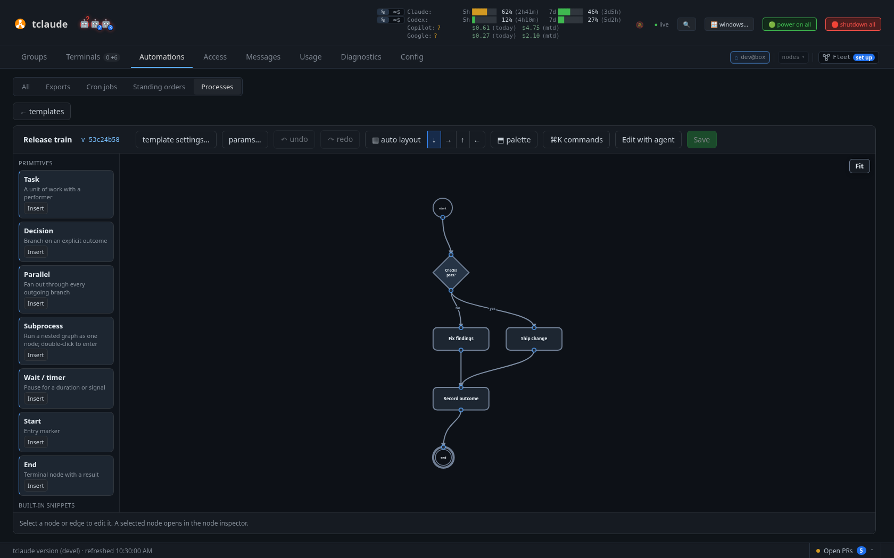

# Processes

Processes are reusable, versioned workflow templates — task chains, decisions,
parallel fan-out, retries, human approvals — authored once and executed as
daemon-owned runs with durable state and an auditable evidence trail. The
feature is experimental and off by default: enable it with the
`features.processes` config flag (**Processes** under
[Config › Experimental](dashboard-config.md#experimental), or in config.json). While the flag is off, every process route in the daemon
returns 404 with the code `processes_disabled` and a message pointing at the
flag.

The runtime is partially implemented: a substantial subset of the engine is
live, and the rest of the CLI surface is stubbed. This page states exactly
which half is which.

!!! note "Not `tclaude agent process`"
    `tclaude agent process` shows and advances a *group's* advisory phase list
    from a task-force template — a checklist for coordination, never enforced.
    That is a different feature; see [Teams at scale](teams-at-scale.md). This
    page is about `tclaude process`: executable templates run by the daemon.

## Start here

1. Turn on **Processes** under [Config › Experimental](dashboard-config.md#experimental).
2. Create a template under **Automations › Processes**, or let **Edit with agent** draft it.
3. Start a run with the **Group process** button on a group's Processes section.
4. Follow it in [Groups](dashboard-groups.md#agents-and-processes).

[In the dashboard](#in-the-dashboard) covers all of this. The next sections are
reference for the format, the engine and the CLI.

## Authoring templates

Templates are YAML documents with `apiVersion: tclaude.dev/v1alpha1` and
`kind: ProcessTemplate`. The primary authoring surface is the dashboard's
Templates library and drag-and-drop editor, which covers parameters,
performers, edges, layout, snippets, version history, authorship, and
source-hash CAS checks. Agents author the same templates from the CLI:

```bash
tclaude agent process-templates ls [--json]
tclaude agent process-templates show <template-id>
tclaude agent process-templates validate --file template.yaml
tclaude agent process-templates save --file template.yaml \
    --expect-source-hash <hash>
```

Saves are compare-and-swap: `--expect-source-hash` must match the current
stored version, so two writers cannot silently clobber each other — a stale
hash is a refused save, and the caller re-reads with `show` and merges. The
bundled `process-templates` agent skill and the CLI's `--help` are the deep
reference for the authoring shape and the safe show-edit-validate-save loop;
this page does not repeat them.

Two permissions govern authoring, and neither executes anything:

- `process.templates.read` — list, show, validate, export. Installed as an ordinary
  agent default by `tclaude setup --install-default-agent-permissions`.
- `process.templates.manage` — save, import. Never a default.

### Sharing workflows

A process can be shared as a `.pwf` file that carries the template and every
template its subprocess steps reference:

```bash
tclaude agent process-templates export <template-id>     # writes <template-id>.pwf
tclaude agent process-templates inspect <file.pwf>       # offline check and summary
tclaude agent process-templates import <file.pwf> --yes  # review, then import
```

Importing stores templates and never starts a run. The review lists every
command the workflow would run, the roles it asks for and the signer. See
[Portable Workflow Format](pwf.md).

In the dashboard, **share** downloads a `.pwf` from a template's row, the full
editor (saved versions only) or a group's process strip. Import one from the
Processes toolbar, the dock, or a group: use *Import a .pwf* in *Get started*,
or drop the file on the group in Groups › Processes. A group's import offers to
pin the process to that group.

### Saved to a group, or to the library

Every process is a stored template, one versioned artifact, however it was
saved. A group keeps an ordered list of the processes saved to it, shown as
one-click chips that ask only for the start inputs. The library lists a
template unless it was saved to a group without being published:

- **Save to group** saves the template unlisted and pins it to the group
  (`POST /v1/process/templates[/{id}]` with `"listed": false` and
  `"pinGroup": "<group>"`).
- **Start now** on a step list that was never saved saves it unlisted and
  not pinned, so one-off runs leave no chip behind. The run still references
  the template by its ref.
- **Publish** lists it in the library:
  `POST /v1/process/templates/{id}/listing {"listed": true}`, or a save with
  `"listed": true`.
- **Pin / unpin** an existing template:
  `POST /v1/process/groups/{group}/processes {"templateId": …}` and
  `DELETE /v1/process/groups/{group}/processes/{templateId}`.

The library read (`GET /v1/process/templates`) hides unlisted templates
unless asked with `?all=1`. The process context lists each group's saved
processes in pin order, with their start params (whether each is required)
and the program profiles a start must authorize.

Pins and the listing live in tclaude's database, never in the template: a
template's hashes are the same whether or not it is pinned or listed, and an
exported template carries no group. Deleting a template removes its pins.

### Review loops

A process graph is acyclic, except where a decision sends work back for
another round. The canonical shape — implement, review, then decide: approve,
or go back with changes at most three times, and escalate once the rounds are
used up:

```yaml
start: implement
nodes:
  implement:
    type: task
    performer: {kind: agent, role: dev, prompt: "Implement {{ params.issue }}."}
    next: review
  review:
    type: task
    performer: {kind: agent, role: reviewer, prompt: "Review the change."}
    next: decide
  decide:
    type: decision
    performer: {kind: human, ask: "Approve, or send it back with changes?"}
    next: {approved: merge, changes: implement, escalate: ask-owner}
    loops:
      changes: {maxIterations: 3, onExhausted: escalate}
  # merge, ask-owner, and the end nodes follow
```

`loops` bounds a decision outcome that goes back, keyed by outcome.
`maxIterations` (2..100) is the most rounds the loop's body runs: the nodes on
the paths from the outcome's target (`implement`) to the decision. Taking the
outcome with rounds left starts the next round — every body node runs again as
a fresh attempt, attempt numbers keep counting up, and the decision opens a
new window. Past the last round the decision follows `onExhausted` instead;
with no `onExhausted`, the outcome is refused and the decider picks another.

The decider can be an agent instead of a person — `performer: {kind: agent,
role: reviewer, prompt: "Review the change and decide."}` — so a review loop
runs without anyone in it. See [Agent deciders](#agent-deciders).

Every cycle needs a bounded outcome; an unbounded one is a `graph_cycle`
error that says how to bound it. To keep a round well defined, a loop body is
entered only at its target, left only through decisions, holds no
`join: any`, and two loops' bodies nest or are disjoint. An inner loop starts
its count over with each round of the loop around it.

Two worked examples live in the repo under `docs/examples/`
(`code-change-with-review.yaml`, `parallel-any-review.yaml`). Both pass template
validation. `parallel-any-review.yaml` also passes the engine's eligibility check,
and needs its `reviewer` and `codex-reviewer` profiles to exist. Run creation
refuses `code-change-with-review.yaml` today, because it uses stage retries,
`plan.approvalRetry`, a human review stage and two routes out of a task, which the
engine does not execute yet (see below). Read that one as an illustration of the
full authoring format.

## Running

Runs are created and driven through the daemon:



*A process template in the dashboard editor: a decision branching to two tasks that join before the outcome is recorded*

```bash
tclaude process run <template-id> --param key=value \
    --authorize-program-profile <profile>
tclaude process runs ls
tclaude process show <run-id>
tclaude process events <run-id>
tclaude process pause <run-id>
tclaude process resume <run-id>
tclaude process decide <run-id> --node <node> --verdict <verdict> [--attempt N]
tclaude process reconcile <run-id>
tclaude process reissue <run-id> [--node <node>]
tclaude process record-outcome <run-id> [--node <node>] \
    --outcome succeeded|failed
tclaude process resolve-blocked <run-id> --node <node> --attempt <n> \
    --action retry|skip|cancel [--note "why"]
tclaude process report succeeded|failed [--run <run-id> --node <node> \
    --attempt <n>] [--verdict <verdict>] [--note "summary"]   # agent performers only
tclaude agent process-templates ls
```

Creating a run pins the exact saved template head and its parameters; later
edits to the template never change a run already in flight. Every program
profile a run may execute must be authorized explicitly at creation with
`--authorize-program-profile` — nothing is authorized implicitly, and that
includes every derived stage of a compound task, not just the parent's
performer.

Permissions: reads (`runs ls`, `show`, `events`) require `process.runs.read`;
every mutating verb requires `process.runs.manage`. Neither is an ordinary
default, but owning a group confers `process.runs.read`, so a coordinating
agent can watch run status and evidence without a human approval per read.
Ownership confers reads only — mutations always need an explicit
`process.runs.manage` grant or a one-shot `--ask-human` approval — and an
explicit per-agent deny overrides everything, the owner grant included. See
[Permissions and audit](permissions-and-audit.md). Starting a run bound to a
group or an agent uses the scope gates below instead.

## Run scope

Every run is bound to a context when it starts, and keeps that binding:

| Scope | Start with | Bound to |
| --- | --- | --- |
| `none` | `tclaude process run <template>` | nothing — the original, unscoped run |
| `group` (⌂) | `... --group <name-or-id>` | the group's id, so renaming the group keeps the binding |
| `agent` (◉) | `... --agent <agent>` | the agent's stable `agent_id`, so the run survives reincarnate and compact; a clone does not copy it |

The run's **owner** is whoever started it (`human:operator` or
`agent:<agent_id>`). `tclaude process show` prints the scope and owner;
`tclaude process runs ls` adds a SCOPE column and filters with `--group`,
`--agent` and `--performer`. `--performer` matches runs bound to that agent
and runs with a node attempt dispatched to it.

**Who may start a scoped run.**

- `none`: `process.runs.manage` for the template, as before.
- `group`: `process.runs.start` covering the group. Group owners hold it for
  their own groups; anyone else needs a grant (unscoped, or scoped to the
  group and/or template). The human may always start one.
- `agent`: the agent itself with `self.process` (default-granted by
  `tclaude setup --install-default-agent-permissions`); for another agent,
  `agent.process`, or `groups.members.process` covering every group the
  target is in (group owners hold that for their members).

The scope gates confer the *binding* only. A run that authorizes program
profiles (`--authorize-program-profile`) also needs `process.runs.manage`,
and group ownership never satisfies that: scope narrows authority, it never
widens it into host program execution.

**Where program steps run.** Scope also narrows where a program step
(`performer.kind: program`) executes. The bounds are resolved when each
attempt is planned (a reissue resolves them again) and recorded on it:

| Scope | Working directory | Confinement |
| --- | --- | --- |
| `none` | the daemon's, unchanged | none, unchanged |
| `agent` | the bound agent's current working directory (its worktree) | the sandbox the agent's current generation was launched with — its recorded sandbox profiles, enforced by tclaude's own layer (bubblewrap on Linux, Seatbelt on macOS) whichever layer confines the agent itself |
| `group` | the group's default working directory | the group's sandbox profiles, enforced by tclaude's own layer, as the group's default spawn profile would launch an agent |

- An agent with no OS sandbox at all (`--sandbox-impl off` or
  `resource-only`, Codex `--sandbox danger-full-access`, or a harness
  sandbox recorded as off) has nothing to narrow to: its program steps run
  **unconfined** in its working directory. Likewise a group with no default
  spawn profile, or whose default profile runs unconfined, keeps the
  unscoped behaviour. Either way the attempt is recorded as `unconfined`,
  with the reason.
- Bounds that cannot be enforced **fail the attempt closed**: the program
  never starts, and never unconfined instead. That covers a host where
  tclaude's sandbox is unavailable (no bubblewrap, no unprivileged user
  namespaces), an agent whose sandbox snapshot is not recorded, and a group
  with a sandboxing default profile but no default working directory. The
  attempt's `program_observed` error names what is missing; with a retry
  policy the branch parks as blocked like any other failure.
- A program step runs under the neutral `shell` launch identity inside the
  sandbox: it gets the profile's grants and its working directory, never a
  coding harness's credentials or state directories. Writes to a linked git
  worktree's shared `.git` directory are not granted, so a program that
  commits needs a profile that grants them.
- Resource limits in the profile are not applied to program steps yet.

Each attempt's `program_prepared` (or `program_reissued`) event carries a
`bounds` object — `scope`, `cwd`, `sandbox` (`tclaude-layer` or
`unconfined`), `profiles`, `reason`, and `error` when it cannot be
enforced. `process show --json` lists each program node's latest bounds
under `programBounds`, and the dashboard shows them on the program step (see
below).

**Orphaned runs.** A scope is never changed silently. If a group-scoped
run's group is deleted, or an agent-scoped run's agent is retired or
deleted, the run pauses with scope state `orphaned` (its `action` reads
`orphaned` and a `run_orphaned` event records why). Program work already in
flight finishes, but nothing new is planned and resume, decisions and
reconciliation are refused until the human re-scopes it:

```bash
tclaude process rescope <run-id> --none            # unbind it
tclaude process rescope <run-id> --group <group>   # re-bind to a group
tclaude process rescope <run-id> --agent <agent>   # re-bind to an agent
```

The one input an orphaned run still accepts is giving it up:
`tclaude process resolve-blocked ... --action cancel` on a blocked node.
Runs of a deleted group stay listable with `runs ls --group <group-id>`.

`rescope` is human-only and records a `run_rescoped` event. On a bound
agent-scoped run, `rescope --group` **promotes** it to a group the agent
belongs to; completed history is kept. Demoting a group-scoped run to agent
scope is not supported.

Unscoped runs need no migration and appear only in `tclaude process runs ls`,
not in the dashboard: Automations › Processes lists templates, and the Groups
and Terminals overlays show scoped runs only.

**Runs in context.** The dashboard overlays poll `GET /v1/process/context`
alongside the snapshot. It returns one mini-graph projection per scoped run
(authored nodes with kind, state, work-step index and performer; edges with
their disposition; the current nodes) in a `runs` map, and refers to them by
id: per group `active`, `needsYou` (awaiting a decision, blocked, needing
reconciliation) and the recently finished `done`; per agent its current step
(`index` of `total`) in each run bound to it; and a top-level `orphaned`
list. It is bounded: each group or agent contributes at most 16 active and 8
finished runs (8 listed per bucket), at most 64 runs in all, and 48 nodes
per run. The human and holders of `process.runs.read` see every
scoped run; another agent sees its own groups' runs and the runs bound to
itself. Visibility is unchanged:
`process.runs.read` (which group owners hold) still gates the run surfaces.

## In the dashboard

With `features.processes` on, the dashboard covers the whole loop: authoring,
starting a run in a group or for one agent, following it, and acting on it.
All of it goes through the same daemon routes and permissions as the CLI.

**Quick start** (Groups › Processes). Before your first process, a group
with no processes shows *Get started* in its body; afterwards (or once you
dismiss it) it folds to *No processes yet · Get started ▸*. From it, pick a starter (filled from the group's roles and
members), reuse a library template, or begin a blank step list. Or describe
the flow in plain words and press *Draft steps*: a process scribe drafts the
steps in the background, with no terminal, for the group's members and roles.
This uses a model run, so it only ever starts from that click, after you
approve the scribe's access: the same grant as any process scribe
(`process.templates.read` and `process.templates.manage`, every other
permission denied; see *Co-design with a scribe* below). The grant is not
limited to this draft: the scribe is asked to work on it, and it can save any
process template. The draft is saved to the group (pinned, not listed in the library),
and the group body shows the scribe's live reply, where you can answer it.
When it finishes, *Review steps* opens the draft in the step list. *Stop
scribe* stops it, keeps the draft and opens what it saved so far, and *open in
graph editor* continues with the scribe beside the canvas. A reload or a tab
change brings the panel back while the scribe is running; *hide* leaves the
scribe working, and *✎ Scribe* in the process's ▶ strip reopens the panel. The
scribe cannot start a run, and nothing runs until you press *Start now*. *Start
now* runs the version on screen: if a newer one was saved after you opened it,
say by asking the scribe for more through the graph editor's dock, nothing
starts, and you choose between reviewing the newer version and starting the one
you reviewed. *Start* in a process's ▶ strip, like the group's start form, runs the current
version, and asks first only while a scribe is at work on it: when its scribe is mid-turn, or when
a running scribe saved a version you have not opened from the group. Reviewing
in the graph editor does not count, so that version can ask once. You then open
the draft or start anyway, and if the version changes before you answer, nothing
runs. An idle scribe with nothing new adds no step, so reruns stay one click. The
step
list edits a process as numbered steps, each done by a specific agent, any
member with a role, anyone free in the group, you, or a command; one line sets
what an agent step does when no member can take it (wait, spawn the group's
default spawn profile or another profile you pick, or fail: the template's
`fallback`), and an agent step can override that with its own choice under
its Who picker, or follow the process; a step that does not simply wait shows
its fallback (`↯ spawn opus-lead`, `↯ fail`) on its node; your answers to a *you* step branch to
later steps, and `{{name}}` in a prompt becomes a start input. A preview, the
start inputs and who each step would use now (the daemon's resolve-preview,
a dry run of the group rules) update as you edit. A command
step runs on this host only after you tick *Allow step N to run* for its
program profile. *Start now*
runs the steps once in the group (saved as an unlisted template, so a one-off
run leaves nothing behind in the library or the group); *Save to <group>*
keeps them as one of the group's processes; *Save to library* lists them for
every group; *open in graph editor* saves them and opens them below. A
group's saved processes show as chips at the top of its body: ▶ asks only for
the start inputs and command consent and starts it, *✎ Edit steps* reopens it
as a step list (saving writes a new version), and the strip also publishes it
to the library or removes it from the group. *✎* on a chip opens the process in
place as a small graph, the same draft as the step list (*☰ Steps* / *◈
Graph*): hover a step for *+ after*, *⑂ branch* (a decision's new outcome) and
*⫴ alongside* (a parallel fan-out that joins at the next step), click it for a
compact inspector with the step list's fields, right-click it for structure
(insert before or after, branch, run alongside, duplicate, change kind,
delete), or drag *+* into empty space to add a step. *⤢ full editor* opens the
same draft (saved first) in Automations › Processes, which also edits
parallel, wait and subprocess nodes; *Save new version* writes it against the
version it was opened at. A process the step list cannot
show (parallel, wait or subprocess nodes) opens in the graph editor instead.

**Authoring** (Automations › Processes, then open a template). The graph
editor has the node inspector, live validation, undo/redo, snippets and
versioned saves; see [Dashboard › Processes](dashboard-automations.md#processes). Three
things there are specific to processes:

- **Co-design with a scribe.** *Edit with agent* docks the template's scribe
  beside the canvas: chat with it there (while it works, what it has written
  so far and a one-line note per tool call stream in, read from its own
  transcript, on every harness but OpenCode; its final reply replaces them
  when the turn ends) or switch the dock to its terminal. The dock's context
  actions send it the selection, a node to explain, the focused validation
  issue, or a description to draft from. When the scribe saves a version, *Review on
  canvas* paints it over your draft (added, changed, removed) and you accept
  or reject each change; your own unsaved edits are never overwritten, and
  conflicting edits are flagged rather than merged silently. The scribe can
  save an unfinished template too: graph and semantic validation errors are
  advisory on save (the draft just cannot run yet), so each step it makes
  reaches your canvas as it goes.
- **Subprocesses.** A ▣ node runs a nested graph (see
  [Subprocess nodes](#what-executes-today)). Double-click it to edit its body
  in place: a breadcrumb and a minimap of the parent show where you are, the
  dashed port nodes are its contract (⇄ ports binds body params and maps body
  ends onto the ▣ node's outcomes), and Esc or Alt+↑ goes back up. The
  palette's outline lists every nested body. *⇪ extract as template* saves a
  body as its own template and turns the node into a reference to it. A
  reference is not edited in place, since other templates may share it. While
  you author, the editor resolves each reference the way a run would, and any
  problem (a missing template, in-ports it does not declare or leaves unbound,
  trouble further down) marks the ▣ node. Its inspector lists them as
  "inside template X: …" with an *open X to fix* button.
- **Composing on the canvas.** The palette also lists your other templates:
  drop one (or any node kind) on the canvas, or onto a connector to splice it
  in between. *⊞ expand* draws a ▣ node's body on the parent canvas as a
  framed group whose nodes you edit in context; *⊟ collapse* folds it back.
  Select a region and choose *▣ wrap as subprocess…* to fold it into one ▣
  node — the ports come from the connectors crossing its boundary — and
  *⇲ unwrap* inlines a body again.

**Starting a run.** In Groups, in the **Both** or **Processes** focus, use
the **Group process** button on a group's Processes section, or **Agent process**
for a run bound to one agent: pick a template, fill its params, and tick the
program profiles you authorize it to run under (never pre-ticked). A group process
is group-scoped (⌂) and an agent process is agent-scoped (◉). The CLI equivalent
for an agent is `--agent`.

**Following it.**

- **Groups › Agents** — each group header counts running, waiting-on-you and
  planned runs, and the optional Process column (turn it on under **▾ view**)
  shows a *run › node* badge on each member row for every run the agent works
  in (amber when parked on a human gate, dashed when queued).
- **Groups › Processes** — each group's runs as live graph cards with the
  agents on the nodes they perform, needs-you first. *open ›* focuses one run:
  the live graph, a docked inspector (approve or request changes on a human
  gate, the node's history), the group's agents as a performer dock, and the
  run's ⏸ pause / ▶ resume.
- **Terminals** — a pane whose agent takes part in a run shows a small
  top-right cluster of run icons (ring = run state, badge = this agent's step
  i/n), repeated on the tab. An icon opens a popover with the mini-graph and
  the agent's node lit, its contract, what feeds it and what waits on it, and
  the run actions. A run bound to that agent opens instead as a vertical
  stepper with a bounds strip (working dir, sandbox, grants, spend, identity).
  Each program step says where its attempt runs or ran (directory and
  sandbox), and a step recorded as unconfined, or whose bounds cannot be
  enforced, is flagged. The run focus inspector shows the same on a program
  node as *runs*.

**Acting on it.** Decide human gates from the run focus or the popover;
reassign an agent node by dragging a member from the performer dock onto it
(or *reassign node* in the Terminals popover); pause and resume from the run
focus, the popover, or the stepper. Each maps to the CLI verb of the same
name and needs the same permission.

## What executes today

- **Sequential task chains** starting at any executable node kind — top-level
  `start` names the entry node, and a separate `start`-typed node is optional.
- **Exclusive decisions** with human or agent deciders: the verdict selects
  exactly one authored outcome edge and closes the alternatives. Authored
  decisions open once — unless they are in a loop body — and need no
  `--attempt`. An agent decider reports its verdict instead of a person
  deciding (see [Agent deciders](#agent-deciders)).
- **Parallel fan-out** (`type: parallel`) reduced by `join: all` or
  `join: any`. Branches execute concurrently, bounded to four external
  programs at a time; ready branches past the bound wait for a slot. A branch
  parked on a human decision does not block its siblings.
- **`join: any` races its branches.** The first arrival wins and alone
  activates the reducer and everything downstream. Losing branches are not
  cancelled — they run to their own settled outcome and are recorded as
  evidence that cannot replace the winner or run the downstream route twice,
  and the run reports no terminal status until every dispatched branch has
  settled. A losing branch that *fails* still fails the run, exactly as under
  `join: all`.
- **Program performers** (`performer.kind: program`): executed as argv without
  a shell, with a bounded environment and bounded output, inside the run
  scope's bounds (see [Where program steps run](#run-scope)).
- **Bounded program retries.** `retry.maxAttempts: <n>` includes the first
  attempt and is capped at 100; attempts run back to back, and nothing can
  interrupt a task still spending its budget. A failed attempt inside the
  budget re-readies only that node; parallel siblings are untouched. A task
  with no `retry` policy stays fail-fast. Every attempt carries its own
  attempt number and command id, so a delayed report from an earlier attempt
  is refused as stale rather than credited to the current one. Attempt numbers
  are visible in `show --json` and in the `program_prepared` /
  `program_observed` rows of `events`.
- **Blocked-branch parking.** When a retry-authored task exhausts its budget,
  the branch is parked, not failed: the node becomes `blocked`, the run stays
  running, and siblings keep executing. (`retry.maxAttempts: 1` and no policy
  at all therefore behave differently on purpose.) `show` lists each parked
  branch with the exact blocked attempt and the failure reason; an operator
  resolves it with `resolve-blocked`. `retry` opens one more authored-size
  attempt window (attempt numbers keep counting up); `skip` settles the task
  through its authored route as a success would, distinguished only by the
  `blocked_resolved` evidence; `cancel` gives up on the whole run — parked
  branches and awaited decisions are dropped, already-dispatched programs
  drain honestly, and the run finishes `canceled`. The node and attempt must
  match exactly, so a stale or wrong-branch resolution is refused. A parked
  branch keeps the run open: an end node will not complete around a resolution
  still on offer.
- **Compound tasks.** A task declaring `plan`, `checks`, or `review` runs its
  stages in order — `<id>.plan`, `<id>.do`, `<id>.test.<step>`, `<id>.review`,
  and the engine-owned `<id>.done`. Each stage is an ordinary node under its
  derived id: dispatched, observed, reconciled, and shown like a plain program
  task. Stages are derived from the pinned template on every load, never
  stored, so nothing can drift. The parent stays `running` while any stage is
  live and settles its single authored route exactly once, when `done`
  completes; a failed stage fails the run like any fail-fast task. With a
  `retry` on the task, a failed check or review sends the work back instead:
  the do stage runs again under the task's budget, followed by every stage up
  to the one that failed. Stage performers are programs or agents — an agent
  stage is dispatched like an agent task, and its `failed` report is a failed
  stage. A do stage an agent performs is told which stage sent its work back
  and what that stage reported. Stage-level `retry` / `approvalRetry` are not
  executable yet.
- **Human plan approval.** A compound whose `plan` declares `approval: human`
  gains one extra stage between plan and do, `<id>.plan.approval`: an awaited
  decision with the fixed verdicts `approve` and `rework`, decided through the
  ordinary `decide` command and permission. `approve` readies the do stage;
  `rework` returns the plan stage to ready, and the window reopens when the
  re-run plan succeeds. There is no approval budget — each rework is one
  explicit, audited human action buying exactly one more plan execution.
  Because the window can reopen, a verdict must name it:

  ```bash
  tclaude process decide <run-id> --node <id>.plan.approval \
      --attempt N --verdict approve|rework
  ```

  `show` reports the exact `--attempt` in its next-step hint, and the run
  refuses any other value — including a verdict formed against an earlier
  window and submitted late.

- **Subprocess nodes** (`type: subprocess`) run a nested graph as one node
  of their parent. The body is either inline (`subprocess.start`,
  `subprocess.nodes`, `subprocess.params`) or another stored template
  (`subprocess.templateRef`, optionally pinned with `version: sha256:<hex>`).
  The body is its own param scope: `subprocess.inputs` binds each body param
  from a literal or `{{ params.x }}` of the parent, and an unbound param falls
  back to its default. `subprocess.outputs` maps each body end node to one of
  the subprocess node's `next` outcomes; with a single outcome, unmapped ends
  use it. Body nodes run under namespaced ids (`<id>/<inner id>`), so a body
  decision is decided with `decide --node review/gate`. The subprocess node
  stays `running` while its body is live and settles its own route exactly
  once, when a body end node is reached; on an untaken branch the whole body
  is skipped with it. Referenced templates are resolved when the run is
  created and embedded in the run's snapshot, so later edits to them never
  change a run in flight; reference cycles and nesting deeper than four levels
  are refused. Inner program profiles need authorizing at run creation like
  any other.
- **Agent performers** (`performer.kind: agent` on a plain task) — see
  [Agent performers](#agent-performers) below.
- **Bounded review loops** (see [Review loops](#review-loops)). The decider's
  evidence note is handed to the agent step the work goes back to, together
  with the round (`Round: 2 of at most 3`), and that step goes back to the
  same performer when it can. `show --json` lists each loop with its round
  under `loops` and puts `round`/`rounds` on commands; the process context
  carries `round`/`rounds` on loop nodes and `maxIterations` on the edge that
  goes back. Each round is recorded as `loop_iterated` evidence, and a used-up
  loop as `loop_exhausted`. A decision in a loop body reopens every round, so
  `show` reports its `attempt` window from round two on; `decide` without
  `--attempt` takes the current window.

One sizing rule applies only to running: a run records durable evidence per
node, and that row bounds node ids at 256 bytes. Run creation refuses a
template whose node ids — authored, derived from compound stages, or
namespaced into a subprocess body — exceed it; editing and storing such a template still works.

## What does not execute yet

These CLI verbs are stubs that return a "process runtime is temporarily
unavailable: no engine is installed" error: `preview`, `apply`, `worklist`,
`advance`, `unblock`, `observe`, `resolve`, `verify`, `repair`.

These authoring features are valid in a stored template but refused at run
creation with a path-specific diagnostic, rather than failing later: human
task performers; agent performer `timeout`; retry backoff waits; same-session retry feedback
for program tasks (`retry.onFail: feedback-same-session` is executable only
for agent tasks); retries on compound stages; `plan.approvalRetry`; human
stage performers; poison handling; wait nodes; captures.

## Agent performers

A plain task with `performer.kind: agent` is performed by an agent. When the
node becomes ready the daemon resolves a performer from the run's scope and
delivers the node's prompt **as a message in that agent's inbox** — never by
typing into its pane. The message carries the run id, node id, and attempt,
and the exact command to report back with:

```bash
tclaude process report succeeded --run <run-id> --node <node> --attempt <n> \
    --note "PR #12 is open"
tclaude process report failed --run <run-id> --node <node> --attempt <n> \
    --note "why it failed"
```

`--run`, `--node`, and `--attempt` may be omitted when the agent has exactly
one open node. The report is authenticated by the calling agent's identity and
must match the exact attempt that was delivered to it: another agent is
refused, a report for an older attempt is refused as stale, and a repeated
identical report is acknowledged without being applied twice. A report goes
through the same transition a program result does, so retry budgets, parking,
and fail-fast behave identically.

**Who performs the node.** An agent step names at most one selector:

- `assignee`: a specific agent, by name or agent id;
- `role`: any member of the run's group with that role;
- `anyone: true`: anyone in the run's group.

With none of them, the step's `profile` is the role (the original shape): a
member whose role matches the profile, or the role that spawn profile
declares.

What happens when nobody can take the step is its **fallback**, separate from
the role: `fallback: {action: spawn, profile: P}` spawns a fresh performer
into the group (with no `profile`, the group's default spawn profile), `wait`
waits as **needs performer**, and `fail` fails the attempt, so the step's
retry and fail routing apply. Set it on a step, or once for the whole process
with a top-level `fallback`; the step's own wins. A step with neither uses
the legacy `spawn: allowed` (spawn with its `profile`), and otherwise waits.

| Scope | Resolution |
| --- | --- |
| group | the explicit `assignee`, if it names a current member; else a member the selector admits (its `role`, anyone, or the `profile` role), idle first, then busy, then offline, and among equals the one holding the fewest open process steps; else the fallback — a spawn only when the run owner could spawn into the group |
| agent | the bound agent performs every agent node; an `assignee` naming anyone else waits as needs performer |
| none | only an explicit `assignee` (any active agent); otherwise the node waits as needs performer, or fails when its fallback is `fail` |

`POST /v1/process/resolve-preview` with a template and a `group` answers, for
each agent step, who would take it if the run started now — a member, a spawn
of which profile, a wait, or a failure — without starting anything. The
process context lists each group's `defaultSpawnProfile` and member `roles`.

A **needs performer** node is retried on every runtime sweep (once a minute),
so it is picked up as soon as a matching member joins. `show` prints the
reason it waits.

**Retries.** `retry.onFail: fresh-attempt` (the default) hands the next
attempt to a different performer when one is available — spawning one if the
step's fallback says so — and only falls back to the previous performer as a last
resort. `retry.onFail: feedback-same-session` hands it back to the same
performer, together with the note its failed report carried.

**Performers going away.** An offline performer keeps the node: its inbox holds
the prompt and the node simply waits. A performer that is retired or leaves
the group is replaced by re-resolving the same attempt. A run bound to an
agent is never re-resolved to someone else.

**People always win.** `record-outcome --node <node>` settles an agent's node
in its place; the performer is told the attempt no longer needs it, and its
later report is refused as stale. When a run is ending — a sibling failed, or
an operator cancelled — outstanding agent attempts are withdrawn and their
performers told to stop.

**Reassigning.** `tclaude process assign <run-id> --node <node> --agent <agent>`
(HTTP `POST /v1/process/runs/{id}/nodes/{node}/assign` with `{"agent": ...}`)
hands a node's outstanding, not yet reported attempt to a named performer. It
needs the same permission as `decide`. The new performer must fit the run's
scope: a member of a group run, the bound agent of an agent run, or for an
unscoped run an agent the owner (and an agent caller) shares a group with. It
gets the prompt and is the only agent that may report; a previous performer is
told to stop. A node that is not ready yet, already reported, or not agentic
has nothing to reassign (409).

In the dashboard the same operation is a drag: in Groups › Processes, drag
an agent from a run's performer dock onto its agent node (or use the node
inspector's reassign picker); in Terminals, the run popover's
"reassign node" opens a picker of the group's members.

**Pausing.** `tclaude process pause <run-id>` (HTTP
`POST /v1/process/runs/{id}/pause`) holds a run: it dispatches no new agent
turns or program commands, while attempts already in flight finish and their
outcomes and reports are recorded. Decisions are still accepted; what they
make ready waits too. A paused run's `paused` field says who paused it and
when, its `action` reads `paused` unless something still needs a human, an
undelivered agent attempt stays undelivered, and reassigning (which would
start a new turn) is refused until it is resumed.
`tclaude process resume <run-id>` (`POST /v1/process/runs/{id}/resume`)
releases the pause and plans what waited. Both need the same permission as
`decide`, are idempotent, and record `run_paused` / `run_resumed` evidence; a
finished run cannot be paused. The dashboard's Pause / Resume control sits in
the Terminals run popover and stepper and in the Groups single-run focus.

`show --json` lists every attempt's performer under `performers` (agent,
display name, live status, how it was chosen, and what it reported); outstanding
agent commands report their dispatch state (`pending`, `needs_performer`,
`delivered`, `reported`) instead of `needs_reconcile`. A daemon restart picks
in-flight dispatches back up without re-sending them. An outstanding agent
command occupies one of the run's four concurrency slots, like a program.

### Agent deciders

A decision with `performer.kind: agent` is decided by an agent. It is
dispatched exactly like an agent task — same selectors, fallbacks, and inbox
message — and nobody is asked for a verdict. The message lists the verdicts
the agent chooses between, and the agent reports one:

```bash
tclaude process report succeeded --run <run-id> --node <node> --attempt <n> \
    --verdict changes --note "add tests for the empty-input case"
```

The verdict routes exactly as a person's would, loops included, and the note
is the decision's evidence: when the verdict sends work back for another
round, that round's performers are told it. A verdict that is not one of the
decision's outcomes, or that would go back past a loop's last round with no
`onExhausted`, is refused and nothing is recorded, so the agent can report
again. An agent that cannot decide reports `failed`, which fails the decision
like any failed agent step. Nobody can decide in an agent's place with
`tclaude process decide`; reassigning or recording an outcome works as for any
agent step.

## Crashes and reconciliation

A command is durable before its program starts, so after a daemon restart
tclaude cannot know whether an outstanding command's program actually ran. It
never guesses and never silently re-runs one. `show` reports each outstanding
command as `needs_reconcile`, and an operator resolves it explicitly:
`record-outcome` ("I checked out of band; here is what happened") or `reissue`
("run it again"). When a run holds more than one such command, both verbs
require `--node`.

A restart preserves each node's exact attempt number. `reissue` re-runs the
same durable attempt rather than spending another from the retry budget;
`record-outcome --outcome failed` spends it, and the next attempt starts if
the budget allows. A failed branch fails the run, but the run is only reported
`failed` (or `canceled`, after a cancel resolution) once every in-flight
command has been accounted for.

Parked branches survive restarts unchanged — the checkpoint carries the
obligation and the blocked attempt. If another branch fails or the run is
cancelled while a branch is parked, the parked obligations are dropped: the
run is over, so it stops offering a resolution nothing could act on.

## Storage

Run state lives in SQLite under `~/.tclaude/data/`; the checkpoint there is
authoritative, and `tclaude process events` renders the ordered human-facing
evidence per run. On startup the daemon removes obsolete filesystem run data
and legacy lock files while preserving the complete authoring root — template
versions, heads, layouts, snippets, authorship records, and template locks.
